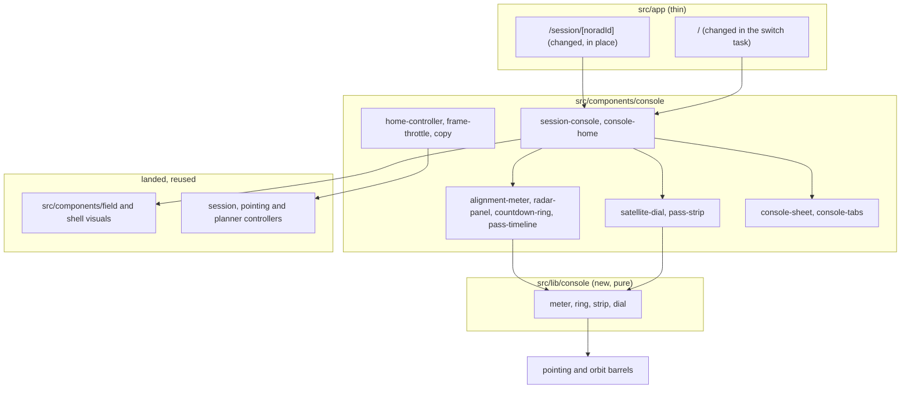

# Design Document

## Overview

S8 (console-ui) redraws the home screen and the session screen of the landed S1 to S7 app as a mobile console: a live radar, an alignment meter, one large AR button, a countdown ring, a satellite dial, and a pass strip. The S7 text-heavy panels move behind sheets and tabs. It changes presentation and thin controller code only.

Design stance:

- One new framework-free lib directory, `src/lib/console` (the Console_Lib), holds the three small pure functions: the Meter_Level mapping, the ring fraction and the pass-strip placement, plus two dial helpers. It imports only the barrels of `pointing` and `orbit`.
- One new component directory, `src/components/console`, holds the presentational components, one thin controller for the home screen, a frame throttle and the new `CONSOLE_COPY`. Pages stay thin.
- Landed logic is reused as it is: `LockResult.pointingErrorDeg` for the meter, `domePoint`/`domeRadius` for the radar, `buildSkyTrack` for the path, `createPlannerController` for the home passes, `createPassFieldController` for the session path. No S3 or S4 extension is needed (section "Pointing_Error source").
- No new package, no WebGL, `satellite.js` stays 6.0.2, lock tolerance stays 10°, all times are UTC through `formatUtc`.
- Tests are limited to the cases named in requirements.md "Verification scope". Everything else is checked on the owner's phone (Requirement 16).

Inputs from the landed code that shape this design:

- `SessionSnapshot` already carries `lock: LockResult | null` with `pointingErrorDeg`, `locked`, `deviceHeadingDeg`, `devicePitchDeg`, plus `target`, `countdownMs`, `targetPass`, `pointingSource` and `demoBasis`. `PointingSnapshot.lock` carries the same `LockResult` and is updated on every sensor event, while `SessionSnapshot.lock` is updated on the session tick and on drag-pose changes.
- `src/app/page.tsx` is a server page (checks 1.20 and 1.21 forbid `'use client'`, `fetch`, `async` there). The Console_Home is therefore a client component imported by it.
- `globals.css` already has a `prefers-reduced-motion: reduce` block that sets `animation: none` and `transition: none` on every element. CSS motion added by S8 is covered by it. The SMIL `animateMotion` of the landed `GhostSky` is not covered by that rule (risk R3).
- `createPlannerController` always searches 168 h at 0° and badges illumination in chunks of 6 passes, with a `setTimeout(0)` before the search.

### Decision index

| ID | Decision | Section |
|---|---|---|
| C1 | Console_Lib path `src/lib/console`; import allow-list: the `pointing` and `orbit` barrels | Architecture |
| C2 | Meter_Level: level 1 up to the lock tolerance, then linear to 0 at 90°; bands locked, closing (to 30°), far, unavailable | Alignment meter |
| C3 | Pointing_Error comes from `LockResult.pointingErrorDeg`; sensor mode reads the pointing snapshot, demo mode reads the session snapshot; no landed extension | Pointing_Error source |
| C4 | Radar_Panel is one SVG component on the landed `DomeFrame`; redraw gated to one frame per animation frame, at most 30 per second | Radar panel |
| C5 | Radar_Sweep is a CSS rotation of one SVG group; paused when the AR_View is open; removed by the landed reduced-motion rule | Radar panel |
| C6 | Countdown_Ring lead window 30 min; near-AOS threshold 5 min, shown as a text label and a solid-to-dashed change | Countdown ring |
| C7 | Satellite_Dial is a rotary SVG dial of seven nodes with drag, tap and previous/next buttons | Satellite dial |
| C8 | Selection key `zombieSatellite.console.selectedSlug` through the injected `KeyValueStorage` | Home controller |
| C9 | Pass_Strip is a view of the landed planner rows filtered to the next 48 h; no landed change | Pass strip |
| C10 | Console_Sheet is the native `<dialog>` opened with `showModal()`; Console_Tab bar is a small ARIA tab list | Sheets and tabs |
| C11 | `FieldSessionPanel` gets one optional `sections` prop (default: all, as landed) so its parts can be re-hosted | Re-hosting S7 |
| C12 | The Session_Console replaces `/session/[noradId]` in place; the Console_Home replaces `/` in the last Should-tier task | Delivery order |
| C13 | New strings only in `CONSOLE_COPY` at `src/components/console/copy.ts` | Console copy |

## Architecture

### Layers



### C1: Console_Lib path and import allow-list

Path `src/lib/console`, entry file `index.ts` only. A new directory is justified because the meter mapping must be tested in Node against a pinned set, and the landed lib directories each have their own boundary scan with a closed allow-list (S3's pointing scan, the S6 shell scan), so adding functions there would widen those scans.

Allowed imports of a Console_Source_Module: relative paths inside `src/lib/console`, and `../pointing/index` (for `LOCK_TOLERANCE_DEG`) and `../orbit/index` (for the `Pass` type only). Forbidden: the DOM globals `window`, `document`, `navigator`, `localStorage`, `requestAnimationFrame`, any storage, network, file or clock access, including `Date.now`. The scan is a copy of `tests/helpers/field-source-scan.ts` pointed at `src/lib/console` with that allow-list, in `tests/helpers/console-source-scan.ts`.

Files:

| File | Content |
|---|---|
| `src/lib/console/meter.ts` | `METER_CLOSING_DEG`, `METER_FAR_DEG`, `meterLevel`, types `MeterBand`, `MeterLevel` |
| `src/lib/console/ring.ts` | `RING_LEAD_MS`, `RING_NEAR_MS`, `countdownRingFraction`, `remainingRingFraction`, `ringIsNear` |
| `src/lib/console/strip.ts` | `STRIP_WINDOW_MS`, `passStripMarks` |
| `src/lib/console/dial.ts` | `dialRotationDeg`, `dialIndexFromRotation` |
| `src/lib/console/index.ts` | The barrel; the only entry file |

### Component files

```
src/components/console/
  copy.ts                  CONSOLE_COPY
  frame-throttle.ts        one notification per animation frame (injected FrameScheduler)
  home-controller.ts       selection, storage, planner lifecycle, 1 Hz live position
  alignment-meter.tsx      arc gauge, degrees number, band label
  radar-panel.tsx          dome, path, satellite, reticle, Lock_Ring, sweep
  countdown-ring.tsx       ring with the formatted time inside
  pass-timeline.tsx        AOS, peak, LOS marks with UTC text
  console-sheet.tsx        native dialog wrapper
  console-tabs.tsx         ARIA tab bar
  session-console.tsx      layout of the awaiting-pass, in-pass and completed phases
  satellite-dial.tsx       rotary dial
  pass-strip.tsx           48 h strip and the pass sheet content
  console-home.tsx         home layout
  story-panel.tsx          the landed EntryArticle content, moved
```

All `.tsx` files hold props-in, markup-out components with local UI state only (open sheet, pointer drag). Timers, animation frames, sensors, storage and the camera stay in the landed controllers and in `home-controller.ts` and `frame-throttle.ts`, which take injected dependencies (`Clock`, `TimerApi`, `KeyValueStorage` from `src/components/pointing/deps.ts`, `FrameScheduler` from `src/components/field/deps.ts`). The browser implementations are the landed `createBrowserDeps`, `createFieldBrowserDeps` and `createSessionBrowserDeps`.

### Delivery order in files

| Tier | Content | Files |
|---|---|---|
| Must | Lib, meter, radar, session console main area, copy, scaffold | `src/lib/console/*`, `alignment-meter`, `radar-panel`, `frame-throttle`, `session-console`, `copy`, session page, CSS, tests |
| Should | Ring and timeline, sheets and tabs, S7 panels moved, dial, home radar, home switch, touch and motion | `countdown-ring`, `pass-timeline`, `console-sheet`, `console-tabs`, `session-panel` prop, `satellite-dial`, `home-controller`, `console-home`, `story-panel`, home page |
| Could | Pass strip with its sheet, home Compact_Controls | `pass-strip`, `console-home` additions |

Every step leaves a building app. Until the switch task, `/` is the landed page. The Session_Console replaces the session screen in place from its first task; the S7 panels stay on it as landed (below the new main area) until the sheets task moves them.

## Components and Interfaces

### Alignment meter (Requirement 2)

```ts
export type MeterBand = 'locked' | 'closing' | 'far' | 'unavailable';
export interface MeterLevel { readonly level: number; readonly band: MeterBand }

export const METER_CLOSING_DEG = 30;  // upper edge of the closing band
export const METER_FAR_DEG = 90;      // the level reaches 0 here

/** pointingErrorDeg: null when there is none. toleranceDeg is LOCK_TOLERANCE_DEG. */
export function meterLevel(pointingErrorDeg: number | null, toleranceDeg: number): MeterLevel;
```

Rules:

- `null`, `NaN` or a negative value: `{ level: 0, band: 'unavailable' }`.
- `e <= toleranceDeg`: `{ level: 1, band: 'locked' }`.
- Otherwise `level = max(0, 1 - (e - tolerance) / (METER_FAR_DEG - tolerance))`; band `closing` when `e <= METER_CLOSING_DEG`, else `far`.

`level` never increases with `e`. The band edge is above the tolerance, so the meter has no lock threshold of its own. The component does not call `meterLevel` for the locked state alone: the displayed badge uses `LockResult.locked` (which includes the landed `1e-9` comparison epsilon), and the component shows the locked band when `lock.locked` is true even if `meterLevel` returned `closing` by a floating-point hair. The mapping is called with `LOCK_TOLERANCE_DEG` from the `pointing` barrel.

Pinned example set for the test (Requirement 2, criterion 5), tolerance 10:

| Input | Level | Band |
|---|---|---|
| 0 | 1 | locked |
| 10 (exactly the tolerance) | 1 | locked |
| 50 (the value above it) | 0.5 | far |
| 180 | 0 | far |
| absent (`null`) | 0 | unavailable |

The band for 50 is `far` (50 > 30). The level for 50 is `1 - 40/80 = 0.5`. The closing band therefore spans levels from 1 down to `1 - 20/80 = 0.75`. The implementation task writes these literals into the test.

Component `AlignmentMeter` props: `{ errorDeg: number | null; locked: boolean; behind: boolean }`. It draws a 240° arc gauge: a faint track, a filled arc of length `level`, the lock zone marked as a tick at full, the error in degrees in monospace at the centre (`12.4°`), and a band label below ("Locked", "Closing in", "Off target", "No pointing"). The band is also carried by the label text and by the arc style (solid, dashed, dotted), so colour is never the only cue (Requirement 2, criterion 8). `behind` adds the landed behind wording ("Behind you"). The arc fill uses a CSS `stroke-dashoffset` transition of 120 ms; with reduced motion the global rule removes it and the arc still updates (Requirement 11, criterion 4).

Labels say "Pointing" and "aim", never signal strength (Requirement 12). Example strings: `meterTitle: 'Aim'`, `meterCaption: 'How closely the phone points at the satellite'`.

### Pointing_Error source (Requirement 13, criterion 2; Decision OQ-B)

`LockResult.pointingErrorDeg` is already exposed by both snapshots, so no field is added. The session console selects the lock as follows, in one small function inside `session-console.tsx`:

- `snapshot.clockMode === 'real'` and `pointingSource === 'sensor'`: use `pointingSnapshot.lock`, because it updates on each sensor event and gives a live meter.
- Otherwise (demo, auto-point or manual): use `snapshot.lock`, which the controller already republishes on each drag pose change and each tick.

Both lock objects come from the landed `evaluateLock` (C52 with the 10° tolerance), so the meter, the badge, the Lock_Ring and the QSL statistics agree. In `awaiting-pass`, or when `orbitDataMissing` is true, the error is `null` and the meter shows the unavailable band.

Demo (Decision OQ-H): in a Demo_Session the meter follows the drag view and the auto-point source of the landed controller. No scripted approach path is added.

### Radar panel (Requirement 5)

```ts
interface RadarPanelProps {
  readonly satellite: { azimuthDeg: number; elevationDeg: number } | null;
  readonly path: SkyTrack | null;        // landed Field_Core type, from the pass field controller
  readonly passMarks: { aos: Direction; peak: Direction; los: Direction } | null;
  readonly reticle: { headingDeg: number; pitchDeg: number } | null;
  readonly locked: boolean;
  readonly sunlitOnly: boolean;
  readonly profile: IlluminationProfile | null;
  readonly sweep: boolean;
  readonly emptyText: string | null;
}
```

It reuses `DomeFrame`, `DOME_RADIUS` and `DOME_VIEWBOX` from `sky-dome.tsx` (exported in S7), `domePoint`, `domeRadius` and `LOCK_TOLERANCE_DEG`, so the dome geometry and the Lock_Ring radius (`domeRadius(10°)`) are the landed ones; the reticle-to-satellite distance on the dome then reads as the Pointing_Error near the zenith, as on the landed `PassDome`. The path segments and shadow segments are drawn the way `SkyTrackView` draws them (the Sky_Track samples and the illumination intervals), so the radar is a larger, interactive variant of the S7 track. To avoid copying that logic, the path-drawing part of `sky-track.tsx` is exported as `SkyTrackLayer` (a layer inside an existing `<svg>`; see "Landed files changed").

- `satellite === null` or no data: `emptyText` (one line, `CONSOLE_COPY.radarEmpty`) over the frame; nothing invented is drawn.
- `sweep`: one `<g className="radar-sweep">` holding a line and a faint wedge, rotated by a CSS `@keyframes` of 8 s per turn. It is presentational only.
- In the session console in demo-manual mode, the radar element takes the pointer handlers of the landed drag area (`pointerDown`, `pointerMove`, `pointerUp` of the session controller) with `touch-action: none`, so the radar itself is the drag surface. The landed separate drag box moves into the controls sheet for the sensor modes.

Redraw rate (Requirement 5, criterion 5): `frame-throttle.ts` wraps a `subscribe` function so that bursts of notifications (sensor events can arrive above 60 Hz) cause one React update per animation frame, capped at 30 updates per second (skip a frame when the last update was under 33 ms ago). It uses the injected `FrameScheduler` and `Clock`. The radar and the meter subscribe to the pointing session through this wrapper; the session controller's own 1 Hz-class snapshot is used unthrottled.

Loop stop (Requirement 11, criterion 3): the sweep is CSS only, so it stops when the element unmounts. While the AR_View is open the console root gets `data-ar-open`, and CSS sets `animation-play-state: paused` on `.radar-sweep` under that attribute. The throttle cancels its pending frame in its unsubscribe.

### Countdown ring and timeline (Requirement 6)

```ts
export const RING_LEAD_MS = 30 * 60_000;  // the ring starts filling 30 minutes before AOS
export const RING_NEAR_MS = 5 * 60_000;   // "AOS near"

export function countdownRingFraction(countdownMs: number | null): number;            // 0 when null or >= lead; 1 at 0
export function remainingRingFraction(nowMs: number, riseMs: number, setMs: number): number; // share of the pass left, [0, 1]
export function ringIsNear(countdownMs: number | null): boolean;                       // 0 <= countdown <= RING_NEAR_MS
```

All three are pure; the instant is passed in, nothing reads the clock. `CountdownRing` draws a circle with a `stroke-dasharray` fill, the `formatCountdown` text inside, and a caption ("to AOS"). Near AOS the ring changes from a solid to a dashed stroke and the caption changes to "AOS soon", so the change is not colour alone (Requirement 6, criterion 3). In `in-pass` the same component shows `remainingRingFraction` with the caption "to LOS".

`PassTimeline` is a thin horizontal rule with three marks (AOS, peak, LOS) placed by `passProfilePath`'s share logic (the peak share is `(peakMs - riseMs) / (setMs - riseMs)`), each with the UTC time from `formatUtc` below it, sliced to the time part the way the landed minute table does (`formatUtc(ms).slice(11, 19)`). The current instant is a moving tick.

### Satellite dial (Requirement 7)

```ts
export function dialRotationDeg(index: number, count: number): number;          // -index * 360 / count
export function dialIndexFromRotation(rotationDeg: number, count: number): number; // nearest node, wrapped into [0, count)
```

`SatelliteDial` draws seven nodes on a circle (one per catalog entry in landed order, from `listCatalogEntries()`), inside a bottom-anchored wide arc so the selected node sits at the top centre and is drawn larger, with its name and status label above the dial. Playable nodes are drawn as filled circles with a phosphor stroke and the text "Playable"; story-only nodes are drawn as brass rings with the text "Story only" (the landed `SHELL_COPY.playableLabel` and `storyOnlyLabel`), so the difference is shape, colour and text.

Interaction, all on pointer events with `touch-action: none` on the dial:

- Drag: the pointer angle around the dial centre (`Math.atan2`) is tracked; the rotation follows the angle delta. On release, `dialIndexFromRotation` snaps to the nearest node and the rotation animates to it with a 200 ms CSS transition (removed by reduced motion).
- Tap on a node selects it.
- Two 44 × 44 buttons (previous, next) select the neighbour, wrapping around, and the dial is a `role="radiogroup"` of seven `role="radio"` nodes with `aria-checked`; arrow keys move the selection.

The primary action below the dial: for a Playable_Entry a link "Start session" to `/session/[noradId]`; for a Story_Only_Entry the button "View story" that opens the story sheet (Decision OQ-F), with the landed unplayable reason text. No other action is offered for story-only entries. The S6 lifeline of the selected entry is shown in the story sheet (`LifelineView`, as landed) and, for playable entries, as a thin line under the name.

### Home controller (Requirements 7 and 8)

```ts
export const SELECTED_SLUG_KEY = 'zombieSatellite.console.selectedSlug';
export interface HomeSnapshot {
  readonly entry: CatalogEntry;
  readonly observer: ObserverPosition | null;   // null: no Observer known (location control shown)
  readonly nowMs: number;
  readonly live: { azimuthDeg: number; elevationDeg: number } | null;
  readonly planner: PlannerSnapshot | null;      // null for story-only entries
}
export interface HomeController {
  subscribe(listener: () => void): () => void;
  getSnapshot(): HomeSnapshot;
  select(slug: string): void;
  dispose(): void;
}
```

Dependencies (all injected): `Clock`, `TimerApi`, `KeyValueStorage`, `TleFetcher` (through `createTleSource`). Behavior:

- Selection: on creation it reads the key. If the value is not a catalog slug, it selects the first Playable_Entry (the landed catalog order, first with `playable`). `select` validates the slug against the catalog and writes it, swallowing storage errors (Decision OQ-A).
- Observer: from the landed `createObserverStore(storage)`. The landed store returns the Beijing default when nothing is stored, so "no Observer known" is decided by checking `storage.getItem(OBSERVER_STORAGE_KEY) === null` through a small `hasStoredObserver` helper in the controller; in that case the home shows the landed location control (`createLocator`, geolocation and manual input) in place of the radar. After the locator applies a position it is stored through `createObserverStore(...).set`, and the controller re-reads it.
- Passes: a playable selection creates one `createPlannerController` (landed, unchanged) and disposes the previous one. Creation is delayed by a 250 ms `setTimeout` after the last selection, so spinning the dial does not start a search per node. The planner already schedules its own search with `setTimeout(0)` after the TLE loads, so the first paint is not blocked (Requirement 8, criterion 6). While it is `loading`, `searching` or `badging` the home shows a "Calculating passes…" line and the ring in its empty state; an empty result shows "No pass found in the next 48 hours".
- Live position: a 1 Hz timer calls `observeAt` through the planner snapshot's `satrec` and the observer, for the current instant, and exposes the azimuth and elevation (null below the horizon; the radar then shows the next pass path only). A failure leaves `live` null.
- Next pass: derived in the component from `planner.rows`: the first row with `pass.setMs > nowMs`. If `riseMs <= nowMs` the ring shows "In pass now". The path for the radar is `buildSkyTrack(satrec, observer, pass)` from the Field_Core, memoised per pass.

### Pass strip (Requirement 8, criteria 2 and 3)

```ts
export const STRIP_WINDOW_MS = 48 * 3_600_000;
export interface StripMark { readonly pass: Pass; readonly xFraction: number; readonly sizeFraction: number }
export function passStripMarks(passes: readonly Pass[], nowMs: number): StripMark[];
```

`xFraction = (riseMs - nowMs) / STRIP_WINDOW_MS` clamped to [0, 1] for a pass in progress (x = 0); passes with `riseMs >= nowMs + STRIP_WINDOW_MS` or `setMs <= nowMs` are dropped; `sizeFraction = maxElevationDeg / 90` clamped. Pure; sorted by `riseMs`. The planner rows (168 h at 0°) are filtered by this function, so the landed planner needs no window parameter (Decision OQ-G). The cost of computing 168 h and showing 48 h is accepted: the planner already does it on the planner page.

`PassStrip` draws a horizontal axis with day ticks, one circle per mark (radius from `sizeFraction`, between 8 and 16 px) and the S7 illumination state as a text glyph under the mark (`profile.kind`: sunlit "S", partly "P", shadowed "D", unknown "?", with an accessible name from `FIELD_COPY`). The mark's hit area is 44 × 44 CSS pixels. Tapping a mark opens a Console_Sheet showing AOS, peak and LOS through `formatUtc`, the Maximum_Elevation, the `IlluminationBadge`, the Local_Time_Note as a secondary line (`formatLocalTimeNote`), and a link to `/session/[noradId]`. The session start for that pass follows the landed behavior: the session always targets the next pass (S7 F11), and the sheet says so when the tapped pass is not the next one, using `FIELD_COPY` wording if it exists and a `CONSOLE_COPY` line otherwise.

### Sheets and tabs (Requirement 10)

`ConsoleSheet` props: `{ open: boolean; title: string; onClose: () => void; children }`. It renders a `<dialog>`, calls `showModal()` when `open` becomes true and `close()` when it becomes false, and calls `onClose` from the dialog's `close` event. The native modal dialog provides the focus trap, the Escape key and the return of focus to the opener (the element focused before `showModal()`). On Android Chrome the system back gesture closes a modal dialog through the browser's close watcher. A visible 44 × 44 close button is always present. The sheet is a bottom sheet (max height 85 vh, scrollable) on a narrow screen. The children are mounted only while open, so a closed sheet costs nothing and the camera, map and viewer stop when it closes.

`ConsoleTabs` props: `{ tabs: {id, label}[]; selected: string; onSelect }`. It renders `role="tablist"` with `role="tab"`, `aria-selected`, `aria-controls`, roving `tabindex`, and Left/Right/Home/End keys. The panel has `role="tabpanel"`.

### Session console layout (Requirement 4)

`SessionConsole` receives the landed snapshots and callbacks as props from `session/[noradId]/page.tsx` (the page keeps creating the controllers, as today). It renders, for the three phases:

```
header   name, status chip, downlink text (one line), "UTC" chip
radar    RadarPanel (square, width min(100vw, 52vh))
         in-pass: AlignmentMeter overlaid on the lower part of the radar
         awaiting-pass: CountdownRing in the same place
row      Lock badge · Doppler figure (formatDopplerReadout, or the landed No_Frequency_Note for IMAGE) · LOS ring (in-pass)
row      AR_Entry (large button, full width)
dock     5 buttons: Tuning · Passes · Guide · Map · Story        (each opens a sheet)
         1 button: Controls
footer   simulated-beacon label (SESSION_COPY.simulationNotice) and the Doppler dial caption
```

First-screen budget on 360 × 640: header 44 px, radar 250 px (the meter arc overlaps its lower 70 px), ring or LOS row 56 px, AR_Entry 56 px, dock 56 px, footer note 36 px, the landed bottom tab bar (`--tabbar-h`, 3.4 rem). The sum is about 560 px, leaving margin. The review on the phone checks this (First_Screen, Requirement 4, criterion 1).

Phase content:

- `awaiting-pass`: radar with the Target_Pass path and AOS and peak marks, `CountdownRing`, `PassTimeline`, AR_Entry, dock. "Start demo instead" and "Abort" go into the Controls sheet, plus a 44 px "Demo" button in the row.
- `in-pass`: radar with the live satellite, reticle and Lock_Ring, `AlignmentMeter`, Lock badge with the degree number, Doppler figure, the landed `DopplerDial` inside the Doppler sheet opened from the figure (the dial stays in its S6 form; the caption `SHELL_COPY.dialCaption` is shown wherever the Doppler figure or the dial is shown). In real mode with `pointingSnapshot.permission` of `unknown` or `denied`, the meter slot shows the "Enable motion sensors" button (44 px) instead of the unavailable text, with the landed `pointing.requestPermission()` call kept synchronous in the click handler.
- `completed`: the landed `ResultView`, "New session" and the QSL link, in the same layout classes.
- `selecting` stays the landed block of the page (observer fields, location, pass preview, start buttons), with the buttons restyled to the Touch_Minimum by CSS only.

AR_Entry calls the landed `openAr()` of the page, and the `ArView` mount stays as landed. The page sets `data-ar-open` on the console root while it is open (C5).

The Controls sheet holds what stays technical: observer fields and location, mute and volume and "Enable sound", abort, in demo the Auto-point/Manual switch, in real mode the drag-compass switch, the calibration offset buttons, and the S6 Sky_View (camera toggle and marker frame, moved as is into `controls-sky-view` markup of the same file; its camera stops when the sheet closes, S6 DD-2 unchanged). Sound controls are also reachable in one tap there; a mute button (44 px) stays on the first screen next to the Doppler figure.

### Re-hosting the S7 panels (Requirement 10, criteria 1, 5, 6)

| S7 content | New place | Change |
|---|---|---|
| Illumination badge, Sky_Track, max elevation | Tuning sheet, top | `FieldSessionPanel` with `sections` |
| Tuning_Table, nominal and LES-1/Prospero notes | Tuning sheet, tab "Tuning" | same |
| Instrument_Detail with Minute_Table, copy, CSV, shadow lines | Tuning sheet, tab "Minutes" | same |
| Ground_Track_Map | Map sheet | `GroundTrackMap` unchanged, mounted in the sheet |
| Pass_Planner link | Passes sheet (link to `/planner/[noradId]`) | link only |
| Listening_Guide link | Guide sheet (link to `/guide/[noradId]`) | link only |
| Story, history, sources, Model_Viewer | Story sheet | `story-panel.tsx` (the landed `EntryArticle` markup, links unchanged) |

`FieldSessionPanel` gets one optional prop, `sections?: ReadonlyArray<'overview' | 'tuning' | 'minutes' | 'map' | 'links'>`, default all five, which renders exactly what it renders today. The sheets pass the sections they need. All the logic (minute table memo, copy, CSV, 1 Hz fallback instant) stays in the component. No S7 behavior changes, and every content is reachable without the AR_View, the camera or the sensors.

Because the panel's `useMemo` and 1 Hz interval run while it is mounted, and the sheets mount it only while open, the `FieldSessionPanel` work happens only when a sheet is open. The `PassFieldController` stays in the page as landed and still feeds the radar path.

### Console home (Requirements 7 to 9)

```
header   wordmark, status line
dial     SatelliteDial (selected node enlarged; name; status label; lifeline line)
radar    RadarPanel (playable and an Observer known) | location control (no Observer) | story hint (story-only)
ring     CountdownRing "to next pass" + formatted time + UTC AOS
strip    PassStrip (Could tier)
actions  primary action; secondary row: Cards · Log · Planner · Guide · About
footer   honesty footer (SHELL_COPY.honestyFooter)
```

The secondary row (Requirement 9, criterion 2) uses 44 px buttons; "Planner" and "Guide" are links for the selected playable entry and are disabled (not rendered) for story-only entries. The history, story text and the First_Run_Guide open in sheets ("Story", "How it works"). The landed `FirstRunGuide` component is re-hosted unchanged in its sheet; its dismissal flag key is unchanged. The landed Global_Navigation in `layout.tsx` is unchanged (Decision OQ-E).

`console-home.tsx` is a client component. `src/app/page.tsx` stays a server page that renders `<ConsoleHome />` after the switch, so checks 1.20 and 1.21 keep passing.

### Console copy (Requirement 12; Decision OQ-I)

`src/components/console/copy.ts` exports `CONSOLE_COPY = Object.freeze({...})` with plain string literals only (the scan reads property-assignment strings). It follows the S6 header comment about checks 1.24 and 1.25. Groups: meter (title, caption, four band labels, behind text, enable-sensors text), radar (empty text, cardinal aria text, sweep is not announced), ring (to AOS, AOS soon, to LOS, in pass now, calculating, no pass in 48 h), dial (group label, previous, next, view story, start session, playable and story-only reuse the SHELL_COPY labels), dock labels, sheet titles and the close label, tab labels, strip (axis label, glyph names, next-pass note), location prompt.

Wording rules (from S4 to S7): a string that names a radio term (beacon, signal, radio, transmission, downlink) also says "simulated" or "synthesized" (check 1.24); no sentence pairs a reception word (receive, hear, decode, pick up, catch) with a radio term (check 1.25); the meter strings use "aim", "pointing" and "target", never "signal strength", and the words "receive" and "hear" are avoided in every new string. The simulated-beacon label is the landed `SESSION_COPY.simulationNotice` and `SHELL_COPY.dialCaption`, reused.

### Frame throttle

```ts
export function throttleSubscribe(
  subscribe: (listener: () => void) => () => void,
  deps: { frames: FrameScheduler; clock: Clock },
  minIntervalMs: number,          // 33
): (listener: () => void) => () => void;
```

Used with `useSyncExternalStore`. `getSnapshot` stays the source's own, so React always reads the latest value on each notification.

## Landed files changed (Requirement 13)

| File | Change | Reason |
|---|---|---|
| `src/app/session/[noradId]/page.tsx` | Controller creation and effects stay; the rendered body of the awaiting-pass, in-pass and completed phases is replaced by `SessionConsole`; the selecting block stays; an `arOpen` data attribute | The in-place console (Decision OQ-C) |
| `src/app/page.tsx` | In the switch task: render `ConsoleHome`; the `EntryArticle` markup moves to `story-panel.tsx` | Decision OQ-D |
| `src/components/field/session-panel.tsx` | Optional `sections` prop, default all | Re-hosting in sheets (C11) |
| `src/components/field/visuals/sky-track.tsx` | Export the path and shadow drawing as `SkyTrackLayer`; `SkyTrackView` renders it, markup unchanged | The radar reuses the path drawing instead of copying it |
| `src/app/globals.css` | Appended "Console" block; no existing rule changed | Layout, touch sizes, motion |
| `tests/scaffold/scaffold.test.ts` | Enumerations of checks 1.19, 1.24, 1.25 | Requirement 14 |
| `README.md`, `docs/submission/DEVPOST.md`, `docs/submission/VIDEO_SCRIPT.md` | Feature text, only after the owner's acceptance | S6 Final_Submission_Checklist |

Explicit extensions and non-extensions:

- S3 and S4 pointing snapshot: **no extension**. `pointingErrorDeg` is already on `LockResult` in both snapshots (C3). Decision OQ-B's permission is not used.
- `src/lib/orbit`, `src/lib/pointing`, `src/lib/session`, `src/lib/shell`, `src/lib/catalog`, `src/lib/field`, `src/lib/qsl`: not changed.
- `src/components/shell/visuals/sky-dome.tsx`: not changed (the S7 exports of `DomeFrame`, `DOME_RADIUS`, `DOME_VIEWBOX` are enough).
- `src/components/field/planner-controller.ts`: not changed; the 48 h window is applied on the view side.
- `layout.tsx` and the Global_Navigation: not changed.
- New package: none.

## Data Models

- `MeterLevel`, `MeterBand`, `StripMark`: above.
- `HomeSnapshot`: above.
- Storage: one new key, `zombieSatellite.console.selectedSlug`, value a catalog slug. A missing, unreadable or unknown value selects the first Playable_Entry.
- No new persisted data besides that key.

## Error Handling

| Case | Behavior |
|---|---|
| No TLE, observation failure | Radar shows `radarEmpty`; the meter shows the unavailable band; nothing is invented |
| No pointing source (permission unknown, denied, no sample) | Unavailable band, the "Enable motion sensors" button or the landed drag-compass fallback text |
| Satellite below the horizon in `in-pass` | The landed `orbitDataMissing` or `target` data decide; the radar draws no satellite, the meter is unavailable |
| Storage failure on the selected slug | Swallowed; the selection works for the visit |
| No Observer on the home | Location control, no radar, no ring |
| Planner `tle-unavailable` | The home shows the landed orbit-unavailable wording and keeps the dial usable |
| `<dialog>` unsupported | The sheet content renders inline below the dock with the same close button (progressive fallback via `typeof HTMLDialogElement`) |

## Testing Strategy

### Scope (owner ruling)

Only the cases named in requirements.md "Verification scope". Components, drawing, motion, touch, sheets, tabs and the feel of the meter are phone-review items. No correctness properties are written; this is a presentation change.

### The automated tests

| File | Cases | Requirement |
|---|---|---|
| `tests/console/meter.test.ts` | The five pinned inputs of the table in "Alignment meter" with tolerance 10 | 2.5 |
| `tests/console/source-boundary.test.ts` with `tests/helpers/console-source-scan.ts` | `index.ts` is the only entry; no import outside the allow-list; no forbidden global | 3.3 |
| `tests/scaffold/scaffold.test.ts` | Extended enumerations (next section) | 14 |

The ring, strip and dial functions are pure and small; they are reviewed on the phone, not tested (no cases beyond the named ones without the owner's approval).

### Review items (not automated)

The meter while moving the phone toward and away from the satellite (demo and real time), radar and reticle, AR_Entry, ring, dial gestures, sheets and tabs, touch sizes, reduced motion, the first screen at 360 × 640, the Honesty_Scan wording of every new string, and redraw smoothness.

## Scaffold check changes (Requirement 14)

Nothing existing is removed or loosened:

- **1.19, directory listing of `src/app`**: unchanged (S8 adds no route directory).
- **1.19, `.ts` under `src/app`**: unchanged.
- **1.19, `.tsx` inventory under `src`**: the current entries plus `components/console/alignment-meter.tsx`, `components/console/console-home.tsx`, `components/console/console-sheet.tsx`, `components/console/console-tabs.tsx`, `components/console/countdown-ring.tsx`, `components/console/pass-strip.tsx`, `components/console/pass-timeline.tsx`, `components/console/radar-panel.tsx`, `components/console/satellite-dial.tsx`, `components/console/session-console.tsx`, `components/console/story-panel.tsx`. The test title names the console components.
- **1.24 and 1.25, `checkedTexts()`**: add `['console copy strings', propertyStrings('src/components/console/copy.ts')]`; add a `CONSOLE_COMPONENTS` constant with the eleven file paths above to the rendered-JSX group by explicit name. `SESSION_PAGES`, `APP_FILES` and `FIELD_COMPONENTS` already cover the changed page and `session-panel.tsx` and `sky-track.tsx`.
- **1.20, 1.21**: unchanged; `src/app/page.tsx` stays free of `'use client'`, `fetch`, `async`, `next/font`, `next/image` while importing the client `ConsoleHome`.
- **1.22, 1.23**: unchanged.
- The README text added after acceptance is scanned (1.24, 1.25) and written under the wording rules above.

## Prefers-reduced-motion handling (Requirement 11)

- The landed global rule removes every CSS animation and transition, so the sweep, the dial snap, the ring fill, the meter arc transition and the sheet slide are instant or absent without per-component code.
- The sweep is additionally not rendered when `window.matchMedia('(prefers-reduced-motion: reduce)')` matches, read once through an injected `matchMedia` in the page and passed as the `sweep` prop (a static radar is shown).
- Information stays: the meter still updates on every frame without easing, the ring still shows its fraction, the dial still snaps.
- The SMIL `animateMotion` of the landed `GhostSky` is not touched by that rule. The Console_Home does not use `GhostSky`; the landed home keeps it until the switch.

## Risks

| ID | Risk | Mitigation |
|---|---|---|
| R1 | S3 R1 (iOS compass under steep tilt) makes the meter jump | Unchanged policy; the meter is only as good as the sensor (Known limitation 1) |
| R2 | Frequent React updates from sensor events slow a mid-range phone | Frame throttle at 30 Hz; the radar is one SVG with a few dozen elements |
| R3 | `GhostSky` SMIL ignores reduced motion | Not used on the Console_Home; the landed home is replaced in the switch task |
| R4 | The rotary dial is hard to use with a thumb | Tap and the two buttons always work; fallback is a scroll-snap carousel if the owner's phone review rejects the dial |
| R5 | The 168 h planner search on each selection change stalls the phone | 250 ms selection delay, the planner's own `setTimeout(0)` and chunked badging; the strip shows 48 h of it |
| R6 | Native `<dialog>` back-gesture behavior differs across browsers | Close button and Escape always work; checked on the owner's phone |
| R7 | The Honesty_Scan rejects new wording (radio terms, reception words) | The wording rules above; reword, never weaken the scan |
| R8 | Moving the S7 panels behind sheets hides content from tests of the landed pages | No test reads those pages' rendered output except the JSX-text scan, which covers the new files by name |

## Decided points (owner's design review)

1. **Previewing the Console_Home before the switch (decided).** Decision OQ-D keeps the landed home at `/` until the Should tier is done. For the preview, `src/app/page.tsx` renders a temporary client wrapper component (`src/components/console/console-preview.tsx`) that shows `ConsoleHome` when the URL has `?console=1` and the landed home content otherwise. `page.tsx` itself stays a server page free of `'use client'`, `fetch` and `async` (checks 1.20 and 1.21); the `useSearchParams` or `window.location` read lives only in the wrapper. The wrapper is created in the home-radar task and is deleted in the switch task, which then renders `ConsoleHome` directly. Because the scaffold `.tsx` inventory is an exact list, the task that creates the wrapper adds it by name and the switch task removes it by name.
2. **Dial form (decided).** The Satellite_Dial is the draggable circular dial (C7). Tap on a node and the previous/next buttons are always available, so the dial never depends on a drag gesture. The scroll-snap carousel is not built.
3. **Pass_Strip for a later pass (decided).** A Pass_Strip mark beyond the next pass opens its Console_Sheet with the details only (AOS, peak, LOS, Maximum_Elevation, illumination) and one line of note that a session starts for the next pass. The sheet offers the session link for the next pass only. The session controller is NOT changed to start a later pass.
