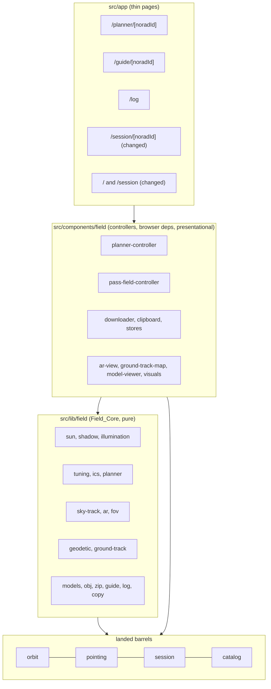

# Design Document

## Overview

S7 (field-companion) turns the landed S1 to S6 app into a field companion for experienced satellite listeners, while the newcomer path stays simple. It adds, in delivery order: the Sun and shadow model with the pass Illumination_Profile and Shadow_Silence of the simulated beacon; the Tuning_Table; the Sky_Track; the AR_View with FOV_Calibration; the Ground_Track_Map; the Pass_Planner with calendar export; the Listening_Guide; the satellite models with viewer and download; the Listening_Log; the First_Run_Guide and the Instrument_Detail on every screen; and the update of the submission materials.

Design stance:

- One new framework-free lib directory, `src/lib/field` (the Field_Core), holds all new pure logic. It consumes only the barrels of orbit, pointing, session and catalog.
- Browser access (camera, clipboard, downloads, storage, timers, animation frames) lives in Field_Controllers under `src/components/field` with injected dependencies. Pages stay thin.
- No new package, no WebGL, `satellite.js` stays 6.0.2, lock tolerance stays 10°, all times are UTC, and every string passes the Honesty_Scan unchanged.
- The landed code is changed only where this document lists it (section "Landed files changed"). `src/lib/orbit` and `src/lib/pointing` are not changed at all. `src/lib/catalog` data is not changed.
- Tests are limited to the cases named in requirements.md "Verification scope" (owner ruling). Everything else is checked by review and by the owner's phone acceptance (Requirement 25).

No expected number of the Reference_Document baselines was re-verified in this phase. Where a test needs an expected value, this document states the reference and the formula; the implementation task writes the literal.

### Decision index

| ID | Decision | Section |
|---|---|---|
| F1 | Field_Core path `src/lib/field`; import allow-list orbit, pointing, session, catalog barrels | Architecture |
| F2 | Sun from the USNO low-precision algorithm, accuracy 0.02° (about 1 arcminute) | Sun direction |
| F3 | Cylindrical shadow, Earth radius 6378.137 km, equals the 50 % illumination boundary within 0.3 km; Penumbra never occurs | Shadow model |
| F4 | Illumination sampled every 10 s (cap 600 samples), transitions refined to 1 s by bisection; failed samples are skipped, no sample at all gives `unavailable` | Illumination profile |
| F5 | Shadow_Silence is one line in `beaconState` (quality forced to 0, so the noise floor stays at its no-signal level); the controller computes the flag per sample | Shadow_Silence |
| F6 | Tuning precision 0.1 kHz (4 decimals of MHz), `Math.round`; Minute_Table on whole UTC minutes plus AOS and LOS; CSV with 5 columns | Tuning |
| F7 | Sky_Track sits next to the S6 `PassProfile`; `PassProfile` stays on the picker rows | Sky track |
| F8 | AR projection wraps the landed `projectMarker` and rescales NDC by a tangent ratio; S3 unchanged | AR math |
| F9 | Vertical_FOV range 45° to 100°, default 75°, key `zombieSatellite.field.verticalFovDeg`; the S6 Sky_View keeps 75° | FOV calibration |
| F10 | AR_View is a full-screen overlay mounted by the Session_Page with its own Camera_Controller instance; the S4 snapshot gains `demoBasis` | AR seam |
| F11 | Planner is the route `/planner/[noradId]`; compute is chunked on the main thread; the session link always targets the next pass | Planner |
| F12 | `.ics` with VALARM 10 min before AOS, UID `<noradId>-<riseMs>@zombiesatellite` | Calendar |
| F13 | Geodetic by Bowring iteration inside Field_Core; footprint on a sphere of radius 6371.0088 km | Ground map |
| F14 | Equirectangular SVG map, bundled Natural Earth 110m coastline as one simplified path string | Ground map |
| F15 | Original_Model only as `.obj` with a redistributable licence and at most 150 KB; otherwise an Illustrative_Model built in code | Models |
| F16 | Model_Viewer on Canvas 2D; Model_Download is one stored ZIP with the model and its Attribution_File | Models |
| F17 | Listening_Guide is the route `/guide/[noradId]`, data in `src/lib/field/guide.ts` | Guide |
| F18 | Listening_Log is the route `/log`; no Log_Card is made | Log |
| F19 | Instrument_Detail is an inline expandable panel (`details` element, a toggled strip in the AR_View) | Two depths |
| F20 | First_Run_Guide is a card on the Home_Page, flag `zombieSatellite.field.firstRunDone` | Two depths |

## Architecture

### Layers



The session controller (landed, changed minimally) imports `isInShadow` from the Field_Core. `src/lib/session` does not import the Field_Core; it only gains a boolean input.

### F1: Field_Core path and import allow-list

- Path: `src/lib/field`, one `index.ts` barrel as the only entry file (S1 to S6 convention). Data modules (coastline, model definitions, guide data) live in the same directory and obey the same rules.
- Allowed specifiers of every file under `src/lib/field`:
  - relative paths that resolve inside `src/lib/field`;
  - exactly the `index` barrel of `src/lib/orbit`, `src/lib/pointing`, `src/lib/session` and `src/lib/catalog`.
- Not allowed: any package (so no `satellite.js`), React, Next.js, `src/lib/shell` (the dome geometry is applied in the component layer), `src/components`.
- Forbidden identifiers (Requirement 1, criterion 3): `window`, `document`, `navigator`, `localStorage`, `sessionStorage`, `indexedDB`, `Blob`, `URL`, `Image`, `HTMLCanvasElement`, `fetch`, `XMLHttpRequest`, `performance`; forbidden calls: `Date.now()` and `new Date()` without arguments. `TextEncoder` is allowed (the ZIP writer uses it).
- Source_Boundary_Scan: `tests/helpers/field-source-scan.ts`, copied from `tests/helpers/shell-source-scan.ts` (import and export specifiers, `import()`, `require`, `import type`) with the identifier and call checks of `tests/helpers/source-scan.ts` added. Test: `tests/field/source-boundary.test.ts`, two cases like the shell one (`index.ts` is listed; no violation).
- Module enumeration (all `.ts`):

| File | Content |
|---|---|
| `index.ts` | Barrel |
| `constants.ts` | Shared constants (steps, ranges, limits) |
| `time.ts` | Julian date, `gmstRad` |
| `sun.ts` | `sunDirection`, `subsolarPoint` |
| `shadow.ts` | `illuminationState`, `isInShadow` |
| `illumination.ts` | `illuminationProfile`, `shadowedAt`, `shadowIntervals` |
| `tuning.ts` | `tuningTable`, `minuteTable`, `tuningCsv`, formatting |
| `sky-track.ts` | `buildSkyTrack`, `trackSegments`, tick instants |
| `ar.ts` | `projectAr`, track arc, horizon, cardinals, lock ring, edge arrow |
| `fov.ts` | FOV range, `normalizeFov` |
| `planner.ts` | `filterPassesByElevation`, badge classification, constants |
| `ics.ts` | `buildCalendarEvent`, escaping, folding |
| `geodetic.ts` | `subSatellitePoint` |
| `ground-track.ts` | `orbitalPeriodMin`, `groundTrack`, `footprint`, `terminator` |
| `model-build.ts`, `model-defs.ts` | Primitive builders and the seven Illustrative_Model definitions |
| `obj.ts` | `parseObj`, `serializeObj` |
| `zip.ts` | `buildStoredZip` with CRC-32 |
| `model-view.ts` | `projectModel` (rotation and perspective to 2D lines) |
| `models.ts` | Model_Records of the register and Attribution_File text builders (data and strings) |
| `guide.ts` | Listening_Guide data (strings as property values) |
| `log.ts` | Log_Entry validation, append, parse, serialize |
| `copy.ts` | `FIELD_COPY` |
| `data/coastline.ts` | `COASTLINE_PATH`, one string constant |

### Component layer and routes

| Path | Role |
|---|---|
| `src/components/field/deps.ts` | `ClipboardLike`, `FieldDownloadDeps`, `FrameScheduler` interfaces |
| `src/components/field/browser-deps.ts` | Builds the real browser dependencies (storage, clock, timers, fetcher, download, clipboard, `requestAnimationFrame`) |
| `src/components/field/tle-source.ts` | `createTleSource(fetcher, noradId)`: TLE and `Satrec`, one fetch through the shared fetcher |
| `src/components/field/planner-controller.ts` | Pass_Planner state and chunked computation |
| `src/components/field/pass-field-controller.ts` | Per-pass field model (Sky_Track, profile, Tuning_Table) for the Session_Page |
| `src/components/field/field-downloader.ts` | Text and binary downloads in the Download_Pattern |
| `src/components/field/fov-store.ts`, `log-store.ts`, `first-run-store.ts` | Storage wrappers |
| `src/components/field/ar-view.tsx` | AR_View container (camera, size, frame loop, FOV control) |
| `src/components/field/ground-track-map.tsx` | Ground_Track_Map |
| `src/components/field/model-viewer.tsx` | Model_Viewer and Model_Download buttons (home page) |
| `src/components/field/first-run-guide.tsx` | First_Run_Guide card |
| `src/components/field/session-panel.tsx` | Session_Page block: badge, Sky_Track, Tuning_Table, Instrument_Detail, map, links |
| `src/components/field/visuals/sky-track.tsx` | Sky_Track on the Sky_Dome |
| `src/components/field/visuals/ar-overlay.tsx` | AR_Overlay SVG |
| `src/components/field/visuals/field-bits.tsx` | `IlluminationBadge`, `SelfReportedMark`, `InstrumentDetail` |
| `src/app/planner/[noradId]/page.tsx` | Pass_Planner page (client) |
| `src/app/guide/[noradId]/page.tsx` | Listening_Guide page (client, static content) |
| `src/app/log/page.tsx` | Listening_Log page (client) |

The three new pages follow the landed `session/[noradId]` pattern: `'use client'`, `useParams`, `resolvePlayableEntry`, a "not found" branch. The Global_Navigation stays as it is; the new pages are reached from the picker rows, the Session_Page, the Home_Page entry cards and one Home_Page link (see "Two depths of use").

### Delivery order in files

The tier order of Requirement 26 maps to file groups, so each task leaves a building app:

1. Must: `time`, `sun`, `shadow`, `illumination`, the S4 change, `copy`; `tuning`; `sky-track`, `session-panel`, `visuals/sky-track`, `pass-field-controller`; `ar`, `fov`, AR components.
2. Should: `geodetic`, `ground-track`, coastline, map; `planner`, `ics`, planner page; `guide`, guide page.
3. Could: models group; `log`, log page; first run and Instrument_Detail polish.
4. Submission materials, then the owner's acceptance.

## Components and Interfaces

### Time and Sun direction (Requirement 2, criteria 1, 2, 5)

`time.ts`:

```ts
export function julianDate(instantMs: number): number;   // ms / 86 400 000 + 2 440 587.5
export function gmstRad(instantMs: number): number;      // IAU-82 polynomial, same as satellite.js gstime, in [0, 2π)
```

`gmstRad` is used only by the Terminator (the satellite position carries its own `gmstRad`). It is checked once by the implementer against the GMST of Reference_Document section 4.3 (3.8292582544 rad at the Reference_ISS_Instant) as a one-off comment in the code review, not as a committed test (no test beyond the named ones).

`sun.ts`, formula of the USNO "Computing Approximate Solar Coordinates" (https://aa.usno.navy.mil/faq/sun_approx), with `D = julianDate(t) − 2451545.0`, all angles in degrees:

```
g = 357.529 + 0.98560028 D          (mean anomaly)
q = 280.459 + 0.98564736 D          (mean longitude)
L = q + 1.915 sin g + 0.020 sin 2g  (apparent ecliptic longitude, aberration included)
e = 23.439 − 0.00000036 D           (obliquity)
direction = ( cos L,  cos e sin L,  sin e sin L )
```

```ts
export function sunDirection(instantMs: number): Vec3;                              // unit vector
export function subsolarPoint(instantMs: number): { latitudeDeg: number; longitudeDeg: number };
```

`subsolarPoint`: declination `δ = asin(z)`, right ascension `α = atan2(y, x)`, longitude `λ = wrap180(α − gmstRad)` (C22, C24). The Sun distance is not computed: the cylindrical model does not need it.

Accuracy (criterion 1): the USNO page states about 1 arcminute within two centuries of 2000. The design takes **0.02°** as the stated bound over 2026 to 2030.

Frame approximation (criterion 2): the formula gives the Sun in the mean equator and equinox of date; SGP4's TEME uses the true equator and the mean equinox of the TLE epoch. The differences are nutation in obliquity (at most 9″) and precession between the TLE epoch and the instant (about 50″ per year, so under 5″ for a TLE up to a month old). Together under 0.004°; the stated total of the Sun direction in TEME is **0.02°**, dominated by the formula.

Test (criterion 5): `tests/field/sun-shadow.test.ts`, case 1. Reference: by definition the Sun's apparent ecliptic longitude is 0°, 90°, 180°, 270° at the March equinox, June solstice, September equinox and December solstice. Instants (UTC, the implementer confirms them on the USNO "Earth's Seasons" page, https://aa.usno.navy.mil/data/EarthSeasons, before writing the literals; secondary sources agree within one minute, which is 0.0007° of solar longitude): 2026-03-20T14:46Z, 2026-06-21T08:24Z, 2026-09-23T00:05Z, 2026-12-21T20:50Z. Expected vectors: `(1, 0, 0)`, `(0, cos ε, sin ε)`, `(−1, 0, 0)`, `(0, −cos ε, −sin ε)` with `ε = 23.436°` (mean obliquity of 2026). Assertion: the angle between the computed and the expected vector is at most 0.05° (margin 2.5 over the stated bound).

### Shadow model (Requirement 2, criteria 3, 4, 6)

Decision F3: a **cylindrical** model.

- Earth radius: `SHADOW_EARTH_RADIUS_KM = 6378.137` (WGS84 `a`, C29).
- Rule: with `s` the Sun unit vector and `r` the satellite ECI position, the satellite is in Umbra iff `r·s < 0` and `|r − (r·s) s| < 6378.137`; otherwise Sunlit.
- Reason for cylindrical over conical: the edge of a cylinder of radius `R` equals the 50 % illumination point of the real penumbra to within `x R / d` ≈ 0.3 km for a satellite `x` = 6800 km behind the Earth (`d` = 1 AU), which is under 0.05 s at orbital speed. The real umbra-to-penumbra band is about 60 km wide (about 8 s of orbit), so a conical model would add a Penumbra state but not better knowledge of when a sunlight-powered transmitter switches off, which depends on battery, attitude and temperature (Known limitation 1). Atmospheric refraction at the terminator (tens of km) is ignored.
- Consequence for the types: Penumbra never occurs (criterion 4). `IlluminationState = 'sunlit' | 'umbra'`; `In_Shadow` means `'umbra'`.

```ts
export type IlluminationState = 'sunlit' | 'umbra';
export function illuminationState(eciPositionKm: Vec3, sunUnit: Vec3): IlluminationState;
export function isInShadow(eciPositionKm: Vec3, instantMs: number): boolean;   // sunDirection(instantMs) inside
```

Test (criterion 6), same file, case 2, at the instant 2026-03-20T14:46Z where `s` is about `(1, 0, 0)`: the position `7000·s` is `'sunlit'`; the position `−7000·s` is `'umbra'`. Both positions are built from the computed `s`.

### Illumination profile (Requirement 3, criteria 1 to 3)

```ts
export type ShadowTransition = { readonly atMs: number; readonly kind: 'entry' | 'exit' };
export type IlluminationProfile =
  | { readonly kind: 'sunlit' }
  | { readonly kind: 'shadowed' }
  | { readonly kind: 'partly'; readonly startsInShadow: boolean; readonly transitions: readonly ShadowTransition[] }
  | { readonly kind: 'unavailable' };

export function illuminationProfile(satrec: Satrec, pass: Pass): IlluminationProfile;
export function shadowedAt(profile: IlluminationProfile, tMs: number): boolean | null;   // null for 'unavailable'
export function shadowIntervals(profile: IlluminationProfile, pass: Pass): ReadonlyArray<{ fromMs: number; toMs: number }>;
```

Sampling and refinement (criterion 2, decision F4):

- Samples with `propagateAt` (no observer needed) at `riseMs`, then every `step` ms up to and including `setMs`, `step = max(10 000, ceil((setMs − riseMs) / 600 000) × 1000)`. A typical pass of 10 min gives 61 samples; a 6 h pass gives a 36 s step.
- For each adjacent pair of successful samples whose states differ, bisection on the instant to a bracket of 1 s (the S1 resolution of rise and set), using `isInShadow` on a fresh `propagateAt`. Shadow_Entry and Shadow_Exit are reported at the end of the bracket nearer the new state. Resolution: **1 s**. A shadow shorter than one step inside a pass is not detected; physically it cannot happen inside one pass (a shadow lasts minutes).
- Failure handling (criterion 3): a sample with `ok: false` is skipped; the previous good state carries across it. If no sample succeeds the profile is `{ kind: 'unavailable' }`. The function never throws for a propagation failure (it throws only for an invalid `Satrec`, as `propagateAt` does).
- Presentation of `unavailable`: the badge reads "Illumination unknown", the Sky_Track draws all segments as sunlit, and Shadow_Silence is not applied. Nothing is invented.

Badge (criteria 4 to 6): `IlluminationBadge` shows `sunlit`, `shadowed`, `partly` (with the entry and exit instants through `formatUtc` in the Instrument_Detail) or `unknown`. WHERE the entry is a Sunlit_Only_Entry the badge for `shadowed` and `partly` adds the Field_Copy line "Silent in Earth's shadow". For other entries the badge states the illumination only and never says "silent".

### Shadow_Silence and the S4 change (Requirement 4)

Requirement 4, criterion 1 asks whether the noise floor keeps sounding. Decision F5: it keeps sounding at its **no-signal level**. Reason: Shadow_Silence then behaves exactly like a pointing error of 45° or more, which the landed beacon already treats as "no signal": carrier and ticks at gain 0, noise at `NOISE_FLOOR_GAIN + NOISE_SPAN_GAIN`. The user hears that the audio is alive but the beacon is gone, and no new audio code is needed.

The smallest change that meets criteria 1 to 6:

1. `src/lib/session/beacon.ts`: `BeaconInputs` gains `readonly shadowSilent?: boolean`. In `beaconState`, the line `const q = signalQuality(inputs.pointingErrorDeg);` becomes `const q = inputs.shadowSilent === true ? 0 : signalQuality(inputs.pointingErrorDeg);`. Nothing else in the file changes. An omitted flag keeps every landed behavior, so the landed `beacon.test.ts` cases still hold.
2. `src/components/session/session-controller.ts`:
   - import `isInShadow` from `../../lib/field/index`;
   - `BeaconLevels` gains `shadowSilent: boolean`; `NO_BEACON_LEVELS` has `false`; `refreshPointingError` builds `{ ...beaconLevels, pointingErrorDeg }` so the flag survives pointing updates;
   - in `sampleAt`, after a successful observation: `shadowSilent = entry.beacon.sunlitOnly === true && isInShadow(observation.eciPositionKm, t)`, stored with the other levels; `t` is the Session_Instant, so real time and the 60× demo use the same code (criterion 2);
   - `stateAt` passes `shadowSilent: beaconLevels.shadowSilent` to `beaconState`;
   - `SessionSnapshot` gains `shadowSilent: boolean` (copied from the levels in `buildSnapshot`) for the page note (criterion 4);
   - an observation failure resets the levels to `NO_BEACON_LEVELS`, so a failure never silences the beacon by shadow.
3. `src/components/session/copy.ts`: `sunlitNote` becomes: `Sunlit only: in reality it transmits only while the Sun shines on it. In Earth's shadow the simulated beacon falls silent.` Scan check: it holds "beacon" and "simulated" (1.24); no reception word (1.25).
4. `src/app/session/[noradId]/page.tsx`: while `snapshot.shadowSilent`, a paragraph shows `FIELD_COPY.shadowSilenceNote` ("The satellite is in Earth's shadow, so the simulated beacon is silent."; same scan check).

What does not change (criterion 5): the transition table, the lock evaluation and statistics, the Session_Result, and the beacon of LES-1, Prospero and IMAGE (their `sunlitOnly` is `null`, so the flag is always false). Timing: the flag is refreshed at each session sample (4 Hz), so in demo the silence starts and stops with a granularity of 15 s of satellite time (0.25 s of wall time); in real time with a granularity of 0.25 s.

The supersession of S4 Known limitation 1 and S4 Requirement 9, criterion 6 is recorded here; the landed S4 documents are not edited.

The existing `tests/session/session-controller.test.ts` is touched only if the added snapshot fields break an exact-equality assertion; no case is added.

### Tuning table (Requirement 5)

```ts
export interface TuningPoint {
  readonly kind: 'aos' | 'tca' | 'los';
  readonly tMs: number;
  readonly frequencyMhz: number;      // rounded to 0.1 kHz
  readonly shiftKhz: number;          // unrounded physical shift
  readonly azimuthDeg: number;
  readonly elevationDeg: number;
  readonly truncated: boolean;        // aos with startTruncated, los with endTruncated
}
export type TuningResult =
  | { readonly kind: 'table'; readonly nominalMhz: number; readonly points: readonly [TuningPoint, TuningPoint, TuningPoint] }
  | { readonly kind: 'no-frequency' }      // downlinkMhz is null: nothing is computed
  | { readonly kind: 'unavailable' };      // an observation failed at a Tuning_Point
export function tuningTable(input: { satrec: Satrec; observer: Observer; downlinkMhz: number | null; pass: Pass }): TuningResult;
export function minuteTable(input: { satrec: Satrec; observer: Observer; downlinkMhz: number | null; pass: Pass }):
  { kind: 'rows'; rows: readonly TuningPoint[] } | { kind: 'no-frequency' } | { kind: 'unavailable' };
```

- Computation (criterion 2): `observeAt(satrec, t, observer)`; `shiftKhz = physicalDopplerShiftKhz(downlinkMhz, rangeRateKmPerS)` from the session barrel; `frequencyMhz = roundMhz(downlinkMhz + shiftKhz / 1000)`. The Doppler formula is not reimplemented. IMAGE: `downlinkMhz === null` returns `{ kind: 'no-frequency' }` before any call to the engine (criterion 8).
- Precision and rounding (criterion 3): the frequency is shown in **MHz with 4 decimals** (resolution 0.1 kHz). `roundMhz(x) = Math.round(x × 10 000) / 10 000`; display `toFixed(4)`. The shift is shown with the landed `formatDopplerReadout` (2 decimals, kHz, explicit sign).
- Minute_Table instants (criterion 4): the AOS instant, every whole UTC minute strictly between AOS and LOS, and the LOS instant. Reason: memory-channel programming follows the wall clock. Columns: UTC instant (`formatUtc`), frequency, Doppler shift, azimuth, elevation. A Start_Truncated pass labels its first row "Now" instead of AOS; an End_Truncated pass labels its last row "Window end" instead of LOS (Field_Copy). A row whose observation fails is omitted.
- Tuning_CSV (criterion 5): `tuningCsv(rows, header): string`; RFC 4180 style, UTF-8, CRLF line ends, a final CRLF. Header (from Field_Copy): `utc,frequency_mhz,doppler_shift_khz,azimuth_deg,elevation_deg`. Row: `formatUtc(t)` (the only UTC formatter; it contains spaces but no comma), frequency with 4 decimals, shift with 2 decimals and an ASCII `-` or `+`, azimuth and elevation with 1 decimal. File name: `zombiesatellite-<slug>-<yyyymmddhhmm>-tuning.csv` with the AOS instant, built from `formatUtc` digits. MIME `text/csv;charset=utf-8`. The clipboard receives the same text.
- Notes (criteria 6, 7): the table always prints "Computed from <displayFrequency verbatim>" plus, for LES-1, the Field_Copy line "Computed from 237 MHz, the rounded value of 'about 237 MHz'. The frequencies are approximate." and, for Prospero, "137.56 MHz is the historical downlink of Prospero. Later reports of it being heard are unconfirmed." (checked against 1.24 and 1.25: no radio term). The prose of the app keeps "about 237 MHz".

Test (criterion 9), `tests/field/tuning.test.ts`, one case:

- Fixture: the ISS TLE of Reference_Document section 4.2; Observer (39.9042°N, 116.4074°E, 0 km); a `Pass` literal with `riseMs` = 2026-11-09T11:18:05Z and `setMs` = 2026-11-09T11:28:47Z (the 1 s reference of section 4.7) and `peakMs` = 2026-11-09T11:23:00Z (the instant of the section 4.3 baseline); `downlinkMhz` = 145.9775.
- Expected TCA: the baseline range rate at the section 4.3 instant is −2.1094 km/s (`tests/helpers/baseline.ts`), so the shift is `−145.9775 × 1000 × (−2.1094) / 299 792.458` ≈ +1.0271 kHz and the frequency rounds to **145.9785 MHz**. The ±0.01 km/s baseline tolerance moves the value by 0.000005 MHz, inside the rounding cell.
- Expected AOS and LOS: literals computed once in the implementation task with the test oracle `rangeRateOracle` of `tests/helpers/oracles.ts` and the formula `Δf = −f0 · ṙ / c`, rounded as above, and written into the test with a comment naming this method.

### Sky track (Requirement 6)

```ts
export type SkySample =
  | { readonly ok: true; readonly tMs: number; readonly azimuthDeg: number; readonly elevationDeg: number }
  | { readonly ok: false; readonly tMs: number };
export interface SkyTrack {
  readonly samples: readonly SkySample[];
  readonly tickMs: readonly number[];          // Time_Tick instants, a subset of the sample instants
  readonly aos: SkySample; readonly tca: SkySample; readonly los: SkySample;
}
export function buildSkyTrack(satrec: Satrec, observer: Observer, pass: Pass): SkyTrack;
export function trackSegments(track: SkyTrack, profile: IlluminationProfile): ReadonlyArray<{ inShadow: boolean; samples: readonly Extract<SkySample, { ok: true }>[] }>;
export function tickLabel(tMs: number): string;     // formatUtc(tMs).slice(11, 16) + 'Z'
```

- Sampling step (criterion 1): `max(10 s, ceil(duration / 180))`, so a pass has at most 180 steps. The timeline is the union of the regular steps, `riseMs`, `peakMs`, `setMs` and the tick instants, so AOS, TCA, LOS and every tick have exact `observeAt` samples.
- Time_Ticks (criterion 2): the smallest interval of 1, 2, 5, 10, 15, 30, 60 min that gives at most 12 ticks, on instants that are multiples of the interval in UTC. Labels `HH:MMZ` from `formatUtc`.
- Marks: the AOS and LOS marks sit on the horizon at the exact sample azimuth, labelled with the azimuth in degrees; the Culmination_Point is labelled with the Maximum_Elevation. For a truncated pass the first or last mark reads "Now" or "Window end".
- Dome drawing: `domePoint(azimuthDeg, max(elevationDeg, 0), R)`. Elevation is clamped at 0 because AOS and LOS are located within 1 s and can read a hundredth of a degree below the horizon; no other correction is made. True azimuths are used (no calibration offset): the Sky_Track is a map of the sky, not of the phone.
- Failures (criterion 6): a sample with `ok: false` splits the polyline; nothing is drawn at that sample.
- Shadow segments (criterion 4): `trackSegments` splits the polyline where `shadowedAt` changes; the first sample of a new segment repeats the last sample of the previous one, so the line is continuous. The shadow part is drawn dashed in brass, the sunlit part solid in phosphor (classes in `globals.css`).
- Current_Point (criterion 3): the Session_Page passes `snapshot.target` (the last sample, 4 Hz); the dome draws the satellite marker on top.
- Decision F7 (criterion 5): the Sky_Track **sits next to** the S6 `PassProfile`. `PassProfile` stays on the picker rows (five small schematics, no engine call, readable at a glance). The Sky_Track is the main pass visual of the Pass_Planner detail and of the Session_Page. Reason: the picker shows five satellites at once and does not need samples; replacing the profile there would add computation and lose the elevation-over-time view that the dome does not show.

### AR math (Requirement 7, criteria 2 to 8, 13; Requirement 9, criteria 5, 6)

Decision F8, the projection with a variable Vertical_FOV. `src/lib/pointing/projection.ts` fixes `t = tan(75° / 2)`. The Field_Core wraps it:

```ts
export function projectAr(target: SceneVector, basis: CameraBasis, aspect: number, verticalFovDeg: number): MarkerPosition {
  const base = projectMarker(target, basis, aspect);               // landed, at 75°
  if (!base.inFront) return base;
  const k = Math.tan((VERTICAL_FOV_DEG * Math.PI) / 360) / Math.tan((verticalFovDeg * Math.PI) / 360);
  const ndcX = base.ndcX * k, ndcY = base.ndcY * k;
  return { inFront: true, ndcX, ndcY, onScreen: Math.abs(ndcX) <= 1 && Math.abs(ndcY) <= 1 };
}
```

At 75° `k` is exactly 1, so `projectAr` equals `projectMarker` there by construction (Requirement 9, criterion 6), and S3 is unchanged. Rejected alternative: adding a FOV parameter to `projectMarker` (a signature change of a landed S3 function and of `markerPlacement`).

All overlay directions are built as the lock builds them: `sceneDirection(effectiveAzimuthDeg(azimuthDeg, offsetDeg), elevationDeg)` (criterion 2). The calibration offset is applied to every overlay element, including the Horizon_Line and the Cardinal_Marks, so that after the user has matched the satellite to the sky the horizon and the cardinals match it too.

```ts
export const AR_NDC_LIMIT = 6;                    // points farther than this from the centre are culled
export interface ArPoint { readonly ndcX: number; readonly ndcY: number }
export interface ArPiece { readonly inShadow: boolean; readonly points: readonly ArPoint[] }
export function arMarker(az: number, el: number, offsetDeg: number, basis: CameraBasis, aspect: number, fovDeg: number): MarkerPosition;
export function projectTrackArc(segments, offsetDeg, basis, aspect, fovDeg): ArPiece[];        // criterion 6
export function projectTicks(track: SkyTrack, offsetDeg, basis, aspect, fovDeg): Array<{ tMs: number; ndcX: number; ndcY: number }>;
export function horizonLine(offsetDeg, basis, aspect, fovDeg): ArPiece[];                      // az 0..360 step 5, el 0
export function cardinalMarks(offsetDeg, basis, aspect, fovDeg): Array<{ label: 'N' | 'E' | 'S' | 'W'; ndcX: number; ndcY: number }>;
export function lockRing(az, el, offsetDeg, basis, aspect, fovDeg): ArPiece[];                 // 36 points on the 10° circle
export function edgeArrow(az, el, offsetDeg, basis, aspect, fovDeg): { angleRad: number; ndcX: number; ndcY: number } | null;
```

- Behind rule (criterion 8): a point is behind when `projectMarker` reports `inFront: false`, which is the landed `zc ≤ 0`; the lock's own test `f·u < 0` (C52) is the same sign test, and `LockResult.behind` is shown unchanged. The Field_Core defines no other criterion. Polylines are split at behind points and at points beyond `AR_NDC_LIMIT`, so a behind sample is never drawn as if it were in front.
- Lock_Ring (criterion 4): the circle of angular radius `LOCK_TOLERANCE_DEG` around the satellite direction `u`: `p(θ) = cos ρ · u + sin ρ (cos θ e1 + sin θ e2)` with `e1, e2` perpendicular to `u`, 36 points, each projected with `projectAr`. The ring therefore scales with the Vertical_FOV by construction. The ring is drawn for the satellite only, never as a lock threshold; `LockResult.locked` colours it (criterion 5).
- Cardinal_Marks (criterion 7): azimuths 0°, 90°, 180°, 270° at elevation 0°, kept only when in front and within `|ndc| ≤ 1.2`.
- Edge_Arrow (criterion 8): `null` when the marker is in front and on screen. Otherwise the direction is `(u·right, u·up)` (the camera-plane components of `u`), `angleRad = atan2(upComponent, rightComponent)`, and the arrow sits at that direction scaled so that `max(|x|, |y|) = 0.9`. If both components are under 1e-9 (target exactly behind), the angle is 0 (right).
- Awaiting phase (criterion 10): the AR_View draws `arMarker(aosAzimuthDeg, 0, ...)` as the "AOS" mark on the Horizon_Line and the Track_Arc of the Target_Pass; there is no live satellite marker before AOS because the satellite is below the horizon.

Tests (criterion 13, Requirement 9 criterion 6), `tests/field/ar-projection.test.ts`, example cases; every expected value is analytic (basis looking north, level: `forward` = −Z, `right` = +X, `up` = +Y, from `cameraBasisFromDrag({ headingDeg: 0, pitchDeg: 0 })`):

1. `projectAr` at 75° equals `projectMarker` for a set of five targets (the default-FOV agreement).
2. At 60° and aspect 0.5, a target at azimuth 10°, elevation 0° gives `ndcX = tan 10° / (tan 30° · 0.5)` and `ndcY = 0`.
3. A target at azimuth 180° (behind) is not in front, and `projectTrackArc` of a two-sample track whose second sample is behind returns one piece with one point and draws nothing for the behind sample.
4. `horizonLine` passes through the centre row (`ndcY = 0` at the north point) and `cardinalMarks` returns only `N` for the north-looking basis, at `ndcX = 0`, `ndcY = 0`.
5. `lockRing` around the forward direction: the top point has `ndcY = tan 10° / tan(fov / 2)` at 75° and at 60°.
6. `edgeArrow` for a target at azimuth 40°, elevation 0° gives `angleRad = 0` and `ndc = (0.9, 0)`; for a target at elevation 70° straight ahead in azimuth it gives `angleRad = π/2`.

### FOV calibration (Requirement 9)

`fov.ts`: `FOV_MIN_DEG = 45`, `FOV_MAX_DEG = 100`, `FOV_DEFAULT_DEG = VERTICAL_FOV_DEG` (75), `FOV_STEP_DEG = 1`, `normalizeFov(raw: unknown): number` (a finite number inside the range is returned, anything else gives 75; criterion 3).

- Range reason: in portrait the vertical axis of a phone image is the long side of the sensor. A main camera of about 80° diagonal gives about 68° on the long side and a wide camera of 110° gives about 88°; 45° to 100° covers both with margin.
- Storage (criterion 2): `fov-store.ts` over `KeyValueStorage`, key `zombieSatellite.field.verticalFovDeg`, value `String(value)`.
- Scope (criteria 4, 5): the Vertical_FOV feeds only `projectAr` and so the overlay and the on-screen ring size. The lock stays `evaluateLock` with `LOCK_TOLERANCE_DEG`. The S6 Sky_View (`markerPlacement`) stays at the fixed 75°: it is a small secondary view, and changing it would touch landed S6 code and tests for no gain.
- Control: a range input in the AR_View (45 to 100, step 1) with a numeric readout.

### Pass planner core (Requirement 10)

`planner.ts`: `PLANNER_WINDOW_HOURS = 168`, `PLANNER_SEARCH_MIN_ELEVATION_DEG = 0`, `PLANNER_MIN_ELEVATIONS = [0, 10, 20, 30]`, `DEFAULT_PLANNER_MIN_ELEVATION_DEG = 10`, `filterPassesByElevation(passes, minElevationDeg)` (keeps passes with `maxElevationDeg >= minElevationDeg`, order preserved).

### Calendar event (Requirement 11)

```ts
export function buildCalendarEvent(input: {
  entry: { slug: string; name: string; noradId: number; displayFrequency: string | null };
  pass: Pass; aosAzimuthDeg: number; losAzimuthDeg: number;
  profile: IlluminationProfile; stampMs: number;          // DTSTAMP, supplied by the caller
}): string;
export function calendarFileName(slug: string, riseMs: number): string;
```

- Format (criterion 1): RFC 5545. `BEGIN:VCALENDAR`, `VERSION:2.0`, `PRODID:-//zombieSatellite//field-companion//EN`, `CALSCALE:GREGORIAN`, one `VEVENT` with `UID`, `DTSTAMP`, `DTSTART` (AOS), `DTEND` (LOS), `SUMMARY`, `DESCRIPTION`, one `VALARM`; no `METHOD`. All instants are UTC basic format `YYYYMMDDTHHMMSSZ`, derived from the `formatUtc` digits (no second UTC formatter).
- UID rule (criterion 4): `<noradId>-<riseMs>@zombiesatellite`. It is deterministic, so importing the same pass again updates the event instead of duplicating it.
- Content (criteria 2, 3): summary `<name> pass`; description lines from Field_Copy pieces: maximum elevation, AOS and LOS azimuths, `displayFrequency` verbatim or the No_Frequency_Note, the illumination text (with the shadow entry and exit instants through `formatUtc` for a partly sunlit pass), and the sentence "The beacon in the zombieSatellite app is simulated; tune your own equipment for the real downlink." Scan check: the sentence has "beacon" and "simulated"; it has no reception word.
- Alarm (criterion 4): `VALARM` with `ACTION:DISPLAY`, a Field_Copy `DESCRIPTION`, and `TRIGGER:-PT10M` (10 minutes before AOS: enough to walk outside and set up an antenna).
- Escaping and folding (criterion 4): TEXT values escape `\`, `;`, `,` and newline as `\\`, `\;`, `\,`, `\n`. Content lines are folded at 75 octets (UTF-8 bytes, never inside a code point) with CRLF plus one space. Line ends are CRLF, including the last.
- File name (criterion 5): `zombiesatellite-<slug>-<yyyymmddhhmm>.ics` (AOS), MIME `text/calendar;charset=utf-8`.
- No test beyond the named ones; the file is imported into a phone calendar during the owner's acceptance.

### Geodetic, footprint, terminator (Requirement 12)

`geodetic.ts` (decision F13; no `src/lib/orbit` extension is needed, criterion 2):

```ts
export function subSatellitePoint(ecfKm: Vec3): { latitudeDeg: number; longitudeDeg: number; altitudeKm: number };
```

Bowring iteration on the WGS84 ellipsoid with `a = 6378.137`, `b = 6356.7523142` (C29), `e² = 2f − f²`:

```
p = hypot(x, y);  λ = atan2(y, x)
φ0 = atan2(z, p (1 − e²))
repeat (at most 10 times, until |Δφ| < 1e-12 rad):  N = a / sqrt(1 − e² sin²φ);  φ = atan2(z + e² N sin φ, p)
h = p / cos φ − N                         (|φ| < 80°);   h = z / sin φ − N (1 − e²)   otherwise
```

Longitude is mapped to [−180, 180] (C27); latitude is geodetic (C26). Accuracy: the iteration converges to better than 1e-9° and 1 mm; the bound is far inside the test tolerance.

Test (criterion 6), `tests/field/ground.test.ts`, case 1: input the ECF vector (−2527.6140, 4838.2075, 4035.6750) km of Reference_Document section 4.3. Expected values: the geodetic inverse of that vector given by `eciToGeodetic` of `satellite.js` 6.0.2 applied to the section 4.3 ECI vector (5024.1427, −2134.2621, 4035.6750) km and GMST 3.8292582544 rad, computed once in the implementation task and written as literals. The reference document lists no geodetic values, so the library inverse is the stated source. Tolerances: 1e-6° for latitude and longitude, 1e-4 km for altitude.

Footprint (criteria 4, 7): spherical Earth of radius `FOOTPRINT_EARTH_RADIUS_KM = 6371.0088` (IUGG mean). The satellite is above 0° elevation inside the circle of angular radius `ρ = acos(R / (R + h))` around the Sub_Satellite_Point (the horizon tangent condition at 0° elevation). The difference to the ellipsoid is under 0.3 % of ρ and C32 (no terrain, no refraction) is the larger limitation (Known limitation 3).

```ts
export function footprintAngularRadiusDeg(altitudeKm: number): number;
export function footprintRing(latitudeDeg: number, longitudeDeg: number, altitudeKm: number, points?: number): MapRing;  // 72 points
```

Test (criterion 7), `tests/field/ground.test.ts`, case 2: exact analytic values: `h = 0` gives 0°; `h = R` gives 60° (cos 60° = 1/2); `h = R (√2 − 1)` gives 45°. Tolerance 1e-9°.

Ring construction: for bearings `θ = 0..355°` step 5°: `φ = asin(sin φ0 cos ρ + cos φ0 sin ρ cos θ)`, `λ = λ0 + atan2(sin θ sin ρ cos φ0, cos ρ − sin φ0 sin φ)`. Longitudes are unwrapped to be continuous around `λ0`. If the circle contains a pole (`|φ0| + ρ > 90°`) the ring is closed through that pole (two extra points at ±90°). The map draws the ring three times at −360°, 0° and +360° under the viewport clip, so no geometric clipping is needed.

Terminator (criterion 5): from `subsolarPoint(t)`, declination `δ` (clamped to `|δ| ≥ 1e-6 rad`) and subsolar longitude `λs`. For each map longitude `L` from −180° to 180° in 2° steps: `φt(L) = atan(−cos(L − λs) / tan δ)`. The night side lies toward the pole of the sign opposite to `δ`. `terminator(t)` returns `{ curve: readonly {lonDeg, latDeg}[]; nightPoleLatDeg: number }`; the map fills the polygon from the curve to the night pole.

### Ground track (Requirement 12, criterion 3; Requirement 13)

```ts
export function orbitalPeriodMin(meanMotionRevPerDay: number): number;       // 1440 / MEAN_MOTION (OQ-5)
export function groundTrack(satrec: Satrec, centerMs: number, periodMin: number):
  { past: readonly MapLine[]; future: readonly MapLine[]; stepMs: number };
```

- Span: one period back and one forward from `centerMs`. Step `periodMs / 180` on an **absolute grid** (sample instants are multiples of the step), so the polyline does not jitter between recomputations; the exact `centerMs` sample is appended to both sides so they meet at the satellite.
- Antimeridian split: a new line starts where two consecutive longitudes differ by more than 180°. A propagation failure also starts a new line; no point is invented.
- Map projection (Requirement 13, criterion 2): **equirectangular**, `x = lonDeg`, `y = −latDeg`, viewBox `-180 -90 360 180`. Reason: lat and lon are linear, the footprint and the terminator need no special cases, and 2:1 fits a phone width. A Mercator or orthographic map was not chosen: both distort or hide exactly what the map must show (the whole orbit).

### Models core (Requirements 15, 16)

```ts
export interface ModelGeometry { readonly vertices: readonly number[]; readonly faces: readonly (readonly number[])[] }
export function parseObj(text: string): ModelGeometry | null;              // v and f lines only; faces with 3 or more indices; null if no face
export function serializeObj(model: ModelGeometry, headerLines: readonly string[]): string;
export function modelEdges(model: ModelGeometry): readonly (readonly [number, number])[];     // unique edges
export function projectModel(model: ModelGeometry, yawRad: number, pitchRad: number, viewHalfSize: number):
  Array<{ x1: number; y1: number; x2: number; y2: number; depth: number }>;
export function buildStoredZip(entries: ReadonlyArray<{ name: string; data: Uint8Array }>): Uint8Array;
```

- Builders (`model-build.ts`): `box`, `prism(n, radius, height)`, `panel`, `rod`, `translate`, `merge`. `model-defs.ts` defines one Illustrative_Model per entry from dimensions that the implementation task records in `docs/reference/MODELS.md`. Budget (Requirement 15, criterion 6): at most 400 unique edges and 4 KB of source per Illustrative_Model, 30 KB for `model-defs.ts` and the builders together.
- `projectModel`: rotation about the vertical axis by `yawRad`, a fixed tilt `pitchRad` (20°), a perspective divide with a camera distance of three model radii, depth for opacity. No hidden-line removal; near edges are brighter (a lit wireframe).
- `buildStoredZip`: ZIP "stored" method (no compression), CRC-32 table in code, UTF-8 names, no extra fields. About 80 lines. Reason: one download delivers the model and its Attribution_File together on iOS and Android, where two programmatic downloads in one tap are often blocked or prompt (decision F16; alternative: two sequential downloads).

### Listening log core (Requirement 17)

```ts
export interface LogEntry { readonly id: string; readonly noradId: number; readonly utcMs: number; readonly frequencyMhz: number; readonly equipment: string; readonly note: string }
export const MAX_LOG_ENTRIES = 200, MAX_EQUIPMENT_CHARS = 120, MAX_NOTE_CHARS = 500;
export function parseLogDraft(input: { noradId: unknown; utcText: string; frequencyText: string; equipment: string; note: string }, nowMs: number):
  { ok: true; value: Omit<LogEntry, 'id'> } | { ok: false; field: 'noradId' | 'utc' | 'frequency' | 'equipment' | 'note'; reason: string };
export function appendLogEntry(existing: readonly LogEntry[], entry: LogEntry): readonly LogEntry[];   // newest 200 kept
export function parseStoredLog(raw: string | null): readonly LogEntry[];
export function serializeLog(entries: readonly LogEntry[]): string;
```

Validation (criterion 2):

| Field | Rule |
|---|---|
| `noradId` | One of the seven catalog NORAD numbers (story-only entries are allowed: a listener elsewhere may report LES-5) |
| UTC | Text `YYYY-MM-DD HH:MM` or `YYYY-MM-DDTHH:MM`, optional `:SS`, optional trailing `Z`; parsed as UTC with `Date.UTC`, rejected if the fields do not round-trip (no 31 February); not before 1957-10-04 and not later than `nowMs + 5 min` |
| Frequency | Decimal number of MHz, greater than 0 and at most 30 000 |
| Equipment | Trimmed, control characters removed, 0 to 120 characters |
| Note | Trimmed, control characters removed except line feed, 0 to 500 characters |

Storage: key `zombieSatellite.field.listeningLog` (separate from `zombieSatellite.session.results` and the S5 collection), a JSON object `{ "v": 1, "entries": [...] }`. `parseStoredLog` drops any invalid element and never throws. At 200 entries the oldest is dropped when a new one is added; the page says so. Display order: newest instant first.

### Field_Copy (Requirement 21)

Three modules of plain string literals, each value a direct property value (the scan reads property-assignment strings only): `src/lib/field/copy.ts` (`FIELD_COPY`), `src/lib/field/guide.ts` and `src/lib/field/models.ts`. Rules:

- No string is built by concatenation or a template literal with substitutions; strings with a number or an instant are assembled in code from separate literal pieces, each of which passes the scan on its own. No user-facing string sits in an array (the scan does not read array elements).
- A string that contains `beacon`, `signal`, `radio` or `transmission` (as a word prefix) must also contain `simulated` or `synthesized`. The guide, log and model texts therefore avoid these four words and use "downlink", "carrier", "CW", "telemetry", "transmits", "receiver", "equipment". This applies to every property string, including labels and URLs: a URL path segment that starts with one of the four words is not used (the proposed guide URLs below were checked against this).
- No reception word (`receiv…`, `captur…`, `decod…`, `listen…`, `hear…`) shares a sentence with a radio term, even when negated.
- The Calendar_Event, the Tuning_CSV header, the Attribution_Files and the First_Run_Guide strings all come from these modules (criterion 1).

`FIELD_COPY` keys (non-exhaustive, wording fixed in the implementation task under the rules above): illumination badge texts, `silentInShadow`, `shadowSilenceNote`, tuning labels and notes (`nominalNote`, `les1Note`, `prosperoNote`, `noFrequencyNote`), Sky_Track labels (`aosLabel`, `nowLabel`, `losLabel`, `windowEndLabel`), AR texts (`arOpen`, `arClose`, `arDemoMark`, `arFovLabel`, `arNoCamera`, `arEnableSensors`), map notes (`mapNoOrbit`), planner texts, calendar pieces, CSV header, guide page labels, log labels and `selfReportedMark`, model labels (`modelIllustrative`), first-run steps, Instrument_Detail labels.

### Pass field controller and TLE source (component layer)

`tle-source.ts`: `createTleSource(fetcher: TleFetcher, noradId): { load(): Promise<{ tle: TleRecord; satrec: Satrec }> }`. It calls `fetcher.fetchTle(noradId)` and `createSatrec(tle)`. The Session_Page passes `sessionDeps.tleFetcher`, the same instance as the session controller, so the landed cache and in-flight de-duplication give one network request per satellite. The planner page builds its fetcher with `createPickerBrowserDeps()`.

`pass-field-controller.ts` (the Session_Page side, factory pattern, all side effects injected):

```ts
export interface PassFieldSnapshot {
  readonly status: 'loading' | 'ready' | 'failed';
  readonly satrec: Satrec | null;
  readonly tle: TleRecord | null;
  readonly pass: Pass | null;
  readonly track: SkyTrack | null;
  readonly profile: IlluminationProfile | null;
  readonly tuning: TuningResult | null;
}
createPassFieldController(deps: { tleSource: ReturnType<typeof createTleSource> }, entry: PlayableEntry): {
  subscribe(l: () => void): () => void; getSnapshot(): PassFieldSnapshot;
  setObserver(position: ObserverPosition): void;
  setPass(pass: Pass | null): void;        // the page passes targetPass ?? previewPass
  dispose(): void;
}
```

`setPass` and `setObserver` recompute synchronously: at most 180 `observeAt` calls, 61 to 600 `propagateAt` calls and 3 more for the tuning, about 10 ms. A failed TLE gives `status: 'failed'` and the panel shows the landed "Orbit data unavailable." text.

### Session_Page seam (Requirements 7 and 8)

Where the AR_View mounts. The Session_Page gets a state `arOpen`. In the `awaiting-pass` and `in-pass` sections (real time and demo) a button `FIELD_COPY.arOpen` sets it. While `arOpen` is true and the phase is one of those two, the page renders `<ArView … />` as a `position: fixed; inset: 0` layer above the page and above the tab bar. When the phase leaves `awaiting-pass` and `in-pass` (completed, abort) the page stops rendering it, so it unmounts and the camera stops.

Camera in real time. `ArView` creates its own `createCameraController({ mediaDevices: browserMediaDevices() })` instance (decision F10) and calls `start()` in an effect on mount; `stop()` in the effect cleanup. The S6 Sky_View keeps its own instance and its landed effect (DD-2: camera only in the real-time `in-pass` Sky_View). Opening the AR_View first turns the Sky_View camera off (`camera.stop()` and `setCameraOn(false)`, two lines in the page), so there is never a second stream. Reason for a second instance: the shared one would need the landed S6 effect rewritten to know about the AR_View. The S6 decision DD-2 is extended, not reversed: the AR_View may use the camera in `awaiting-pass` and `in-pass` of a real-time session; the Sky_View rule is unchanged.

Camera outcomes (Requirement 8, criteria 1 to 4). `on` shows a `<video autoPlay playsInline muted>` with `object-fit: cover` behind the overlay. `denied`, `unavailable`, `failed` and `cancelled` leave the dark sky background with the same overlay and a one-line Field_Copy note; the session continues. The cleanup stops every track on leaving the AR_View, on the phase leaving the two phases (the component unmounts) and on leaving the page (React unmount). No canvas, no frame read, no recorder, no upload, no storage.

Camera basis.

| Session | Basis | Offset | Lock |
|---|---|---|---|
| Real time | `pointingSnapshot.basis` (sensor, or the S3 drag pose when the drag compass is active) | `pointingSnapshot.calibrationOffsetDeg` | `snapshot.lock` |
| Demo, manual pointing | `snapshot.demoBasis` | 0 | `snapshot.lock` |
| Demo, auto-point | `snapshot.demoBasis` | 0 | `snapshot.lock` |

The landed `SessionSnapshot` does not expose the demo aim, so this spec adds `demoBasis: CameraBasis | null` (extension recorded in "Landed files changed"). In the controller: for `auto`, after `offsetDirection` the basis is `cameraBasisFromDrag({ headingDeg: aimed.azimuthDeg, pitchDeg: aimed.elevationDeg })`; for `manual` it is `cameraBasisFromDrag(compass.getPose())`, refreshed in `handlePose` and `sampleAt`; for the sensor source it is `null`. It is cleared with the other sample state. In demo mode the lock evaluation uses offset 0 in the landed code, so the overlay uses offset 0 too and agrees with the lock.

Sensors in the AR_View. Before AOS the landed page shows no sensor button (it sits in the real-time `in-pass` branch). When `pointingSnapshot.permission` is `unknown` or `denied` the AR_View shows an "Enable motion sensors" button that calls `pointing.requestPermission()` in the tap, and a drag layer (the landed pointer handlers) when the drag compass or the demo manual mode is the source. Controls stop pointer propagation so they do not turn the view.

Demo_AR_View (Requirement 8, criterion 5). Same `ArView` with `camera={false}`: a dark background, the same overlay at the demo Session_Instant, and the Field_Copy demo mark ("Demo view, not the real sky") always visible.

Leaving (Requirement 7, criterion 12). One close control in the top corner calls `onClose`; the page's `arOpen` becomes false; the session phase is untouched.

Instrument_Strip (criterion 9). A bottom strip: lock state (`snapshot.lock?.locked`), the Doppler figure `formatDopplerReadout(snapshot.doppler)` (which prints the landed no-frequency text for IMAGE), and in `awaiting-pass` `formatCountdown(snapshot.countdownMs)`. A tap on the strip toggles the Instrument_Detail: azimuth and elevation (`snapshot.target`), the Doppler figure, the illumination text and the Vertical_FOV slider. Slant range and range rate are not in the landed session snapshot and are not added for this screen: the AR_View is an aiming screen, and Requirement 18, criterion 2 lists them only "that apply to the screen". The range rate is visible through the Doppler figure.

Redraw (criterion 14). `ArView` keeps the latest basis in a ref (updated by the page props) and runs a `requestAnimationFrame` loop gated to at most 30 frames per second; a frame sets a counter state only when the basis, the snapshot or the container size changed. A frame projects at most about 330 points (up to 180 track samples, 73 horizon points, 36 ring points, 4 cardinal marks), well under 1 ms. The container size comes from a `ResizeObserver`; its `width / height` is the `aspect` passed to `projectAr`. The loop pauses while `document.visibilityState` is hidden.

Simple_View and Instrument_Detail of the AR_View: Simple is marker, ring, arc, horizon, edge arrow and the strip; Instrument is the toggled detail and the FOV slider.

### Session_Page block (Requirements 3, 5, 6, 12, 13, 18)

`session-panel.tsx` takes `snapshot`, the `PassFieldSnapshot`, the observer and the callbacks, and renders, in this order:

1. The illumination badge of the Target_Pass (or the preview pass while selecting).
2. The Sky_Track dome with the Current_Point.
3. The Tuning_Table (three rows) with the nominal-frequency note, or the No_Frequency_Note.
4. An `InstrumentDetail` (`details`) holding: azimuth, elevation, Doppler figure, the shadow entry and exit instants (`formatUtc`), the Minute_Table with the copy and CSV buttons.
5. The Ground_Track_Map at `snapshot.sessionInstantMs ?? the clock instant` (the demo instant during a Demo_Session).
6. Links to `/planner/<noradId>` and `/guide/<noradId>`.

Simple_View numbers: the three tuning rows, the Maximum_Elevation, the badge. Everything else is in the Instrument_Detail. The page change is the insertion of one `<FieldSessionPanel … />` element after the header, the shadow note, the AR button and the effects of the pass-field controller.

### Planner (Requirements 10 and 11)

Decision F11. Route `/planner/[noradId]`, reached from a "Plan passes" link on each picker row, from the Session_Page panel and from the Home_Page entry cards. The page lists the passes of one Playable_Entry for the Observer of the observer store, over 168 h from the clock instant, with a filter control (0°, 10°, 20°, 30°; default 10°).

`planner-controller.ts`:

```ts
export interface PlannerRow { readonly pass: Pass; readonly profile: IlluminationProfile | null }  // null while pending
export interface PlannerSnapshot {
  readonly entry: PlayableEntry; readonly observer: ObserverPosition; readonly nowMs: number;
  readonly status: 'loading' | 'searching' | 'badging' | 'ready' | 'tle-unavailable';
  readonly rows: readonly PlannerRow[];        // every pass found at 0°
  readonly satrec: Satrec | null;
}
createPlannerController(deps: { clock; timers; storage; tleSource }, entry): {
  subscribe; getSnapshot; setObserver(position): boolean; retry(): void; dispose(): void;
}
```

Scheduling (criterion 8):

1. The page renders at once with `status: 'loading'`.
2. When the TLE arrives the controller sets `status: 'searching'`, publishes, and runs `predictPasses` (168 h, `minElevationDeg: 0`, start = `clock.nowMs()`) in a `timers.setTimeout(…, 0)` task, so the page paints first. The search is about 10 000 propagations, a fraction of a second.
3. It publishes the rows with `profile: null`, then computes `illuminationProfile` for the rows in chunks of 6 passes, one chunk per `setTimeout(…, 0)` task, publishing after each chunk (`status: 'badging'`, then `'ready'`). A generation counter drops stale work after `setObserver` or `dispose`.
4. The filter is applied in the page by `filterPassesByElevation(rows.map(r => r.pass), threshold)`; changing it runs no search.

No Web Worker is used: it would need a second bundle entry and an engine copy for a 0.3 s computation. A Start_Truncated pass (in progress at the window start) is listed with the first row label "Now, in progress" and its elevation range from the window start. An empty filtered list shows "No pass reaches <n>° in the next 7 days" and, if lower-elevation passes exist, a hint to lower the filter; an empty search shows the landed "No pass found in the next 7 days." wording.

Row content (criteria 4, 5, 18.4): line 1 `AOS UTC to LOS UTC` through `formatUtc`; line 2 `AOS azimuth, maximum elevation, LOS azimuth` and the badge; line 3, secondary, `FIELD_COPY`-labelled `formatLocalTimeNote(riseMs, −new Date(riseMs).getTimezoneOffset())` (the extension of S6 Requirement 10, criterion 3, recorded below). The azimuths come from `buildSkyTrack` of the row, computed when the row is first shown (one `observeAt` pair, not a full track).

Selecting a row (criterion 6) shows its detail panel: the Sky_Track dome, the Tuning_Table or No_Frequency_Note, an Instrument_Detail (Minute_Table, copy, CSV, illumination instants), the "Add to calendar" button and the Ground_Track_Map at the clock instant. The detail is computed on selection from the row's pass (`buildSkyTrack`, `tuningTable`).

Link to the session (criterion 7, decision): the S4 session always targets the next pass (`findTargetPass`); the landed controller has no API to target a later pass, and adding one is outside this spec. The planner therefore shows one link "Open session (it targets the next pass)" in the page header, and the first listed pass is marked as the one the session will use. Later passes are prepared through the calendar export.

Calendar (Requirement 11): `field-downloader.ts` delivers the text of `buildCalendarEvent` with MIME `text/calendar;charset=utf-8` and the file name of `calendarFileName`. `stampMs` is `clock.nowMs()`.

### Ground_Track_Map component (Requirement 13)

`ground-track-map.tsx` is an SVG, props `{ satrec, observer, instantMs, meanMotion, entryName }`:

- Static layer: graticule (30° lines) and the `COASTLINE_PATH` as one memoized `<path>`; React does not touch its attribute again.
- Dynamic layer: the night polygon from `terminator`, the past track (dim) and the future track (bright, dashed), the footprint ring drawn at −360°, 0° and +360°, the satellite dot and the Observer_Pin; clipped to the viewBox.
- Redraw strategy (criterion 4): SVG, not Canvas. The map redraws when `instantMs` changes: at the 4 Hz session tick on the Session_Page (also at the 60× demo instant) and at a 1 Hz timer on the planner page. `groundTrack` is recomputed when `instantMs` leaves the interval `[last center − step, last center + step]` (one grid step, about 33 s of satellite time for a low orbit); the terminator is recomputed when the UTC minute changes; the satellite position and footprint are recomputed on every redraw (one propagation). In demo at 60× this means a track recomputation about every 0.55 s of wall time, 361 propagations.
- No orbit (criterion 5): without a TLE, with `propagateAt` failing at the instant, or with a failed `subSatellitePoint`, the satellite elements are replaced by `FIELD_COPY.mapNoOrbit`; the coastline and the terminator still draw (the Sun does not need the TLE) and no position is invented.
- Where (criterion 6): the Session_Page panel (live at the Session_Instant, demo included) and the planner page (live at the clock instant). Not on the Home_Page.
- Simple_View: the map. Instrument_Detail: latitude, longitude, altitude, footprint radius, track span.

### Coastline data (Requirement 13, criteria 7, 8)

- Source: Natural Earth 1:110m `ne_110m_coastline`, public domain (https://www.naturalearthdata.com/about/terms-of-use/; the terms state that all versions of the data are public domain).
- Build: a one-off script `scripts/build-coastline.mjs` (Node built-ins only, like `scripts/generate-icons.mjs`) reads the GeoJSON file given as its argument (the implementer downloads `ne_110m_coastline.geojson` once from the Natural Earth GitHub mirror), applies the Ramer-Douglas-Peucker simplification with a tolerance of 0.25° per line, quantizes to 0.1°, and writes `src/lib/field/data/coastline.ts` exporting one string `COASTLINE_PATH`: SVG path data in the map units (`x = lon`, `y = −lat`) with absolute `M` and relative `l` commands. The generated file is committed; the downloaded GeoJSON is not.
- Size budget: at most 40 KB of source. If the first run exceeds it, the tolerance is raised in 0.05° steps until it fits.
- The string is a variable, not a property assignment, so the Honesty_Scan does not read it. The source and licence are recorded in `docs/reference/MODELS.md` and the README credits.

### Models (Requirements 15 and 16)

Research plan (Requirement 15, criterion 1), run once in the models task, recorded in `docs/reference/MODELS.md`:

1. For each of the seven entries, search in this order: NASA 3D Resources (https://nasa3d.arc.nasa.gov/models, mirrored at https://github.com/nasa/NASA-3D-Resources; NASA states that 3D model polygon data is generally not subject to copyright in the United States, https://www.nasa.gov/multimedia/guidelines/index.html); Smithsonian Open Access 3D models; ESA, JAXA and museum archives; community repositories only where the licence is CC0 or CC BY and the file can be downloaded as `.obj`.
2. Per candidate record a Model_Record: source URL, author, licence, file format, redistribution allowed (yes or no), file size, date checked.
3. Adopt an Original_Model only when redistribution is allowed, the file is `.obj` (the only format the viewer parses; a glTF parser is not written) and the file is at most 150 KB (the viewer draws at most about 6000 unique edges). No decimation tool is written: an oversized model is not adopted.
4. Every entry without an adopted model gets an Illustrative_Model from documented shapes, with the photos and dimensions cited in the register.

`docs/reference/MODELS.md` layout: a table with the columns entry, decision (Original or Illustrative), source URL, author, licence, format, size, redistribution, notes; a section of dimension sources per Illustrative_Model; a section for the Coastline_Data; the date of the research. No model is hotlinked: an Original_Model is committed as `public/models/<slug>.obj` and fetched from the same origin at the user's tap.

Viewer (criteria 1, 2, 5, 6). `model-viewer.tsx` (client) draws on **Canvas 2D** with `requestAnimationFrame`, not React state (the redraw is imperative, 30 fps at most, 18° per second so a turn takes 20 s). It draws `projectModel` lines in phosphor with depth-cued opacity on the night background. It runs only while visible: an `IntersectionObserver` on the canvas and `document.visibilityState` start and stop the loop; a closed `details` element never mounts the canvas. An Illustrative_Model carries the label `FIELD_COPY.modelIllustrative` ("Illustrative model, simplified from documented dimensions"); an Original_Model shows its author and licence line.

Placement (criterion 5): the Home_Page, as a `details` block in each of the seven entry cards. No inset in the AR_View: it would add a second animation to the busiest screen on a mid-range phone.

Download (criterion 3, decision F16). One file `zombiesatellite-<slug>-model.zip` (MIME `application/zip`) made by `buildStoredZip` with two entries: `<slug>.obj` (the original bytes for an Original_Model; `serializeObj` with comment header lines for an Illustrative_Model) and `<slug>-ATTRIBUTION.txt`. The Attribution_File text (`models.ts` builder) states source, author, licence and the retrieval date for an Original_Model; for an Illustrative_Model it states that the model is illustrative and lists the sources of its dimensions. Delivery goes through the Download_Pattern: `createObjectUrl`, `triggerDownload`, `setTimeout` revoke.

### Listening guide (Requirement 14)

Decision F17. Route `/guide/[noradId]` for the five Playable_Entries; linked from the picker row, the Session_Page panel, the planner header and the Home_Page entry card. Data in `src/lib/field/guide.ts`: for each entry an object with `facts` as named properties (`setup`, `illumination`, `status`, …), each `{ text, source: { label, url } }`, plus `recordings` as named properties with `{ label, url }`, and an explicit `none` text where nothing is documented.

Page content (criterion 1): frequency from `displayFrequency` verbatim or the No_Frequency_Note; mode from the catalog `beaconMode` (CW, telemetry, or "Mode not documented"); the simplest documented setup or "No simple setup is documented in the project sources." (criterion 2); the illumination condition from `sunlitOnly` ("Sunlit only" or "Not documented as sunlit only") with its source; recordings as links only (criterion 4); a fixed line "Only your own equipment can pick up the real downlink. zombieSatellite does not." (criterion 6).

Red lines (criterion 5), enforced by the data: Transit 5B-5 carries the identity-dispute fact; no fact mentions a nuclear battery; Prospero carries the "later reports are unconfirmed" fact; IMAGE carries "silent again since August 2018" and no frequency; LES-1 keeps "about 237 MHz".

Sources (criteria 3, 7). Every fact links its source. Sources taken from the Story_Source: the DD1US space-sounds archive (https://www.dd1us.de/spacesounds%204b.html), the AMSAT 2002 Weekly Satellite Report (https://www.amsat.org/amsat/ftp/news/news/2002/wsr181.txt), the AO-7 status page (https://satellites.ham-amplifiers.com/satellite/ao-7), the SpaceDaily correction, the Wikipedia pages and the NASA IMAGE pages already cited there. **New sources proposed for the owner's review** (found by web search during this design; the implementation task opens each page once to confirm the fact before it is used, and drops any fact it cannot confirm):

| ID | URL | Used for |
|---|---|---|
| N1 | https://www.rtl-sdr.com/receiving-dead-satellites-rtl-sdr/ | A documented simple setup for old downlinks in the 136 to 138 MHz and 150 to 400 MHz ranges (RTL-SDR with a QFH antenna): LES-1 and Transit 5B-5 setup facts |
| N2 | https://www.rtl-sdr.com/using-sdr-to-investigate-telemetry-still-broadcasting-from-1960s-satellite-transit-5b5/ | Transit 5B-5: telemetry only while sunlit; recordings and analysis |
| N3 | https://www.sigidwiki.com/wiki/Transit_5B-5 | Transit 5B-5: the identity dispute and a recorded downlink description |
| N4 | https://www.amsat.org/two-way-satellites/ao-7/ | AO-7 modes and frequencies |
| N5 | https://www.amsat.org/live-linear-satellites-2/ | AO-7 active only in sunlight |

No setup for AO-7, Prospero or IMAGE is promised; where N1 to N5 do not support one, the page says none is documented.

### Listening log page (Requirement 17)

Decision F18. Route `/log`, linked from the Home_Page action row ("Listening log"). Contents: a form (satellite `select`, UTC text, frequency text, equipment text, note textarea) with per-field error text from `parseLogDraft`, and the list of entries. `log-store.ts` over `KeyValueStorage`. The entry id is `<utcMs>-<n>` with `n` from an injected counter or noise source. The page never creates an entry from a session, never prefills a log value from a session, and never leaves the device.

Self_Reported_Mark: `SelfReportedMark` (in `field-bits.tsx`) is rendered at the top of the page and inside every entry: a bordered ember-coloured plate with the Field_Copy text "Self-reported. This is the listener's own statement; zombieSatellite did not verify it." (no radio term). Rendering of free text (criterion 9): React text children only; there is no SVG and no `dangerouslySetInnerHTML` in the log path.

Log_Card (criterion 8), decision: **no Log_Card is made.** Reason: a card needs an SVG generator that embeds user text (an escaping surface), a route, a download path, scan enumeration, and a look that must not be mistaken for a QSL_Card, all in the Could tier close to the deadline. The list entry carries the mark and satisfies criteria 5 to 7 and 9 without that surface. The S5 collection, the S5 cards and the `Session_Result` store are not touched.

### Two depths of use (Requirements 18 to 20)

Instrument_Detail (decision F19): an inline expandable panel. `InstrumentDetail` renders a `details` element with a summary `FIELD_COPY.instrumentLabel` ("Instrument"), reachable with one tap, no JavaScript state, readable on a server render and usable under the AR full-screen layer. In the AR_View the Instrument_Strip itself is the toggle. Reason against a sheet or a second route: neither adds anything over an inline panel, and a sheet would layer over the full-screen AR_View.

Simple_View numbers per screen:

| Screen | Simple_View | Instrument_Detail |
|---|---|---|
| Session_Page panel | Badge, Sky_Track, three tuning rows, Maximum_Elevation | Azimuth, elevation, Doppler, shadow instants, Minute_Table, copy, CSV |
| Planner row | AOS and LOS UTC, azimuths, maximum elevation, badge (the fields of Requirement 10, criterion 4) | Local time note, duration, shadow instants |
| Planner detail | Sky_Track, three tuning rows, calendar button | Minute_Table, copy, CSV, illumination instants |
| AR_View | Marker, ring, arc, horizon, edge arrow, strip (lock, Doppler, countdown) | Azimuth, elevation, Doppler, illumination, Vertical_FOV slider |
| Ground map | Map | Latitude, longitude, altitude, footprint radius, track span |
| Guide | Frequency, mode, illumination, setup line, links | None needed (prose page) |
| Log | List and add button | None (no professional numbers) |
| Model viewer | The rotating model and the download button | None |

First_Run_Guide (Requirement 19, decision F20). `first-run-guide.tsx` (client) is a card at the top of the Home_Page. Four steps, each one sentence and one link or button: (1) meet the zombie satellites (scrolls to the catalog), (2) find a pass (link `/session`), (3) try the 60× demo (link to `/session`, where the demo button lives), (4) look at it through the AR view and collect the QSL card (text, link `/cards`). A "Skip" button is on every step; "Done" on the last. On completion or skip it writes `zombieSatellite.field.firstRunDone = '1'` through `KeyValueStorage` and renders nothing afterwards. It reads the flag in an effect, so the server render and the first client render match (nothing shown). It starts no session.

Visual language (Requirement 20). The new screens use the S6 7C classes (`.card`, `.button`, `.primary`, `.dome`, hairlines) and the custom properties in `src/app/globals.css`. New classes are appended to `globals.css` in one block "Field companion": `.track-sun`, `.track-shadow` (brass, dashed), `.ar-view`, `.ar-strip`, `.ar-ring`, `.ar-arc`, `.ar-horizon`, `.ar-edge`, `.map`, `.map-coast`, `.map-night`, `.map-footprint`, `.badge-*`, `.instrument`, `.self-reported`, `.first-run`, `.model-canvas`. No web font; monospace for numbers, serif for guide prose. Visuals are preferred over text on every screen; long prose is limited to the guide.

### Downloads and clipboard (Requirements 5, 11, 16)

`deps.ts`:

```ts
export interface ClipboardLike { writeText(text: string): Promise<void> }
export interface FieldDownloadDeps {
  makeTextBlob(text: string, type: string): unknown;
  makeBytesBlob(bytes: Uint8Array, type: string): unknown;
  createObjectUrl(blob: unknown): string; revokeObjectUrl(url: string): void;
  triggerDownload(url: string, fileName: string): void;
  timers: TimerApi;
}
```

`field-downloader.ts`: `downloadText(text, mime, fileName)` and `downloadBytes(bytes, mime, fileName)`, both the Download_Pattern of `createCardDownloader` (object URL, anchor, revoke after `REVOKE_DELAY_MS`, 1000 ms). `browser-deps.ts` builds the real objects with the `Blob`, `URL` and `document` globals (browser only, like `createQslBrowserDeps`) and `navigator.clipboard` when present, else `null`. A copy failure or a missing clipboard shows a Field_Copy line and leaves the CSV button available.

## Landed files changed (Requirement 22)

| File | Change | Reason |
|---|---|---|
| `src/lib/session/beacon.ts` | Optional `shadowSilent` input; one changed line in `beaconState` | Shadow_Silence (Requirement 4) |
| `src/components/session/session-controller.ts` | Import `isInShadow`; `shadowSilent` in the beacon levels and the snapshot; `demoBasis` in the snapshot; `refreshPointingError` keeps the flag | Shadow_Silence, Demo_AR_View basis |
| `src/components/session/copy.ts` | New `sunlitNote` text | Requirement 4, criterion 6 |
| `src/app/session/[noradId]/page.tsx` | `initialSnapshot` fields; shadow note; AR button and overlay mount; `FieldSessionPanel`; Sky_View camera stop on AR open | Requirements 3 to 8 |
| `src/app/session/page.tsx` | "Plan passes" and "Guide" links per row | Reaching the planner and the guide |
| `src/app/page.tsx` | `FirstRunGuide`, per-entry `ModelViewer` block, guide and planner links, "Listening log" link | Requirements 14 to 19 |
| `src/components/shell/visuals/sky-dome.tsx` | `export` of `DomeFrame`, `R` as `DOME_RADIUS`, `VIEW` as `DOME_VIEWBOX` | The Sky_Track reuses the landed dome frame |
| `src/app/globals.css` | Appended "Field companion" block | Requirement 20 |
| `tests/scaffold/scaffold.test.ts` | Enumerations of checks 1.19, 1.24, 1.25 | Requirement 21 |
| `README.md`, `docs/submission/DEVPOST.md`, `docs/submission/VIDEO_SCRIPT.md` | Feature text and credits | Requirement 24 |

Explicit extensions and non-extensions (Requirement 22, criterion 2):

- S4 beacon change: yes, as above. S4 Known limitation 1 and S4 Requirement 9, criterion 6 are superseded for the beacon only.
- Vertical_FOV: no S3 change; the Field_Core `projectAr` wraps `projectMarker`. The S6 Sky_View stays at 75°.
- Local_Time_Note beyond the Picker_Page: yes, on the planner rows (secondary line after the UTC text). S6 Requirement 10, criterion 3 and S6 DD-3 are extended; the picker is unchanged.
- Camera in the AR_View beyond the real-time `in-pass` phase: yes, `awaiting-pass` and `in-pass` of a real-time session, through a separate Camera_Controller instance. S6 DD-2 is extended for the AR_View only.
- `SESSION_COPY.sunlitNote`: yes.
- `src/lib/orbit`, `src/lib/pointing`, `src/lib/catalog`, `src/lib/qsl`, `src/lib/shell`: not changed. The S5 collection and the S6 service worker: not changed.
- New package: none. Nothing in this design asks for one.

## Data Models

```ts
// Field_Core, summarized (full signatures in "Components and Interfaces")
type IlluminationState = 'sunlit' | 'umbra';
type IlluminationProfile = { kind: 'sunlit' } | { kind: 'shadowed' }
  | { kind: 'partly'; startsInShadow: boolean; transitions: ShadowTransition[] } | { kind: 'unavailable' };
interface TuningPoint { kind: 'aos' | 'tca' | 'los'; tMs: number; frequencyMhz: number; shiftKhz: number; azimuthDeg: number; elevationDeg: number; truncated: boolean }
type SkySample = { ok: true; tMs: number; azimuthDeg: number; elevationDeg: number } | { ok: false; tMs: number };
interface SkyTrack { samples: SkySample[]; tickMs: number[]; aos: SkySample; tca: SkySample; los: SkySample }
interface ModelGeometry { vertices: number[]; faces: number[][] }
interface LogEntry { id: string; noradId: number; utcMs: number; frequencyMhz: number; equipment: string; note: string }
```

Storage keys written by this spec (all through `KeyValueStorage`, all device-local):

| Key | Value |
|---|---|
| `zombieSatellite.field.verticalFovDeg` | `"75"` (a number in 45 to 100) |
| `zombieSatellite.field.listeningLog` | `{"v":1,"entries":[…]}` |
| `zombieSatellite.field.firstRunDone` | `"1"` |

Keys read and not written: `zombieSatellite.session.observer` (the observer store), `zombieSatellite.pointing.calibrationOffsetDeg` (through the pointing session).

Constants: `ILLUMINATION_STEP_MS = 10 000`, `MAX_ILLUMINATION_SAMPLES = 600`, `ILLUMINATION_REFINE_MS = 1000`, `SKY_STEP_MS = 10 000`, `SKY_MAX_STEPS = 180`, `MAX_TICKS = 12`, `GROUND_TRACK_STEPS = 180`, `TERMINATOR_STEP_DEG = 2`, `FOOTPRINT_EARTH_RADIUS_KM = 6371.0088`, `SHADOW_EARTH_RADIUS_KM = 6378.137`, `AR_NDC_LIMIT = 6`, `AR_MAX_FPS = 30`, `CALENDAR_ALARM_MIN = 10`, `MODEL_SPIN_DEG_PER_S = 18`.

## Error Handling

| Situation | Behavior |
|---|---|
| TLE fetch fails (planner, panel) | Landed "Orbit data unavailable." text and a Retry button; no field element is drawn |
| `propagateAt` or `observeAt` fails at a sample | Sky_Track gap; Minute_Table row omitted; Tuning_Table `unavailable` note; illumination sample skipped; no value invented |
| No illumination sample succeeds | Profile `unavailable`: badge "Illumination unknown", no Shadow_Silence |
| Observation fails during a session sample | Beacon levels reset to the landed `NO_BEACON_LEVELS` (no shadow silence by accident) |
| Camera `denied`, `unavailable`, `failed`, `cancelled` | Dark sky background with the same overlay and a one-line note |
| No basis yet in the AR_View | Overlay shows the horizon and the hint to enable sensors or drag; no marker |
| Stored FOV missing, not a number, out of range | 75° |
| Log input invalid | Per-field message; nothing stored; previous entries untouched |
| Stored log malformed | Invalid elements dropped; the page still loads |
| Storage unavailable | The landed safe-storage wrappers swallow the error; values are session-only |
| Clipboard missing or rejects | Field_Copy line; the CSV download remains |
| Model `.obj` fetch or parse fails | The viewer shows the Illustrative_Model of the entry, or a Field_Copy note if none can be drawn; no throw |
| ZIP or download failure | Field_Copy line; no partial file claim |
| Coastline data absent | Not possible at runtime (bundled); the map would still draw the graticule |
| `getTimezoneOffset` or `Intl` oddities | The local-time line follows the S6 rule (`formatLocalTimeNote`); UTC stays primary |

## Testing Strategy

### Scope (owner ruling)

Only the cases that requirements.md names are automated: they run in the Vitest `node` environment, offline under the network guard, with no DOM environment and no React testing library. No other test, instrumentation or multi-layer check is added. Everything else is checked by review and by the owner on a real phone (Requirement 25). Where a landed test breaks only because of an added snapshot field, that assertion is adjusted; no new case is added.

### Correctness Properties: omitted

This spec has no Correctness Properties section. The owner restricted verification to named example tests, so no property-based tests are planned; and the main risks (camera, sensors, audio, drawing, downloads, device behavior) are not amenable to property tests. Round trips for `parseObj`/`serializeObj` and `parseStoredLog`/`serializeLog` would normally be recommended; they are not added because of the owner's ruling, and they are covered by review and by use in the acceptance session.

### The automated tests

| File | Cases | Requirement |
|---|---|---|
| `tests/field/sun-shadow.test.ts` | (1) Sun_Direction at the four 2026 equinox and solstice instants within 0.05° of the definition vectors; (2) constructed positions `7000·s` sunlit and `−7000·s` umbra | 2.5, 2.6 |
| `tests/field/tuning.test.ts` | One fixture pass (ISS TLE, Beijing observer, AOS 11:18:05Z, TCA 11:23:00Z, LOS 11:28:47Z, 145.9775 MHz): TCA 145.9785 MHz from the baseline range rate −2.1094 km/s; AOS and LOS literals from the oracle | 5.9 |
| `tests/field/ar-projection.test.ts` | The six analytic cases of "AR math" | 7.13, 9.6 |
| `tests/field/ground.test.ts` | (1) Sub_Satellite_Point at the Reference_ISS_Instant against the literals from `satellite.js` `eciToGeodetic`; (2) footprint radius 0°, 60°, 45° at `h = 0, R, R(√2−1)` | 12.6, 12.7 |
| `tests/field/source-boundary.test.ts` with `tests/helpers/field-source-scan.ts` | `index.ts` listed; no violation | 1.4 |
| `tests/scaffold/scaffold.test.ts` | Extended enumerations | 21.3 to 21.5 |

Existing helpers are reused: `tests/helpers/baseline.ts` (ISS TLE and baseline instants) and `tests/helpers/oracles.ts` (`rangeRateOracle`).

### Review items (not automated)

The Session_Page seam, the AR_View, the camera, FOV calibration, redraw smoothness of the AR_Overlay and the map, the map and track drawing, the pass planner list and its timing, the `.ics` import, the Models_Register and licences, the model viewer and ZIP download, the guide links and wording, the log marking, the first run, the Honesty_Scan wording of every new string, and the submission red lines. The Manual_Device_Checklist of S3 (risk R1) and the S6 Device_Checklist stay S6 tasks.

## Scaffold check changes (Requirement 21)

In `tests/scaffold/scaffold.test.ts`, nothing existing is removed or loosened:

- **1.19, directory listing**: `['api', 'cards', 'globals.css', 'guide', 'layout.tsx', 'log', 'manifest.ts', 'page.tsx', 'planner', 'pointing', 'session']`.
- **1.19, `.ts` under `src/app`**: stays `['api/tle/route.ts', 'manifest.ts']` (this spec adds no `.ts` there).
- **1.19, `.tsx` inventory**: the current twelve entries plus `app/guide/[noradId]/page.tsx`, `app/log/page.tsx`, `app/planner/[noradId]/page.tsx`, `components/field/ar-view.tsx`, `components/field/first-run-guide.tsx`, `components/field/ground-track-map.tsx`, `components/field/model-viewer.tsx`, `components/field/session-panel.tsx`, `components/field/visuals/ar-overlay.tsx`, `components/field/visuals/field-bits.tsx`, `components/field/visuals/sky-track.tsx`. The test title names the field pages and components.
- **1.24 and 1.25, `checkedTexts()`**: add `['field copy strings', propertyStrings('src/lib/field/copy.ts')]`, `['listening guide strings', propertyStrings('src/lib/field/guide.ts')]`, `['models register strings', propertyStrings('src/lib/field/models.ts')]`; add to the rendered-JSX group `FIELD_PAGES` (the three new pages) and `FIELD_COMPONENTS` (the eight new `.tsx` components) by explicit name. `SESSION_PAGES` already covers the changed session pages and `APP_FILES` the home page.
- **1.20, 1.21**: unchanged; the home page must stay free of `'use client'`, `fetch`, `async`, `next/font`, `next/image` while importing client components.
- **1.22, 1.23**: unchanged; the README keeps the two sentences verbatim.
- README paragraphs are scanned (1.24, 1.25): the S7 text is written under the wording rules of "Field_Copy".

## Submission materials (Requirement 24)

- `README.md`: a "Field companion" feature list (illumination and Shadow_Silence, Tuning_Table, planner and calendar export, Sky_Track, AR_View, ground map, guide, models, log, first run) and a "Credits" list: Natural Earth (public domain), the USNO approximate solar coordinates algorithm (formula source), each Original_Model with author and licence, and the statement that the other models are illustrative. The provenance sentences stay unchanged.
- `docs/submission/DEVPOST.md`: the S7 features; the seven-spec workflow stated factually; the red lines of S6 kept (no claim of real reception, every historical reception attributed, Unconfirmed_Claims respected, English only).
- `docs/submission/VIDEO_SCRIPT.md`: the strongest S7 moments (the AR_View with the Track_Arc over the sky, the Ground_Track_Map); shot durations still sum to at most 180 s; same red lines.
- Red lines of `docs/submission/` are checked by review (S6 Decision RQ-2); the README is covered by the scan.

## Risks

| ID | Risk | Mitigation |
|---|---|---|
| R1 | S3 R1 (iOS compass under steep tilt) can misplace the AR overlay | Unchanged policy: no fallback unless the S6 Device_Checklist shows the flip |
| R2 | `object-fit: cover` and unknown camera intrinsics make the overlay drift from the real sky | FOV_Calibration; Known limitation 2; the owner's phone acceptance |
| R3 | The overlay is heavy on a mid-range phone | 30 fps gate, under 400 projected points, SVG with three paths and a few circles |
| R4 | The Honesty_Scan rejects guide, log or README wording (radio terms, reception words, URLs) | The wording rules of "Field_Copy"; URLs checked; reword, never weaken the scan |
| R5 | The shadow flip of a real transmitter differs from the geometric prediction | Known limitation 1; the text says "geometric prediction" in the Instrument_Detail |
| R6 | No redistributable Original_Model exists for most entries | Illustrative_Model path is the default; the research may find only IMAGE |
| R7 | The coastline exceeds the size budget | Raise the simplification tolerance until it fits 40 KB |
| R8 | The ZIP download fails on one browser | Fallback in review: two sequential downloads (owner's call, see open points) |
| R9 | The proposed guide sources N1 to N5 do not support the intended facts | Each is opened once before use; unsupported facts are dropped and replaced by "none documented" |
| R10 | Planner compute stalls the page for a high-orbit entry | Chunked tasks; IMAGE has few passes; the page paints first |
| R11 | `sessionInstantMs` is only updated at 4 Hz, so the map and the AR marker step | Accepted; the demo at 60× moves 15 s of orbit per update, which the map hides at 360 units width |
| R12 | Calendar apps differ in `VALARM` or folding handling | RFC 5545 only; verified by importing on the owner's phone |

## Open points for the owner's design review

1. Planner session link: it targets the next pass only (no landed API for a later pass). Later passes are prepared through the calendar. Accept, or extend the session controller with a target-pass parameter.
2. Model download as one stored ZIP (model and Attribution_File) versus two sequential downloads (F16).
3. Original_Models only as `.obj` of at most 150 KB; a glTF-only or larger NASA model is not adopted and the entry gets an Illustrative_Model.
4. The new Listening_Guide sources N1 to N5 (Requirement 14, criterion 7).
5. Cylindrical shadow with `umbra` only (F3) and a noise floor that keeps sounding at its no-signal level during Shadow_Silence (F5).
6. The S6 Sky_View stays at the fixed 75° and the AR_View uses its own camera instance (F9, F10).
7. No Log_Card (F18), and no model inset in the AR_View.
8. The Sun reference instants of the 2026 equinoxes and solstices: the implementation task confirms them on the USNO page before writing the literals.
9. `SessionSnapshot` gains `shadowSilent` and `demoBasis`; the landed session-controller test may need an adjusted assertion.
