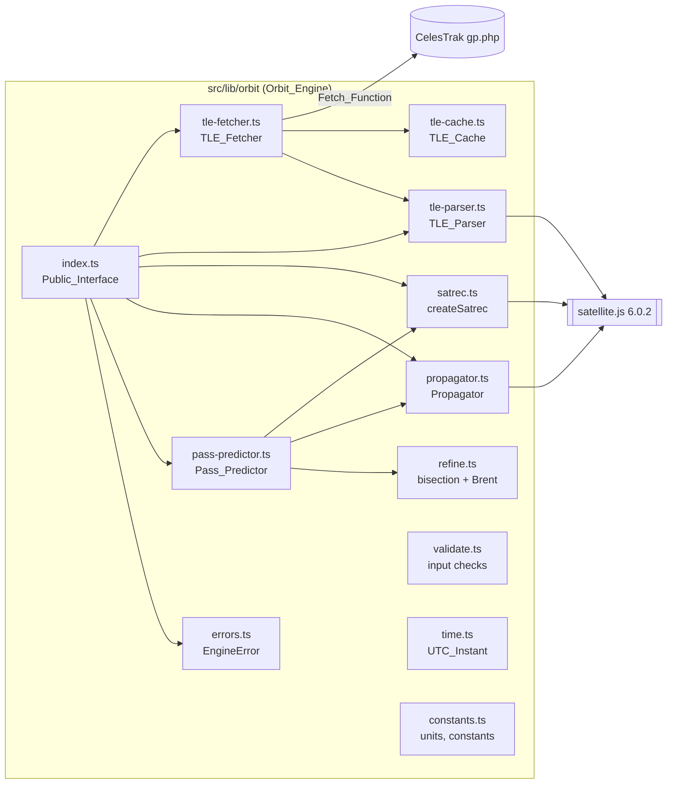

# Design Document: orbit-engine

## Overview

This spec delivers two things:

1. **Project_Scaffold**: a hand-written Next.js 16 + React 19 + TypeScript (strict) project. It has one root layout, one placeholder page, Vitest 5 + fast-check for tests, and pnpm 10 as the only package manager (D26). The scaffold is written by hand instead of with `create-next-app`, because the template imports `next/font/google`, which downloads fonts at build time (Requirement 1, criterion 21).
2. **Orbit_Engine**: a framework-independent TypeScript library in `src/lib/orbit`. It fetches one TLE per NORAD catalog number from CelesTrak, parses and validates it, keeps it in an in-memory cache, propagates it with satellite.js 6.0.2 (SGP4), computes look angles and slant-range rate, and predicts passes. Pass boundaries are refined by bisection and peaks by Brent's method on a whole-millisecond grid.

The engine imports only `satellite.js` and its own modules. It uses no DOM or Node.js globals and reads no local time. All instants it returns are numbers of milliseconds since 1970-01-01T00:00:00Z (UTC). Every failure other than an SGP4 propagation error is an `EngineError` with one of five categories. SGP4 propagation errors are returned as a `{ ok: false }` result, so the Pass_Predictor can treat them as "not above Min_Elevation".

Normative inputs: sections 2 and 4 of `docs/reference/TECHNICAL_ROUTE.md`, with the overrides listed in requirements.md (C25, C77, C78, C80, C86 superseded; P10 normative). The facts that the requirements cite as verified on 2026-11-14 (Node v22.19.0, satellite.js 6.0.2) are the basis of the numeric choices below.

## Architecture



Data flow for a caller in a later spec:

1. `createTleFetcher().fetchTle(25544)` returns a frozen `TleRecord` (from the cache or from CelesTrak).
2. `predictPasses({ observer, tle, start })` returns the passes of the next 24 hours.
3. During a pass, `observeAt(createSatrec(tle), Date.now(), observer)` gives Azimuth, Elevation, Slant_Range and Range_Rate.

### Module layout

| Module (`src/lib/orbit/…`) | Content | Imports |
|---|---|---|
| `index.ts` | The only entry module. Re-exports the Public_Interface listed under "Public_Interface". | engine modules |
| `errors.ts` | `EngineError`, `EngineErrorCategory`, `isEngineError` | none |
| `constants.ts` | Physical constants, URLs, TTL, timeouts, grid steps, `radToDeg` | none |
| `time.ts` | `toTimeMs` (UTC_Instant validation and normalisation), `isoOf` for messages | `errors` |
| `validate.ts` | `assertObserver`, `assertTleRecord`, `assertSatrec` | `errors` |
| `tle-parser.ts` | `parseTle` | `satellite.js`, `errors`, `constants` |
| `tle-cache.ts` | `TleCache` (internal, not exported from `index.ts`) | none |
| `tle-fetcher.ts` | `createTleFetcher` | `tle-cache`, `tle-parser`, `time`, `errors`, `constants` |
| `satrec.ts` | `createSatrec` | `satellite.js`, `validate`, `errors` |
| `propagator.ts` | `propagateAt`, `observeAt`, `normalizeAzimuthDeg`; internal `propagateMs`, `observeMs`, `prepareObserver` | `satellite.js`, `time`, `validate`, `constants` |
| `refine.ts` | `coarseScanInstants`, `bisectCrossing`, `maximizeOnGrid` (pure; the last two operate on a supplied predicate or score function) | `constants` |
| `pass-predictor.ts` | `predictPasses` | `propagator`, `satrec`, `refine`, `time`, `validate`, `errors`, `constants` |

Every file under `src/lib/orbit` is an Engine_Source_Module. Tests, fixtures and test helpers live under `tests/`, never under `src/lib/orbit`. That keeps the source scan of Requirement 14, criterion 12 simple: it checks every source file under `src/lib/orbit`.

Engine modules use extensionless relative imports (`./errors`), which `moduleResolution: "bundler"` resolves for Next.js, Vitest and `tsc`.

## Design Decisions

The requirements leave these points to the design. Each one is fixed here.

| ID | Topic | Decision | Requirements |
|---|---|---|---|
| D1 | TLE checksum (C17) | The TLE_Parser does **not** verify the modulo-10 checksum. C17 stays as written. Mutated test fixtures therefore need no recomputed checksum. Non-TLE bodies are rejected by the structural checks of Requirement 4. | 4.11–4.17, 4.21–4.23 |
| D2 | Output form of instants | Every point in time in a result is a `number` of milliseconds since 1970-01-01T00:00:00Z. `EPOCH` is the exact value of formula 2.9.1 and can carry a fractional millisecond (ISS: …430.048 ms). All other returned instants (`timeMs`, `riseMs`, `peakMs`, `setMs`) are integers. Numbers keep frozen records deeply immutable; a `Date` inside a frozen object could still be changed with `setTime`. | 2.8, 5.11 |
| D3 | Input instants | `toTimeMs(value)` accepts a `Date` (any realm, read with `Date.prototype.getTime.call`) whose time value is not NaN, or a finite `number` with absolute value ≤ 8.64 × 10¹⁵. A number is truncated toward zero as `new Date(value)` does (`Math.trunc(value) + 0`, which also turns −0 into +0). Everything else is `invalid-input`. A `Date` and the number equal to its time value therefore give the same integer and identical results. | 2.4, 2.9, 6.6, 9.10 |
| D4 | Engine_Error | `class EngineError extends Error` with `name = 'EngineError'`, `category: EngineErrorCategory`, `status?: number` (category `http` only) and the standard ES2022 `cause` (set whenever a cause exists, even when the cause value is `undefined`). Category identifiers: `'invalid-input' \| 'network' \| 'http' \| 'invalid-tle' \| 'catalog-mismatch'`. Messages use only numbers and `toISOString()`, never local-time formatting. | 2.5, 2.7, 3.8, 3.9 |
| D5 | Propagation-failure result | Discriminated union on `ok`. `{ ok: false, timeMs, gmstRad, satrecError }` carries no position, velocity, look angles or range rate. | 6.3, 6.5, 6.12 |
| D6 | Field names | `TleRecord` uses the section 4.2 names in upper case plus `OBJECT_NAME`, `TLE_LINE1`, `TLE_LINE2`, `SEMIMAJOR_AXIS_KM`, `ALTITUDE_KM`. `Pass` uses `riseMs`, `peakMs`, `setMs`, `maxElevationDeg`, `durationMin`, `startTruncated`, `endTruncated`. Other outputs carry the unit in the name (`azimuthDeg`, `slantRangeKm`, `rangeRateKmPerS`, `gmstRad`). | 2.6, 4.18, 9.4, 11.3, 11.4 |
| D7 | Azimuth normalisation helper | `normalizeAzimuthDeg(azimuthDeg: number): number`, exported. It takes degrees, because Requirement 2, criterion 6 puts every angle except GMST in degrees at the Public_Interface. | 7.8, 7.10 |
| D8 | Radian-to-degree conversion | `radToDeg(x) = (x / Math.PI) * 180`. It maps `Math.PI / 2` to exactly 90 and `2 * Math.PI` to exactly 360 (verified with Node v22.19.0), and it is monotone. So C37's 2π becomes 360°, which `normalizeAzimuthDeg` maps to exactly 0°, and every Elevation stays in [−90°, +90°]. | 7.2, 7.3, 7.8 |
| D9 | TTL | `TLE_CACHE_TTL_MS = 7_200_000` (2 h), CelesTrak's GP update interval. | 5.2 |
| D10 | Request_Timeout | `REQUEST_TIMEOUT_MS = 15_000`. It covers the Fetch_Function call and the body read. | 3.16 |
| D11 | Cache_Clock | Option `now?: () => Date \| number` of `createTleFetcher`, default `() => Date.now()`. Each reading goes through `toTimeMs`. Tests pass a closure over a variable they set. | 5.8, 5.10, 5.12 |
| D12 | In-flight dedupe and abort | One `Map<number, Promise<TleRecord>>` per fetcher. The promise is registered synchronously inside `fetchTle`; the request body (which calls the Fetch_Function) starts in a microtask after registration. Each request owns an `AbortController` and a `setTimeout` timer. The exchange is raced against a timeout promise, so the timeout also ends a request whose Fetch_Function ignores the signal. The map entry is removed in the request's `finally` block, which runs before any caller's continuation, so a retry from a caller's `catch` starts a new request. | 3.16, 5.6, 5.7 |
| D13 | Whole-millisecond evaluation | The Pass_Predictor evaluates Elevation only at integer milliseconds. Bisection midpoints are `lo + Math.floor((hi − lo) / 2)`; Brent trial points are rounded to integers. Stopping rules are expressed in integer milliseconds: crossing brackets ≤ 1000 ms, peak brackets ≤ 100 ms. Reported instants are evaluated instants, so no rounding happens after refinement. | 9.7, 10.2, 10.3, 10.11, 12.2, 12.5, 12.6 |
| D14 | Window end | `windowEndMs = windowStartMs + Math.round(durationHours * 3_600_000)`, then validated with the ±8.64 × 10¹⁵ ms limit. | 9.6, 9.10 |
| D15 | Peak selection | Brent's method only approaches a bracket end, so the reported peak is the argmax over **every evaluated instant** of the peak search, including both bracket ends, restricted to [Rise_Instant, Set_Instant] for coarse-scan passes. Ties go to the earliest instant. | 9.6, 10.8, 11.5 |
| D16 | Reported crossing | A rise is the "above" end of its final bracket (first instant known above Min_Elevation). A set is the "not above" end of its final bracket (first instant known not above), matching the Brute_Force_Pass definition of rise and set. | 10.11, 10.5, 10.6 |
| D17 | Optional TLE fields | The `TleRecord` omits BSTAR, MEAN_MOTION_DOT, MEAN_MOTION_DDOT, ELEMENT_SET_NO, REV_AT_EPOCH, EPHEMERIS_TYPE and CLASSIFICATION_TYPE. Requirement 4, criterion 10 is a WHERE clause; leaving them out avoids the placeholder values of P13. SGP4 always uses the raw lines. | 4.10, 6.1 |
| D18 | Error precedence | Input checks (`invalid-input`) run before Satrec creation (`invalid-tle`). When an input is both malformed and carries rejected TLE lines, the error is `invalid-input`. The check order inside each function is fixed, so the category and message are deterministic. | 2.7, 9.12, 9.15 |
| D19 | Live_Test_Variable | `ZOMBIESAT_LIVE_TEST`. | 14.3–14.5 |
| D20 | Test timeouts | Hooks and tests that compute a Brute_Force_Reference over ≥ 24 h: 120 000 ms. Property tests of the Pass_Predictor and the time-zone test: 60 000 ms. Live_Test: 30 000 ms (twice the Request_Timeout). Everything else: Vitest default 5 000 ms. | 14.11 |
| D21 | fast-check | Every property runs `fc.assert(…, { numRuns: N })` with N ≥ 100 (100 for Pass_Predictor properties, 200 for cheap pure properties). fast-check prints the seed, path and counterexample of a failing run by default; a run is reproduced with `{ seed, path }`. Async properties are awaited (Vitest 5 fails unawaited async assertions). | 14.7 |
| D22 | Built-in `fetch` blocker | A Vitest setup file replaces `globalThis.fetch` with a recording blocker at load time and fails any test during which the blocker was called. The Live_Test temporarily installs the saved built-in. | 14.1, 14.2, 14.4 |
| D23 | Time-zone repeat | One test file switches `process.env.TZ` between `'UTC'` and `'Asia/Shanghai'` inside the worker process (`pool: 'forks'`, so `process.env` is the real environment), asserts the UTC offsets 0 and −480 min, and compares outputs. Node applies a runtime `TZ` assignment immediately (verified on the Windows developer machine with v22.19.0: offsets −480, 0 and 300 min for 2026-11-09T00:00:00Z after assigning `Asia/Shanghai`, `UTC` and `America/New_York`). The offset assertions of Requirement 14, criterion 10 make the test fail on any platform where the switch does not take effect. | 14.8, 14.10 |
| D24 | Source scan | The scan walks every source file under `src/lib/orbit` and parses it with the TypeScript compiler API, so comments and string contents cannot cause false matches. | 14.12, 2.2, 2.10 |
| D25 | TypeScript version | `typescript ^5.9.3` (5.x only). The `latest` dist-tag of `typescript` on the package registry is 7.0.2 (the native compiler); the 5.x line keeps the JavaScript compiler API that the source scan, the scaffold test and Next.js type checking use. | 1.3, 1.18, 14.12 |
| D26 | Package manager | pnpm 10, pinned as `"packageManager": "pnpm@10.30.3"` in package.json. `pnpm-lock.yaml` is the only lock file. A fresh clone installs with `pnpm install --frozen-lockfile`. Scripts run as `pnpm <script>` and binaries as `pnpm exec <bin>`. pnpm 10 does not run the build scripts of dependencies unless they are allowed, so package.json has no `pnpm.onlyBuiltDependencies` entry unless a command fails without it; the entry is then added and listed in this row. `auto-install-peers` (the pnpm default) installs the `vite` peer dependency of Vitest 5. `pnpm-lock.yaml` stores no registry host for registry packages, so a developer's registry mirror does not leak into the lock file. The project owner chose pnpm on 2026-11-15; it replaces npm, which the first version of this design used. Requirement 1, criterion 7 (one package manager, no lock file of another) holds unchanged. | 1.4–1.7, 1.12, 1.13 |

## Components and Interfaces

### Errors (`errors.ts`)

```typescript
export type EngineErrorCategory =
  | 'invalid-input'
  | 'network'
  | 'http'
  | 'invalid-tle'
  | 'catalog-mismatch';

export interface EngineErrorOptions {
  readonly cause?: unknown;   // copied to Error.cause when the key is present
  readonly status?: number;   // HTTP status, category 'http' only
}

export class EngineError extends Error {
  override readonly name = 'EngineError';
  readonly category: EngineErrorCategory;
  readonly status: number | undefined;
  constructor(category: EngineErrorCategory, message: string, options?: EngineErrorOptions);
}

export function isEngineError(value: unknown): value is EngineError; // instanceof check
```

The constructor calls `super(message, options !== undefined && 'cause' in options ? { cause: options.cause } : undefined)`, so a rejection reason of `undefined` is still recorded as the cause.

### Time and constants (`time.ts`, `constants.ts`)

```typescript
export type TimeInput = Date | number;

/** Internal. Validates a UTC_Instant (D3) and returns its integer time value in ms. */
export function toTimeMs(value: unknown, label: string): number;
```

`toTimeMs` throws `EngineError('invalid-input')` for an Invalid Date, a number that is NaN or ±∞ or whose absolute value exceeds 8.64 × 10¹⁵, and any value that is neither a `Date` nor a `number` (strings such as ISO 8601 text, `null`, `undefined`, plain objects). The message names the parameter (`label`) and the received kind, never a local-time rendering.

| Constant | Value | Source |
|---|---|---|
| `MU_KM3_PER_S2` | 398600.4418 | C19, 2.9.7 |
| `WGS84_A_KM` | 6378.137 | C19, C29 |
| `EARTH_ROTATION_RATE_RAD_PER_S` | 7.292115 × 10⁻⁵ | Glossary Earth_Rotation_Rate |
| `MAX_TIME_MS` | 8.64 × 10¹⁵ | ECMAScript time range |
| `CELESTRAK_GP_URL` | `https://celestrak.org/NORAD/elements/gp.php` | Glossary |
| `TLE_CACHE_TTL_MS` (exported) | 7 200 000 | D9 |
| `REQUEST_TIMEOUT_MS` (exported) | 15 000 | D10 |
| `COARSE_STEP_MS` | 60 000 | Req 10.1 |
| `CROSSING_BRACKET_MS` | 1 000 | Req 10.2, 12.5, 12.6 |
| `PEAK_BRACKET_MS` | 100 | Req 10.3 |
| `DEFAULT_WINDOW_HOURS` / `MAX_WINDOW_HOURS` | 24 / 168 | C81, Req 9.2, 9.8 |
| `DEFAULT_MIN_ELEVATION_DEG` | 0 | Req 9.3 |

`radToDeg(x) = (x / Math.PI) * 180` (D8). Degrees to radians use satellite.js `degreesToRadians`.

### TLE_Parser (`tle-parser.ts`)

```typescript
export function parseTle(text: string): TleRecord; // frozen result, throws EngineError
```

A non-string argument gives `invalid-input`. Every other rejection is `invalid-tle`. The checks run in this order; the first failing check determines the message:

1. Split `text` on `\n`. Apply `trimEnd()` to each line, which removes trailing spaces, tabs and `\r` (criterion 2). Keep the non-empty lines in their original order (criterion 20).
2. Exactly three non-empty lines, otherwise reject (criterion 11; covers `No GP data found`, the empty body, `[]`, two-line TLEs and multi-TLE bodies, criterion 17). They are the name line, line 1 and line 2.
3. Line 1 starts with `1 ` and line 2 with `2 ` (criterion 12).
4. Both lines are exactly 69 characters long (criterion 13).
5. `line1[2:7]`, `line2[2:7]`, `line1[18:20]` and `line2[26:33]` match `/^[0-9]+$/` (criterion 14).
6. `Number(line1[2:7]) === Number(line2[2:7])` (criterion 15).
7. After removing leading and trailing U+0020 characters, `line1[20:32]`, `line2[8:16]`, `line2[17:25]`, `line2[34:42]`, `line2[43:51]` and `line2[52:63]` match `/^[0-9]*\.?[0-9]*$/` and contain at least one digit (criterion 21).
8. `MEAN_MOTION !== 0` (criterion 22).
9. `twoline2satrec(line1, line2)` neither throws nor sets a non-zero `error` (criterion 16), its `no` is finite, and `propagate(satrec, new Date(EPOCH))` returns a non-null result whose six position and velocity components are finite (criterion 23).

Field computation (criteria 3–9, 24):

| Field | Computation |
|---|---|
| `OBJECT_NAME` | name line `.trim()` |
| `TLE_LINE1`, `TLE_LINE2` | the trimmed-end lines, 69 characters each |
| `NORAD_CAT_ID` | `Number(line1[2:7])` (`00005` → 5) |
| `OBJECT_ID` | `line1[9:17]` without surrounding spaces (`98067A`) |
| `EPOCH` | `yy = Number(line1[18:20])`; `year = yy < 57 ? 2000 + yy : 1900 + yy`; `Date.UTC(year, 0, 0) + Number(dayText) * 86_400_000` (C02, 2.9.1); not rounded (D2) |
| `INCLINATION`, `RA_OF_ASC_NODE`, `ARG_OF_PERICENTER`, `MEAN_ANOMALY`, `MEAN_MOTION` | `Number(trimmed field text)` |
| `ECCENTRICITY` | `Number('0.' + line2[26:33])` |
| `SEMIMAJOR_AXIS_KM` | `n = MEAN_MOTION * 2π / 86400`; `Math.cbrt(MU_KM3_PER_S2 / (n * n))` (2.9.7) |
| `ALTITUDE_KM` | `SEMIMAJOR_AXIS_KM − 6378.137` (C19) |

The record is returned with `Object.freeze`. All its fields are primitives, so the freeze is deep (Requirement 5, criterion 11). The Satrec built in step 9 is discarded.

### TLE_Cache (`tle-cache.ts`, internal)

```typescript
interface CacheEntry {
  readonly record: TleRecord;   // frozen
  readonly storedAtMs: number;  // Cache_Clock reading when the request ended in a TleRecord
}

class TleCache {
  get(noradId: number): CacheEntry | undefined;
  set(noradId: number, entry: CacheEntry): void; // replaces any previous entry for noradId
  get size(): number;
}
```

A `Map` held in memory, created empty (criteria 1, 9). Entries are never deleted: an expired entry stays until a successful request replaces it, and a failed request leaves every entry untouched (criteria 4–6). Freshness is decided by the fetcher: an entry is fresh when `nowMs − storedAtMs < TLE_CACHE_TTL_MS`, which also treats a negative Entry_Age as fresh (criterion 12).

### TLE_Fetcher (`tle-fetcher.ts`)

```typescript
export type FetchFunction = (input: string, init: RequestInit) => Promise<Response>;

export interface TleFetcherOptions {
  readonly fetch?: FetchFunction;            // default: globalThis.fetch, read per request
  readonly now?: () => Date | number;        // Cache_Clock, default () => Date.now()
}

export interface TleFetcher {
  fetchTle(noradId: number): Promise<TleRecord>;
}

export function createTleFetcher(options?: TleFetcherOptions): TleFetcher;
```

`createTleFetcher` throws `invalid-input` when `options` is present but not an object, or when `fetch` or `now` is present but not a function. Each fetcher owns one `TleCache` and one in-flight map, so tests get an empty cache by creating a new fetcher.

`fetchTle(n)`, synchronous part (runs before the returned promise exists, so concurrent callers see a consistent state):

1. If `n` is not a `number` with `Number.isInteger(n) && 1 <= n && n <= 99999`, return a promise rejected with `invalid-input`. The Fetch_Function is not called (Requirement 3, criterion 7).
2. If the in-flight map holds `n`, return that same promise (Requirement 5, criterion 7). Every caller of one In_Flight_Request receives the same `TleRecord` object or the same `EngineError` object.
3. Read the Cache_Clock through `toTimeMs`; an invalid reading rejects with `invalid-input`. If the cache entry for `n` is fresh, return `Promise.resolve(entry.record)` (Requirement 5, criterion 3).
4. Otherwise create the request promise `p = Promise.resolve().then(() => runRequest(n))`, register `map.set(n, p)` and return `p`. Registration happens before the Fetch_Function is called, because `runRequest` starts in a later microtask (glossary In_Flight_Request).

`runRequest(n)`:

```text
url  = CELESTRAK_GP_URL + "?CATNR=" + String(n) + "&FORMAT=tle"     # Req 3.1, 3.2
init = { method: "GET", credentials: "omit", signal: controller.signal }  # no headers (3.3, 3.14)
fetchFn = options.fetch ?? globalThis.fetch      # read now (3.4, 3.5); called as a plain function
timer = setTimeout(() => { controller.abort(); rejectTimeout(networkError("timed out")) }, REQUEST_TIMEOUT_MS)
try:
    response = await race(callFetch(fetchFn, url, init), timeoutPromise)
        # sync throw or rejection          -> EngineError('network', cause = thrown value)   (3.8)
    if response is not an object with numeric status and function text:
        throw EngineError('network', cause = TypeError)                                   (3.15)
    if response.status !== 200:
        throw EngineError('http', status = response.status)    # body not read            (3.9)
    text = await race(response.text(), timeoutPromise)
        # throw/rejection or non-string     -> EngineError('network', cause)              (3.15)
    record = parseTle(text)                 # EngineError('invalid-tle') propagates       (3.10)
    if record.NORAD_CAT_ID !== n:
        throw EngineError('catalog-mismatch')                                             (3.11)
    cache.set(n, { record, storedAtMs: toTimeMs(now()) })                                 (5.5)
    return record                                                                         (3.6)
finally:
    clearTimeout(timer)
    if map.get(n) === p: map.delete(n)      # before any caller continuation runs (5.6, 5.7)
```

Notes:

- `fetchFn(url, init)` is called as a plain function (`const f = …; f(url, init)`), never as a method of the options object. Browsers throw "Illegal invocation" when `window.fetch` is called with a foreign `this`.
- The timeout promise has a no-op rejection handler attached, and `Promise.race` subscribes to every racer, so a racer that settles after the race (for example the aborted real `fetch`) never becomes an unhandled rejection.
- When the timer fires, the controller is aborted, the race rejects with `EngineError('network')`, the `finally` block removes the In_Flight_Request, and every waiting caller receives the same error (Requirement 3, criterion 16).
- Only a TleRecord whose NORAD_CAT_ID equals `n` is stored; nothing is stored for any error, including the NORAD_CAT_ID of a catalog-mismatch body (Requirement 5, criterion 6).

### Satrec factory (`satrec.ts`)

```typescript
export type { SatRec as Satrec } from 'satellite.js';
export function createSatrec(tle: TleRecord): Satrec;
```

1. `assertTleRecord(tle)` (`invalid-input`, Requirement 2, criterion 11).
2. `satrec = twoline2satrec(tle.TLE_LINE1, tle.TLE_LINE2)`, with the stored strings passed unchanged (Requirement 6, criterion 1). A thrown exception becomes `invalid-tle` with the exception as cause.
3. `satrec.error !== 0` → `invalid-tle` (Requirement 6, criterion 10). No other content check runs here: a Satrec with error code 0 but NaN elements is returned, and its propagations fail, which the Pass_Predictor turns into an empty list (Requirement 9, criterion 11).

### Input validation (`validate.ts`)

| Function | Accepts | Otherwise |
|---|---|---|
| `assertObserver(v)` | non-null object with `latitudeDeg` a finite `number` in [−90, 90], `longitudeDeg` a finite `number` in [−180, 180], `altitudeKm` a finite `number` | `invalid-input` (Requirement 7, criterion 4) |
| `assertTleRecord(v)` | non-null object whose `OBJECT_NAME`, `TLE_LINE1`, `TLE_LINE2`, `OBJECT_ID` are strings and whose `NORAD_CAT_ID`, `EPOCH`, `MEAN_MOTION`, `ECCENTRICITY`, `INCLINATION`, `RA_OF_ASC_NODE`, `ARG_OF_PERICENTER`, `MEAN_ANOMALY`, `SEMIMAJOR_AXIS_KM`, `ALTITUDE_KM` are of type `number` | `invalid-input` |
| `assertSatrec(v)` | non-null object with `typeof error === 'number'`, `typeof no === 'number'`, `typeof jdsatepoch === 'number'` and `method` equal to `'n'` or `'d'` | `invalid-input` |

`assertSatrec` checks types only, not values: a Satrec from a previous failed propagation keeps a non-zero `error`, and satellite.js 6.0.2 `sgp4` clears that flag at the start of every call (`satrec.error = SatRecError.None`, checked in the published `dist/satellite.es.js`), so rejecting it would break later evaluations. The same source shows that the per-call state `sgp4` writes into a deep-space Satrec is recomputed before use on every call, so results do not depend on the order of earlier evaluations.

### Propagator (`propagator.ts`)

```typescript
export interface Vec3 { readonly x: number; readonly y: number; readonly z: number }

export interface Observer {
  readonly latitudeDeg: number;   // WGS84 geodetic, north positive (C26)
  readonly longitudeDeg: number;  // east positive (C27)
  readonly altitudeKm: number;    // above the ellipsoid, km (C28)
}

export interface LookAngles {
  readonly azimuthDeg: number;    // [0, 360), 0 = north, clockwise (C37)
  readonly elevationDeg: number;  // [-90, 90], no refraction (C36)
  readonly slantRangeKm: number;  // C35
}

export interface PropagationSuccess {
  readonly ok: true;
  readonly timeMs: number;                 // integer evaluation instant
  readonly gmstRad: number;                // satellite.js gstime
  readonly eciPositionKm: Vec3;            // TEME (C20, C21)
  readonly eciVelocityKmPerS: Vec3;        // TEME
  readonly ecfPositionKm: Vec3;            // C23, C24
}

export interface PropagationFailure {
  readonly ok: false;
  readonly timeMs: number;
  readonly gmstRad: number;                // still reported (Req 6.3)
  readonly satrecError: number;            // satrec.error after the call (6 for ISS at EPOCH + 3650 d)
}

export type PropagationResult = PropagationSuccess | PropagationFailure;

export interface ObservationSuccess extends PropagationSuccess {
  readonly lookAngles: LookAngles;
  readonly rangeRateKmPerS: number;        // negative approaching, positive receding
}

export type ObservationResult = ObservationSuccess | PropagationFailure;

export function propagateAt(satrec: Satrec, instant: TimeInput): PropagationResult;
export function observeAt(satrec: Satrec, instant: TimeInput, observer: Observer): ObservationResult;
export function normalizeAzimuthDeg(azimuthDeg: number): number;
```

`propagateAt` runs `assertSatrec`, then `toTimeMs`, then the internal `propagateMs`. `observeAt` runs `assertSatrec`, `toTimeMs` and `assertObserver` before any propagation, so an invalid Observer gives `invalid-input` even at an instant where SGP4 would fail (Requirement 7, criterion 4).

`propagateMs(satrec, timeMs)`:

1. `date = new Date(timeMs)`; `gmstRad = gstime(date)`.
2. `pv = propagate(satrec, date)`. A thrown exception counts as a propagation failure.
3. Return `PropagationFailure` when `pv` is `null`, `pv.position` or `pv.velocity` is not an object, `satrec.error !== 0`, or any of the six components is not finite (Requirement 6, criterion 5).
4. `ecf = eciToEcf(pv.position, gmstRad)`. Return fresh `Vec3` copies of `pv.position`, `pv.velocity` and `ecf`, so the results are identical to satellite.js component by component (criteria 2, 4, 11).

`prepareObserver(observer)` converts the Observer once: `geodetic = { latitude: degreesToRadians(lat), longitude: degreesToRadians(lon), height: altitudeKm }` and `ecfKm = geodeticToEcf(geodetic)` (C29, C30). The Pass_Predictor reuses the prepared Observer for every evaluation.

`observeMs(satrec, timeMs, prepared)`:

1. `p = propagateMs(…)`; return `p` when `p.ok` is false.
2. `{ azimuth, elevation, rangeSat } = ecfToLookAngles(prepared.geodetic, p.ecfPositionKm)` (C34–C37; verified to reproduce section 4.3).
3. `azimuthDeg = normalizeAzimuthDeg(radToDeg(azimuth))`; `elevationDeg = Math.min(90, Math.max(-90, radToDeg(elevation)))`; `slantRangeKm = rangeSat`.
4. Range rate (Requirement 8), with θ = `p.gmstRad`, v = `p.eciVelocityKmPerS`, r = `p.ecfPositionKm`, ω = `EARTH_ROTATION_RATE_RAD_PER_S`:

```text
v_rot   = ( v.x·cosθ + v.y·sinθ,  −v.x·sinθ + v.y·cosθ,  v.z )      # Rz(−θ) of C24
v_ecf   = ( v_rot.x + ω·r.y,  v_rot.y − ω·r.x,  v_rot.z )          # v_rot − ω⊕ × r_ecf
d       = r − prepared.ecfKm
rangeRateKmPerS = (v_ecf · d) / slantRangeKm
```

The Earth-rotation term is what separates −2.1094 / +2.6384 / +0.7131 km/s from the rotate-only values −2.0392 / +2.7535 / +0.8120 km/s (Requirement 8, criterion 3).

`normalizeAzimuthDeg(deg)`: `r = deg % 360; w = r < 0 ? r + 360 : r; return (w >= 360 ? 0 : w) + 0`. It is the identity on [0, 360), maps 360 to exactly +0, maps every finite input into [0, 360), returns NaN for NaN or ±∞, and never throws. Together with D8, C37's 2π rad is reported as exactly 0° (Requirement 7, criterion 8).

### Pass_Predictor (`pass-predictor.ts`, `refine.ts`)

```typescript
export interface PassSearch {
  readonly observer: Observer;
  readonly tle: TleRecord;
  readonly start: TimeInput;           // window start
  readonly durationHours?: number;     // default 24, (0, 168]
  readonly minElevationDeg?: number;   // default 0, [-90, 90]
}

export interface Pass {
  readonly riseMs: number;             // Rise_Instant
  readonly peakMs: number;             // Peak_Instant
  readonly setMs: number;              // Set_Instant
  readonly maxElevationDeg: number;    // Maximum_Elevation
  readonly durationMin: number;        // (setMs - riseMs) / 60_000, not rounded (C79)
  readonly startTruncated: boolean;    // Start_Truncated
  readonly endTruncated: boolean;      // End_Truncated
}

export function predictPasses(search: PassSearch): Pass[];
```

#### Step 1: validation (D18 order)

1. `search` is a non-null object, otherwise `invalid-input`.
2. `assertObserver(search.observer)` (Requirement 9, criterion 12).
3. `assertTleRecord(search.tle)` (Requirement 2, criterion 11).
4. `S = toTimeMs(search.start, 'start')`; a missing start is `undefined` and fails here (Requirement 9, criterion 10).
5. `durationHours`: `=== undefined` gives 24. Otherwise it must be a finite `number` with `0 < h <= 168`. The test is `=== undefined`, not `??`, so `null` is rejected (Requirement 9, criteria 2 and 8).
6. `minElevationDeg`: `=== undefined` gives 0. Otherwise it must be a finite `number` in [−90, 90] (criteria 3 and 9).
7. `E = S + Math.round(h * 3_600_000)`; `|E| > 8.64 × 10¹⁵` gives `invalid-input` (criteria 6 and 10).
8. `satrec = createSatrec(search.tle)`; rejected lines give `invalid-tle` (criterion 15).

#### Step 2: elevation oracle

`elev(t)` evaluates `observeMs(satrec, t, prepareObserver(observer))` at an integer instant `t` and returns `elevationDeg`, or `null` for a propagation-failure result. Results are memoised per call in a `Map<number, number | null>`. Derived helpers:

- `above(t) = elev(t) !== null && elev(t) > minEl` (Requirement 9, criterion 11; strict comparison, Glossary Min_Elevation).
- `score(t) = elev(t) ?? -Infinity`, the quantity maximised by the peak search. A failure therefore never wins a comparison and is lower than every Elevation (Glossary Coarse_Scan_Maximum).

Because each reported `maxElevationDeg` is the memoised `elev(peakMs)`, and `observeAt` runs the same `observeMs` code at the same integer instant, the reported Maximum_Elevation equals the Propagator's Elevation at the Peak_Instant exactly (Requirement 9, criterion 7).

#### Step 3: Coarse_Scan (Requirement 10, criterion 1)

`c = coarseScanInstants(S, E)`: `c[0] = S`; `c[k] = S + k · 60 000` for k ≥ 1 while `c[k] < E`; finally `E` is appended when `E > S`. Let `m` be the last index. When `E === S` the scan is the single sample `[S]`.

#### Step 4: passes from runs of samples above Min_Elevation

Each maximal index range `[i, j]` with `above(c[k])` for every `k` in `[i, j]` yields one Pass:

| Item | Rule |
|---|---|
| Rise | `i = 0`: `riseMs = S`, `startTruncated = true` (Requirement 11, criteria 1 and 3). Otherwise `riseMs = bisectCrossing(above, c[i−1], c[i])`, `startTruncated = false`. |
| Set | `j = m`: `setMs = E`, `endTruncated = true` (Requirement 11, criteria 2 and 4). Otherwise `setMs = bisectCrossing(above, c[j], c[j+1])`, `endTruncated = false`. |
| Peak bracket | `h` = index in `[i, j]` with the highest `score(c[h])`, earliest on ties. Bracket `[c[h−1], c[h+1]]`; `[S, c[1]]` when `h = 0`; `[c[m−1], E]` when `h = m`; `[S, S]` when `m = 0` (Requirement 10, criteria 3, 9, 10). |
| Peak | `maximizeOnGrid(score, a, b, c[h])` returns every instant it evaluated, including `a`, `b` and `c[h]`. `peakMs` = argmax of `score` over those instants that lie in `[riseMs, setMs]`, earliest on ties (D15). `maxElevationDeg = elev(peakMs)`. |

`c[h]` is a candidate and lies in `[riseMs, setMs]`, so `maxElevationDeg ≥ score(c[h]) > minEl` (Requirement 9, criterion 13). It is also at least the Elevation of every other Coarse_Scan sample in `[riseMs, setMs]`: those are the run's samples, plus possibly the bracket ends `c[i−1]` or `c[j+1]`, which are not above Min_Elevation (Requirement 10, criterion 8). When a truncated Pass is highest at its window bound, the bound is the peak bracket end and a candidate, and the explicit comparison returns exactly the bound (Requirement 11, criterion 5; baselines 11.7 and 11.8).

#### Step 5: passes from Coarse_Scan_Maxima at or below Min_Elevation (Requirement 12)

Sample `k` is a Coarse_Scan_Maximum when `elev(c[k]) !== null`, `k = 0 || score(c[k]) > score(c[k−1])` and `k = m || score(c[k]) >= score(c[k+1])`. For every such `k` with `!above(c[k])`:

1. Bracket `lo = (k = 0 ? S : c[k−1])`, `hi = (k = m ? E : c[k+1])` (criterion 1).
2. `p` = argmax of `score` over the instants returned by `maximizeOnGrid(score, lo, hi)`, earliest on ties.
3. `!above(p)`: no Pass (criterion 7).
4. `above(p)`: report a Pass with `peakMs = p`, `riseMs = bisectCrossing(above, lo, p)`, `setMs = bisectCrossing(above, p, hi)`, both flags false (criteria 2, 5, 6; Requirement 11, criteria 3 and 4). Both bisections have a valid bracket because `lo` and `hi` are not above Min_Elevation: `lo` is either `c[0]` itself (k = 0), which is not above, or `c[k−1]`, whose score is lower than `score(c[k]) ≤ minEl`; `hi` is `c[m]` itself or `c[k+1]` with `score(c[k+1]) ≤ score(c[k]) ≤ minEl`.

#### Step 6: assembly

Passes from steps 4 and 5 are sorted by `riseMs`, and `durationMin = (setMs − riseMs) / 60_000` is attached. They never overlap and each Set_Instant is strictly earlier than the next Rise_Instant (Requirement 9, criterion 5):

- A run's interval lies in `(c[i−1], c[j+1]]`, and its neighbouring samples `c[i−1]` and `c[j+1]` are not above.
- A step-5 Pass lies in `(lo, hi]`, where `lo` and `hi` are samples adjacent to `c[k]` and are not above. A sample next to a sub-threshold Coarse_Scan_Maximum cannot be above: `c[k+1]` above would mean `score(c[k+1]) > minEl ≥ score(c[k])`, contradicting the maximum condition; the same holds for `c[k−1]`. Two such maxima are never adjacent samples.
- Every reported rise is the later end of a bracket whose earlier end is a sample, or the window start, that is not above; every reported set is at most the next sample. So `setMs ≤ c[q] < riseMs` of the next Pass for some sample `c[q]`.

Containment `S ≤ riseMs ≤ peakMs ≤ setMs ≤ E` follows because every bracket lies in `[S, E]`, and the peak is chosen inside `[riseMs, setMs]` (step 4) or brackets both crossings (step 5) (Requirement 9, criterion 6).

When every Coarse_Scan sample is above Min_Elevation, step 4 finds the single run `[0, m]`, which gives one Pass from `S` to `E` with both flags true (Requirement 11, criterion 6). When no instant is above Min_Elevation, including every call with `minElevationDeg = 90` (Elevation ≤ 90 by D8 and the clamp), steps 4 and 5 report nothing and the result is `[]` (Requirement 9, criterion 14).

#### Refinement primitives (`refine.ts`)

```typescript
/** Coarse_Scan instants of Requirement 10, criterion 1, for integer S <= E. */
export function coarseScanInstants(startMs: number, endMs: number): number[];

/** isAbove(lo) !== isAbove(hi), lo < hi, integers. Returns the later end of the final bracket. */
export function bisectCrossing(isAbove: (t: number) => boolean, lo: number, hi: number): number;

/** Maximises score on the integer instants of [a, b]; returns every instant evaluated. */
export function maximizeOnGrid(score: (t: number) => number, a: number, b: number, x0?: number): readonly number[];
```

`bisectCrossing`: while `hi − lo > 1000`: `mid = lo + Math.floor((hi − lo) / 2)`; if `isAbove(mid) === isAbove(lo)` then `lo = mid`, else `hi = mid`. Return `hi`. The final bracket is at most 1 s wide (Requirement 10, criterion 2; Requirement 12, criteria 5 and 6) and the returned instant is one of its ends (Requirement 10, criterion 11). For a rise `hi` is the first instant known above, for a set the first instant known not above (D16). A 60 s bracket takes 6 evaluations.

`maximizeOnGrid` is Brent's method for a maximum (successive parabolic interpolation safeguarded by golden-section steps, as in Brent's `localmin`) with these integer-grid adaptations:

1. Evaluate `score(a)` and `score(b)` first; they are always candidates (D15).
2. Start point `x = x0` when `a < x0 < b`, otherwise `x = a + Math.round(0.381966 · (b − a))` moved strictly inside `(a, b)`. Brent's state `w = v = x`, `d = e = 0`.
3. Loop while `b − a > 100` (Requirement 10, criterion 3):
   - Try a parabolic step through `(x, fx), (w, fw), (v, fv)` only when `x`, `w`, `v` are distinct, all three values are finite, and the step meets Brent's acceptance test (vertex inside `(a, b)`, `|step| < |e| / 2`). Otherwise take a golden-section step into the larger part of the bracket.
   - Round the trial point to an integer `u`. If `u` equals `x` or is not strictly inside `(a, b)`, use `x + 1` or `x − 1`, whichever is strictly inside `(a, b)`, preferring the step direction. Such a point always exists while `b − a > 100`, because `x` stays strictly inside the bracket.
   - Update `a, b, x, w, v` with Brent's rules, mirrored for a maximum: when `score(u) ≥ score(x)` the bracket shrinks to the side of `x` containing `u` and `u` becomes `x`; otherwise `u` replaces the bracket end on its side.
4. Return every evaluated instant.

Each iteration evaluates a new integer instant strictly inside the bracket, and the bracket shrinks by at least 1 ms, so the loop terminates. Brent's safeguard keeps a 120 s bracket at roughly 25–35 evaluations. The final bracket is at most 100 ms wide and contains Brent's best point `x`. A single three-point parabola on the 60 s grid gives 46.59° and 55.72° for ISS passes 2 and 6. The iterated search reaches the brute-force peaks of 48.6098° and 58.5919° within the ±0.5° of Requirement 10, criterion 4.

Cost of a 24 h call: 1 441 Coarse_Scan samples, about 6 evaluations per crossing, and about 30 per peak search for each Pass and each sub-threshold Coarse_Scan_Maximum (about one per orbit). That is roughly 2 500 SGP4 evaluations. A 168 h call is about 7 times that.

### Public_Interface (`index.ts`)

| Kind | Exports |
|---|---|
| Functions | `parseTle`, `createTleFetcher` (and the `fetchTle` method of its result), `createSatrec`, `propagateAt`, `observeAt`, `normalizeAzimuthDeg`, `predictPasses`, `isEngineError` |
| Classes | `EngineError` |
| Constants | `TLE_CACHE_TTL_MS`, `REQUEST_TIMEOUT_MS` |
| Types | `TimeInput`, `EngineErrorCategory`, `EngineErrorOptions`, `TleRecord`, `FetchFunction`, `TleFetcher`, `TleFetcherOptions`, `Satrec`, `Vec3`, `Observer`, `LookAngles`, `PropagationSuccess`, `PropagationFailure`, `PropagationResult`, `ObservationSuccess`, `ObservationResult`, `PassSearch`, `Pass` |

`TleCache`, `toTimeMs`, the `assert*` validators, `propagateMs`, `observeMs`, `prepareObserver`, `coarseScanInstants`, `bisectCrossing`, `maximizeOnGrid`, `radToDeg` and the other constants are internal. Tests import internals from their modules only where a property targets them directly (`refine.ts` for Properties 17–19, `constants.ts` for `radToDeg` in Property 10).

## Data Models

```typescript
export interface TleRecord {
  readonly OBJECT_NAME: string;        // "ISS (ZARYA)"
  readonly TLE_LINE1: string;          // 69 characters, no terminator
  readonly TLE_LINE2: string;          // 69 characters, no terminator
  readonly NORAD_CAT_ID: number;       // 25544
  readonly OBJECT_ID: string;          // "98067A" (raw TLE form)
  readonly EPOCH: number;              // ms since 1970-01-01T00:00:00Z, formula 2.9.1, may be fractional
  readonly MEAN_MOTION: number;        // rev/day
  readonly ECCENTRICITY: number;       // dimensionless
  readonly INCLINATION: number;        // deg
  readonly RA_OF_ASC_NODE: number;     // deg
  readonly ARG_OF_PERICENTER: number;  // deg
  readonly MEAN_ANOMALY: number;       // deg
  readonly SEMIMAJOR_AXIS_KM: number;  // km, formula 2.9.7
  readonly ALTITUDE_KM: number;        // km, semi-major-axis altitude (C19)
}
```

Baseline values (section 4.2): ISS EPOCH `Date.UTC(2026, 0, 0) + 312.17541007 × 86 400 000` ≈ 1 794 111 155 430.048 ms (2026-11-08T04:12:35.430Z), semi-major axis 6797.04 km, altitude 418.9 km; ZHIHUI TIANWANG-1 01A EPOCH 2026-11-07T05:17:58.466Z, 26560.56 km, 20182.4 km.

Units at the Public_Interface (Requirement 2, criterion 6): degrees for every angle except `gmstRad`; kilometres for positions, distances and altitudes; km/s for velocities and range rate; hours for `durationHours`; minutes for `durationMin`; milliseconds for instants and for `TLE_CACHE_TTL_MS` and `REQUEST_TIMEOUT_MS`.

Mutability: `TleRecord` values are frozen. Results of `propagateAt`, `observeAt` and `predictPasses` are fresh plain objects per call, so callers can modify them without affecting the engine.

## Error Handling

Every failure other than an SGP4 propagation error is thrown (synchronous functions) or rejected (`fetchTle`) as an `EngineError` with exactly one category (Requirement 2, criterion 7).

| Condition | Category | Reported by | Requirements |
|---|---|---|---|
| Instant is not a `Date` or `number`, is an Invalid Date, NaN, ±∞ or outside ±8.64 × 10¹⁵ ms | `invalid-input` | `propagateAt`, `observeAt`, `predictPasses` (start), Cache_Clock readings | 2.9, 6.6, 9.10 |
| Value given as Satrec, TleRecord or Observer fails its structural check | `invalid-input` | `propagateAt`, `observeAt`, `createSatrec`, `predictPasses` | 2.11, 7.4, 9.12 |
| `durationHours` or `minElevationDeg` present and invalid; window end outside the Date range | `invalid-input` | `predictPasses` | 9.8, 9.9, 9.10 |
| `search`, fetcher `options`, `options.fetch` or `options.now` of the wrong type; `parseTle` argument not a string | `invalid-input` | `predictPasses`, `createTleFetcher`, `parseTle` | 2.7 |
| NORAD catalog number not an integer `number` in 1..99999 | `invalid-input`, Fetch_Function not called | `fetchTle` | 3.7 |
| Fetch_Function throws or rejects | `network`, `cause` = thrown value or reason | `fetchTle` | 3.8 |
| Fetch_Function resolves with a non-response value; `text()` throws, rejects or yields a non-string | `network`, `cause` = underlying error | `fetchTle` | 3.15 |
| Request_Timeout (15 s) elapses before the body is read | `network`, request aborted, all waiting callers | `fetchTle` | 3.16 |
| HTTP status other than 200 (403 rate limit included), body ignored | `http`, `status` set | `fetchTle` | 3.9 |
| Body rejected by the TLE_Parser | `invalid-tle` | `fetchTle`, `parseTle` | 3.10, 4.11–4.17, 4.21–4.23 |
| Parsed NORAD_CAT_ID differs from the requested number | `catalog-mismatch` | `fetchTle` | 3.11 |
| `twoline2satrec` throws or sets a non-zero error code | `invalid-tle` | `parseTle`, `createSatrec`, `predictPasses` | 4.16, 6.10, 9.15 |
| SGP4 propagation fails (null result, error code, non-finite component, exception) | no error: `PropagationFailure`; the Pass_Predictor treats the instant as not above Min_Elevation | `propagateAt`, `observeAt`, `predictPasses` | 6.5, 6.12, 9.11 |

No fetch error changes the TLE_Cache (Requirement 5, criterion 6). An error ends the In_Flight_Request, so the next request for the same number sends a new HTTP request.

Messages are deterministic and time-zone independent: they contain parameter names, numbers, NORAD numbers, HTTP status codes and `toISOString()` renderings, and nothing from `toString()`, `toLocaleString()` or `getTimezoneOffset()` (Requirement 2, criterion 5).

### Known limitations

The three limitations of requirements.md apply unchanged: a dip at or below Min_Elevation shorter than 60 s between two Coarse_Scan samples above it is not detected; the 1 s Brute_Force_Reference can understate a zenith peak; Look_Angles at Slant_Range 0 are unspecified. In addition:

- Whether a Pass exists is a threshold decision. When a peak lies within the peak-refinement error of Min_Elevation (about 10⁻⁵° for the ISS, from the 100 ms final bracket), two runs with shifted windows can disagree about that one Pass (Requirement 12, criterion 4). Randomly generated Min_Elevation values hit such a peak with probability below 10⁻⁴ per run. If the property test ever fails for that reason, fast-check reports the seed, and the counterexample will show a Maximum_Elevation within 10⁻⁴° of Min_Elevation.

## Project Scaffold

### Files

| Path | Content |
|---|---|
| `package.json` | manifest with scripts, dependencies and the `packageManager` pin (below) |
| `pnpm-lock.yaml` | committed lock file, tracked in git, the only lock file (Requirement 1, criteria 5, 6, 12) |
| `tsconfig.json` | TypeScript configuration (below) |
| `next.config.ts` | `import type { NextConfig } from 'next'; const nextConfig: NextConfig = {}; export default nextConfig;` |
| `vitest.config.ts` | Vitest configuration (below) |
| `.gitignore` | `node_modules/`, `.next/`, `out/`, `next-env.d.ts`, `*.tsbuildinfo`, `.vitest/`, `coverage/`, `.env*.local` |
| `README.md` | project description, origin statements, commands (below) |
| `src/app/layout.tsx` | root layout with static `metadata` |
| `src/app/page.tsx` | placeholder page at `/` |
| `src/lib/orbit/*.ts` | Orbit_Engine |
| `tests/**` | Test_Suite (see Testing Strategy) |

There is no `public/` folder, no CSS file, no favicon and no other component or route (Requirement 1, criterion 19). `pnpm-lock.yaml` is the only lock file: `package-lock.json`, `npm-shrinkwrap.json`, `yarn.lock`, `bun.lock` and `bun.lockb` do not exist. The `packageManager` field of package.json is `pnpm@10.30.3` (criterion 7, D26).

### package.json

```json
{
  "name": "zombie-satellite",
  "version": "0.1.0",
  "private": true,
  "description": "Pass predictions for a fixed catalog of seven zombie satellites, computed from public CelesTrak TLE data.",
  "packageManager": "pnpm@10.30.3",
  "engines": { "node": ">=22.12.0" },
  "scripts": {
    "dev": "next dev",
    "build": "next build",
    "start": "next start",
    "test": "vitest run",
    "typecheck": "tsc --noEmit"
  },
  "dependencies": {
    "next": "^16.4.6",
    "react": "^19.x.y",
    "react-dom": "^19.x.y",
    "satellite.js": "6.0.2"
  },
  "devDependencies": {
    "@types/node": "^22.x.y",
    "@types/react": "^19.x.y",
    "@types/react-dom": "^19.x.y",
    "fast-check": "^4.10.2",
    "typescript": "^5.9.3",
    "vitest": "^5.1.0"
  }
}
```

- Versions are installed with `pnpm add next@16 react@19 react-dom@19`, `pnpm add --save-exact satellite.js@6.0.2` and `pnpm add -D vitest@5 fast-check@4 typescript@5.9 @types/node@22 @types/react@19 @types/react-dom@19`; `x.y` stands for the versions pnpm records. A caret range `^16.a.b` admits only major 16, `^19.c.d` only major 19, and `^5.9.3` excludes TypeScript 7 (criteria 1, 2, 4).
- `engines.node` `>=22.12.0` admits v22.19.0 and every later version and nothing below 22.0.0 (criterion 8). 22.12.0 is the minimum of Vitest 5.
- `packageManager` pins pnpm to `10.30.3` (D26, criterion 7). The manifest has no `pnpm` section unless D26 lists an entry for it.
- Vitest 5 declares `vite` as a peer dependency, which pnpm 10 installs through `auto-install-peers` (the pnpm default) and records in `pnpm-lock.yaml` (D26).
- pnpm runs scripts through cmd.exe on Windows (its default `script-shell`), even when the developer starts them from PowerShell, and through a POSIX shell elsewhere. Every script is therefore a single command with arguments: no environment assignments, variable expansion, `rm`/`del` or shell operators, so cmd.exe and POSIX shells run them alike (criterion 13). `vitest run` runs once without watching (criterion 14). Vitest exits with 0 when every test passes or is skipped, and with a non-zero code on a failed test, a file that fails to load, an unhandled error, or (with `passWithNoTests: false`) no test file found (criteria 15, 16).

### tsconfig.json

```json
{
  "compilerOptions": {
    "target": "ES2022",
    "lib": ["dom", "dom.iterable", "esnext"],
    "allowJs": false,
    "skipLibCheck": true,
    "strict": true,
    "noEmit": true,
    "esModuleInterop": true,
    "module": "esnext",
    "moduleResolution": "bundler",
    "resolveJsonModule": true,
    "isolatedModules": true,
    "jsx": "react-jsx",
    "incremental": true,
    "plugins": [{ "name": "next" }],
    "paths": { "@/*": ["./src/*"] }
  },
  "include": ["next-env.d.ts", "**/*.ts", "**/*.tsx", "**/*.mts", ".next/types/**/*.ts", ".next/dev/types/**/*.ts"],
  "exclude": ["node_modules"]
}
```

`strict` is true and no strict-family option is set (criterion 3). The `include` patterns cover `src/`, `tests/`, `vitest.config.ts` and `next.config.ts`, so `pnpm run typecheck` checks every TypeScript file of the repository (criterion 18). `next-env.d.ts` and `.next/types` are generated by `next build`, which is why criterion 18 runs after the build. If `next build` adjusts `tsconfig.json`, the adjusted file is committed, so a second build leaves it unchanged.

### vitest.config.ts

```typescript
import { defineConfig } from 'vitest/config';

export default defineConfig({
  test: {
    include: ['tests/**/*.test.ts'],
    environment: 'node',
    pool: 'forks',
    setupFiles: ['./tests/setup/network-guard.ts'],
    passWithNoTests: false,
  },
});
```

`environment: 'node'` applies to every file, and no test file carries an `@vitest-environment` comment (criterion 11). `pool: 'forks'` runs test files in child processes whose `process.env` is the real environment, which D23 relies on.

### UI files

`src/app/layout.tsx` exports `metadata = { title: 'zombieSatellite', description: 'Pass predictions for seven zombie satellites from public TLE data.' }` and a `RootLayout` that renders `<html lang="en"><body>{children}</body></html>`. `src/app/page.tsx` renders a `<main>` with the heading `zombieSatellite` and the sentence "Orbit engine scaffold. The app interface arrives in later specs." Neither file has `'use client'`, data fetching, dynamic APIs, `next/font` or images, so `/` is prerendered at build time with fixed content and requests nothing in the browser (criteria 19–21).

### README.md

The README contains, in this order:

1. A description paragraph: "zombieSatellite is a mobile-first web app for the Kiroween 2026 hackathon (category Resurrection). It predicts passes of seven zombie satellites from public CelesTrak TLE data. Only the orbital data is real: the beacon sound of later versions is simulated, synthesized in the browser from public TLE data."
2. An "Origins" section with these two sentences, verbatim: "The coordinate conventions and numeric acceptance baselines come from the author's earlier personal project SatAware AR." and "All code in this repository was newly written during the Kiroween 2026 submission period." (criteria 22, 23).
3. Requirements (Node.js 22.12 or later, pnpm 10.30.3) and commands: `pnpm install --frozen-lockfile`, `pnpm test`, `pnpm run build`, `pnpm run typecheck` (after a build), `pnpm run dev`.
4. The live CelesTrak test: PowerShell `$env:ZOMBIESAT_LIVE_TEST = "1"; pnpm exec vitest run tests/orbit/live-celestrak.test.ts; Remove-Item Env:ZOMBIESAT_LIVE_TEST`, cmd.exe `set ZOMBIESAT_LIVE_TEST=1` then `pnpm exec vitest run tests/orbit/live-celestrak.test.ts`, POSIX shells `ZOMBIESAT_LIVE_TEST=1 pnpm exec vitest run tests/orbit/live-celestrak.test.ts`. These lines document shell usage and are not package.json scripts.

Every README paragraph or list item that mentions a beacon, signal, radio or transmission also says "simulated" or "synthesized" (criterion 24). No text in the README, package.json, metadata or rendered pages pairs a reception word (receive, capture, decode, listen, hear) with a radio term in one sentence, negated or not (criterion 25).

## Correctness Properties

*A property is a characteristic or behavior that should hold true across all valid executions of a system-essentially, a formal statement about what the system should do. Properties serve as the bridge between human-readable specifications and machine-verifiable correctness guarantees.*

The generators named here are described under "Testing Strategy". "Baseline Satrecs" are the Satrecs of the two Baseline_TLE_Snapshots; "elev(t)" in a property is the `elevationDeg` that `observeAt` returns at `t`, or `null` for a propagation-failure result.

### Property 1: TLE text normalisation invariance

*For any* accepted TLE (the two Baseline_TLE_Snapshots and generated TLEs) and *for any* rendering of it that pads the name line with leading and trailing spaces or tabs, appends any mix of spaces, tabs and `\r` to each line, uses LF or CRLF per line, inserts empty or whitespace-only lines before, between or after the three lines, and optionally ends with a line terminator, `parseTle(rendering)` deep-equals `parseTle(name + '\n' + line1 + '\n' + line2)`, its `OBJECT_NAME` equals the trimmed name, and its `TLE_LINE1`/`TLE_LINE2` are the 69-character lines without trailing whitespace.

**Validates: Requirements 4.1, 4.2, 4.3, 4.20**

### Property 2: Column model of the TLE fields

*For any* TLE generated by formatting random field values into the C18 columns (NORAD 1–99999 zero-padded, international designator, epoch year 00–99, epoch day, inclination, RAAN, eccentricity digits, argument of perigee, mean anomaly, mean motion > 0), `parseTle` either rejects it with `invalid-tle` exactly when satellite.js `twoline2satrec` reports a non-zero error code or `propagate` at the model EPOCH returns no finite state, or returns a frozen record whose fields equal the model exactly: `NORAD_CAT_ID = Number(noradText)`, `OBJECT_ID` = trimmed designator, `EPOCH = Date.UTC(year, 0, 0) + Number(dayText) × 86 400 000` with the C02 century rule, `INCLINATION`, `RA_OF_ASC_NODE`, `ARG_OF_PERICENTER`, `MEAN_ANOMALY`, `MEAN_MOTION` equal to `Number(trimmed text)`, `ECCENTRICITY = Number('0.' + digits)`, `SEMIMAJOR_AXIS_KM` and `ALTITUDE_KM` within 10⁻⁹ km of formula 2.9.7 and C19, and every instant field of type `number`.

**Validates: Requirements 2.8, 4.4, 4.5, 4.6, 4.7, 4.8, 4.9, 4.24, 5.11**

### Property 3: Malformed TLE text is rejected

*For any* accepted TLE text and *for any* mutation from the mutation generator (remove the name line, add a fourth non-empty line, append a second TLE, change the `1 ` or `2 ` prefix, make a line 68 or 70 characters long, put a non-digit or a space into a NORAD, epoch-year or eccentricity field, give line 2 a different NORAD number, replace a decimal field of criterion 21 with a blank, a sign, an exponent, a letter or a second decimal point, set the mean motion to zero), `parseTle` throws an `EngineError` of category `invalid-tle`, and `fetchTle` for the NORAD number of the original text rejects with category `invalid-tle` when a status-200 Fetch_Function returns the mutated text as its body.

**Validates: Requirements 2.7, 3.10, 4.11, 4.12, 4.13, 4.14, 4.15, 4.21, 4.22**

### Property 4: Invalid instants are rejected

*For any* value from the invalid-instant generator (NaN, ±∞, numbers with absolute value above 8.64 × 10¹⁵, `new Date(NaN)`, ISO 8601 and numeric strings, `null`, `undefined`, booleans, bigints, plain objects, arrays), `propagateAt(baselineSatrec, v)`, `observeAt(baselineSatrec, v, referenceObserver)` and `predictPasses({ …, start: v })` throw an `EngineError` of category `invalid-input`; and *for any* valid start within 168 h of +8.64 × 10¹⁵ ms and duration whose window end exceeds that limit, `predictPasses` throws `invalid-input`.

**Validates: Requirements 2.7, 2.9, 6.6, 9.10**

### Property 5: Invalid structured inputs are rejected

*For any* value that is not a Satrec, TleRecord or Observer by the structural checks of `validate.ts` (values from `fc.anything()`, and valid objects with one field removed, given another type, made non-finite, or, for Observers, moved outside [−90°, 90°] latitude or [−180°, 180°] longitude, including numeric strings such as `"39.9"`), every Public_Interface function that requires that kind of value (`propagateAt`, `observeAt`, `createSatrec`, `predictPasses`) throws an `EngineError` of category `invalid-input`, and `observeAt` does so also at an instant where SGP4 propagation fails (ISS at EPOCH + 3650 days).

**Validates: Requirements 2.7, 2.11, 7.4, 9.12**

### Property 6: Invalid pass parameters are rejected

*For any* `durationHours` other than `undefined` that is not a finite `number` in (0, 168], and *for any* `minElevationDeg` other than `undefined` that is not a finite `number` in [−90, 90] (including `null`, NaN, ±∞, 0 hours, negative and oversized values and numeric strings), `predictPasses` with otherwise valid inputs throws an `EngineError` of category `invalid-input`.

**Validates: Requirements 2.7, 9.8, 9.9**

### Property 7: Date and millisecond inputs are interchangeable

*For any* finite number `t` with |t| ≤ 8.64 × 10¹⁵ (integers near the baseline epochs, fractional values, and instants far from epoch that make propagation fail), `propagateAt(s, t)` deep-equals `propagateAt(s, new Date(t))` and `observeAt(s, t, o)` deep-equals `observeAt(s, new Date(t), o)` for both baseline Satrecs, and *for any* valid 1-hour pass search, `predictPasses` with `start: t` deep-equals `predictPasses` with `start: new Date(t)`.

**Validates: Requirements 2.4**

### Property 8: The Propagator agrees with satellite.js

*For any* accepted TLE record (baselines and Property 2 generator) and *for any* integer instant `t` from EPOCH − 30 days to EPOCH + 3650 days, `createSatrec(record)` deep-equals a fresh `twoline2satrec(TLE_LINE1, TLE_LINE2)`; and with `date = new Date(t)`, when satellite.js `propagate` returns finite position and velocity with error code 0, `propagateAt` returns `ok: true` with `gmstRad === gstime(date)`, position and velocity components identical (`Object.is`) to satellite.js, and `ecfPositionKm` identical to `eciToEcf(position, gstime(date))`; otherwise it returns `ok: false` whose own keys are exactly `ok`, `timeMs`, `gmstRad` and `satrecError`, with `gmstRad === gstime(date)`.

**Validates: Requirements 6.1, 6.2, 6.3, 6.4, 6.5, 6.11, 6.12**

### Property 9: Look angles follow formula 2.9.2 and stay in range

*For any* baseline Satrec, *for any* Observer with latitude in [−90°, 90°], longitude in [−180°, 180°] and altitude in [−0.5, 9] km, and *for any* instant within 7 days of the TLE epoch at which propagation succeeds, `observeAt` returns `azimuthDeg` in [0, 360) and `elevationDeg` in [−90, 90], and Slant_Range, Elevation and (where the horizontal distance exceeds 1 km) Azimuth agree within 10⁻⁶ km and 10⁻⁶° (circular difference for Azimuth) with an independent test oracle that applies C30 and C34–C37 to the returned `ecfPositionKm`.

**Validates: Requirements 7.1, 7.2, 7.3**

### Property 10: Azimuth normalisation

*For any* finite number `x`, `normalizeAzimuthDeg(x)` lies in [0, 360) and is not −0; *for any* `x` in [0, 360) it returns `x` unchanged; *for any* such `x` and integer `k` from −4 to 4, `normalizeAzimuthDeg(x + 360k)` is within 10⁻⁹° of `x` in circular distance; and `normalizeAzimuthDeg(360)` and `normalizeAzimuthDeg(radToDeg(2π))` are exactly +0.

**Validates: Requirements 7.8, 7.10**

### Property 11: Range rate matches its definition and the measured range change

*For any* baseline Satrec, *for any* Observer with latitude in [−90°, 90°], longitude in [−180°, 180°] and altitude 0 km, and *for any* integer instant `t` from 2026-11-09T00:00:00Z to 2026-11-10T00:00:00Z at which propagation at `t − 500`, `t` and `t + 500` ms succeeds, `rangeRateKmPerS` at `t` agrees within 10⁻⁹ km/s with a test oracle computing `(Rz(−θ)·v_teme − ω⊕ × r_ecf) · (r_ecf − r_obs) / ρ` from the `propagateAt` outputs, lies within ±0.01 km/s of the central difference `cd = ρ(t + 500) − ρ(t − 500)` (km per 1 s), and has the sign of `cd` whenever |cd| > 0.01 km/s.

**Validates: Requirements 8.1, 8.2, 8.4, 8.8, 8.9**

### Property 12: Successful fetch for any catalog number

*For any* integer N from 1 to 99999 and *for any* accepted TLE body for N (baseline lines with columns [2:7] set to N, rendered with a padded name and CRLF), a new fetcher whose recording Fetch_Function answers status 200 with that body calls the Fetch_Function exactly once, with the URL string `https://celestrak.org/NORAD/elements/gp.php?CATNR=N&FORMAT=tle` (N in decimal without leading zeros, exactly one `FORMAT` parameter), an init object without a `headers` key and with `credentials` other than `'include'`, and resolves to a frozen record that deep-equals `parseTle(body)`.

**Validates: Requirements 3.1, 3.2, 3.3, 3.4, 3.6, 3.14**

### Property 13: Invalid catalog numbers never reach the Fetch_Function

*For any* value that is not a `number` with an integer value from 1 to 99999 (0, negative integers, integers ≥ 100 000, fractional numbers, NaN, ±∞, numeric strings such as `"25544"`, bigints, `null`, `undefined`, objects), `fetchTle` rejects with an `EngineError` of category `invalid-input` and the Fetch_Function is never called.

**Validates: Requirements 2.7, 3.7**

### Property 14: Failed requests are classified and leave the cache unchanged

*For any* set of fresh cache entries for other catalog numbers, *for any* requested N, and *for any* failure scenario (the Fetch_Function throws a generated value synchronously; returns a promise rejected with it; resolves with a non-response value; resolves with a status from 100 to 599 other than 200 and any body; resolves with status 200 and a body whose `text()` rejects; resolves with status 200 and an accepted TLE for a number M ≠ N), `fetchTle(N)` rejects with category `network` carrying the generated value as `cause` in the first two scenarios, `network` in the third, `http` with `status` equal to the generated status in the fourth, `network` carrying the rejection reason as `cause` in the fifth, and `catalog-mismatch` in the sixth; afterwards every earlier entry is still returned unchanged without calling the Fetch_Function, and the next requests for N and for M each call the Fetch_Function again.

**Validates: Requirements 2.7, 3.8, 3.9, 3.11, 3.15, 5.6**

### Property 15: Cache freshness follows Entry_Age

*For any* Cache_Clock reading T₀ at which a request for N ends in a TleRecord and *for any* integer offset Δ from −3·TTL to +3·TTL (TTL − 1 and TTL always included), a second request for N with the Cache_Clock at T₀ + Δ calls the Fetch_Function if and only if Δ ≥ TTL; when it does not, it returns the stored record itself.

**Validates: Requirements 5.3, 5.4, 5.8, 5.12**

### Property 16: Concurrent callers share one In_Flight_Request

*For any* number k from 2 to 10 of callers that request the same N before the first request settles, and *for any* outcome of that request (success, or any failure scenario of Property 14), the Fetch_Function is called exactly once, all k callers receive the same TleRecord object or the same `EngineError` object, and after an error the next request for N calls the Fetch_Function again.

**Validates: Requirements 5.7**

### Property 17: Coarse_Scan instants

*For any* integers S ≤ E with E − S ≤ 168 h, `coarseScanInstants(S, E)` returns S, then S + k·60 000 for every k ≥ 1 with S + k·60 000 < E, then E when E > S; the list is strictly increasing and has no other element.

**Validates: Requirements 10.1**

### Property 18: Crossing bisection

*For any* integers lo < hi and *for any* crossing instant x with lo < x ≤ hi, `bisectCrossing` applied to the rising predicate `t ≥ x` or to the setting predicate `t < x` evaluates only integer instants in [lo, hi] and returns r with x ≤ r < x + 1000, so the returned instant is the later end of a final bracket at most 1 s wide.

**Validates: Requirements 10.2, 10.11, 12.5, 12.6**

### Property 19: Peak search on the integer grid

*For any* integers a < b with b − a ≤ 600 000 and *for any* strictly unimodal score function on [a, b] with its maximum at x* (generated from shifted and scaled bell, parabola and absolute-value shapes, including x* = a and x* = b), the argmax t̂ over the instants returned by `maximizeOnGrid` satisfies |t̂ − x*| ≤ 100; every returned instant is an integer in [a, b]; both a and b are returned; and t̂ = x* exactly when x* is a bracket end.

**Validates: Requirements 10.3, 11.5**

### Property 20: Pass list invariants

*For any* baseline TleRecord, *for any* Observer (latitude in [−90°, 90°], longitude in [−180°, 180°], altitude 0–3 km), *for any* integer window start S from 2026-11-08T00:00:00Z to 2026-11-11T00:00:00Z, *for any* duration in (0, 48] hours with E = S + round(duration × 3 600 000), and *for any* Min_Elevation in [−90°, 90°], every Pass of `predictPasses` has integer `riseMs`, `peakMs`, `setMs` with S ≤ rise ≤ peak ≤ set ≤ E, `durationMin === (set − rise) / 60 000`, `maxElevationDeg === elev(peak)` and `maxElevationDeg > minElevationDeg`, and `maxElevationDeg ≥ elev(c)` for every Coarse_Scan instant c in [rise, set] with non-null elev(c); Passes are in ascending order with each `setMs` strictly before the next `riseMs`; elev(S) > Min_Elevation holds if and only if the list is non-empty and its first Pass has `startTruncated` true and `riseMs = S`, and no other Pass has `startTruncated` true; elev(E) > Min_Elevation holds if and only if the list is non-empty and its last Pass has `endTruncated` true and `setMs = E`, and no other Pass has `endTruncated` true; if every Coarse_Scan instant is above Min_Elevation the list is the single Pass [S, E] with both flags true; for every Pass with `startTruncated` false, elev(rise) > Min_Elevation and elev(rise − 1000) is null or ≤ Min_Elevation; for every Pass with `endTruncated` false, elev(set) is null or ≤ Min_Elevation and elev(max(rise, set − 1000)) > Min_Elevation.

**Validates: Requirements 2.8, 9.4, 9.5, 9.6, 9.7, 9.13, 10.2, 10.8, 10.11, 11.1, 11.2, 11.3, 11.4, 11.6, 12.5, 12.6, 12.7**

### Property 21: No passes above +90°

*For any* baseline TleRecord, Observer, window start and duration as in Property 20, `predictPasses` with `minElevationDeg: 90` returns an empty list without throwing.

**Validates: Requirements 9.14**

### Property 22: Agreement with the Brute_Force_Reference

*For any* Min_Elevation in [−90°, 90°], *for each* baseline TleRecord and *for each* Observer of the fixed set {Reference_Observer, (0°, 0°, 0 km), (−33.8688°, 151.2093°, 0 km)}, with window start 2026-11-09T00:00:00Z and duration 24 h: every Brute_Force_Pass whose peak elevation exceeds Min_Elevation by more than 0.1° is overlapped by a Pass on the closed interval from the Brute_Force_Reference sample before it (or the window start) to its set (or the window end); and every Pass that overlaps exactly one Brute_Force_Pass has, against that Brute_Force_Pass, a Rise_Instant within ±10 s unless start-truncated, a Set_Instant within ±10 s unless end-truncated, and a Maximum_Elevation within ±0.5°.

**Validates: Requirements 10.5, 10.6, 10.7, 12.1, 12.2, 12.3**

### Property 23: Window-shift stability

*For any* baseline TleRecord, Observer (latitude in [−90°, 90°], longitude in [−180°, 180°], altitude 0 km), window start S from 2026-11-09T00:00:00Z to 2026-11-10T00:00:00Z, duration from 1 to 24 hours, Min_Elevation in [−90°, 90°] (biased toward [−10°, 60°]) and integer offset δ with −60 000 < δ < 60 000 ms, every Pass of either run (start S or S + δ) whose rise and set lie inside both Search_Windows, that is neither start- nor end-truncated, and that overlaps no truncated Pass of the other run, has exactly one Pass in the other run with rise and set within ±10 s and Maximum_Elevation within ±0.5°.

**Validates: Requirements 12.4**

## Testing Strategy

### Approach

Two kinds of tests complement each other:

- **Property tests** (fast-check) for Properties 1–23, each in one `it` block tagged with a comment `// Feature: orbit-engine, Property N: <title>`, run with `fc.assert(…, { numRuns })`, `numRuns` ≥ 100 (D21). fast-check reports the seed, path and shrunk counterexample on failure.
- **Example tests** for baselines, fixed scenarios, edge cases and configuration checks. They pin the section 4 numbers and the scenarios of Requirements 11 and 13 that no generator would hit reliably.

Every test runs offline by default. All assertions on async results are awaited.

### Layout

| Path | Content |
|---|---|
| `tests/setup/network-guard.ts` | Vitest setup file: built-in `fetch` blocker (below) |
| `tests/helpers/baseline.ts` | The section 4.2 TLE texts, expected section 4.2/4.3/4.6/4.7 values, the Reference_Observer, ISO instants |
| `tests/helpers/mock-celestrak.ts` | `createMockCelestrakFetch()` (Mock_CelesTrak_Fetch: status 200, `text/plain`, ISS TLE with the name line right-padded to 24 characters, CRLF), configurable variants for other bodies, statuses, throws, rejections and never-settling requests; every variant records `{ url, init }` in its own array (no `vi.fn`, because Vitest 5 clears mock call history between tests) |
| `tests/helpers/brute-force.ts` | Brute_Force_Reference sampling and Brute_Force_Pass extraction |
| `tests/helpers/oracles.ts` | Independent look-angle oracle (C30, C34–C37) and range-rate oracle (Requirement 8 formula) |
| `tests/helpers/arbitraries.ts` | fast-check generators |
| `tests/helpers/source-scan.ts` | TypeScript-AST scanner for Requirement 14, criterion 12 |
| `tests/orbit/*.test.ts` | Engine tests (table below) |
| `tests/scaffold/scaffold.test.ts` | Static checks of Requirement 1 |

Test helpers are imported only by test files; they are not Engine_Source_Modules.

### Built-in `fetch` blocker (D22; Requirement 14, criteria 1 and 2)

`tests/setup/network-guard.ts` keeps its state on `globalThis[Symbol.for('zombieSatellite.networkGuard')]` = `{ builtinFetch, blockedFetch, calls }`, so test files reach the same state whatever module instance they import:

1. At load, before any test file imports the engine, it saves the built-in `globalThis.fetch` once per worker as `builtinFetch` and installs `blockedFetch`. `blockedFetch` records the requested URL in `calls` and returns a rejected promise (`TypeError('network access is disabled in the default test run')`). No request leaves the process.
2. `beforeEach`: reinstall `blockedFetch`. `calls` is not cleared here, so a call made in a `beforeAll` hook fails the next test instead of being lost.
3. `afterEach`: reinstall `blockedFetch`; if `calls` is non-empty, clear it and throw an error naming the URLs. Vitest reports the test as failed even when the code under test caught the rejection.
4. `afterAll`: if `calls` is non-empty (a call after the last test of a file), throw, which fails the run.

A test that installs a mock as `globalThis.fetch` (Requirement 3, criterion 5) replaces the blocker only for its own duration; `afterEach` puts the blocker back. A self-check test calls `globalThis.fetch('https://celestrak.org/…')`, asserts that `calls` holds the URL and that the promise rejected, and clears `calls` so that its own `afterEach` passes.

The engine reads `globalThis.fetch` per request, the source scan rules out `node:http`, `node:net` and other built-ins in the engine, and no test opens sockets, so blocking `fetch` is enough to keep the default run free of DNS lookups and connections.

### Live_Test (Requirement 14, criteria 3–5)

`tests/orbit/live-celestrak.test.ts` declares `it.skipIf(!process.env.ZOMBIESAT_LIVE_TEST)(…, 30_000)`. An unset or empty variable skips the test without running its body, and Vitest still exits with 0. When enabled, the body installs `builtinFetch` as `globalThis.fetch`, calls `createTleFetcher().fetchTle(25544)` once with no Fetch_Function, restores `blockedFetch` in `finally`, and asserts only `NORAD_CAT_ID === 25544`, `OBJECT_ID === '98067A'` and `OBJECT_NAME === 'ISS (ZARYA)'`. Any rejection, including `http` with status 403, fails it.

### Time-zone repeat (D23; Requirement 2, criterion 5; Requirement 14, criteria 8 and 10)

`tests/orbit/timezone.test.ts` (timeout 60 000 ms) defines `computeAll()`, which creates fresh records, Satrecs and Observers and returns plain data: the parsed baseline records (4.18, 4.19), `propagateAt` results (6.7–6.9), `observeAt` results with look angles and range rates (7.5–7.7, 8.5–8.7) and the `predictPasses` results of Requirement 13, criteria 1, 5 and 7. Errors, if any, are captured as `{ category, message }`, because Vitest's equality compares `Error` objects by message only.

The test saves `process.env.TZ`, sets it to `'UTC'`, asserts `new Date('2026-11-09T00:00:00Z').getTimezoneOffset() === 0`, runs `computeAll()`, sets `'Asia/Shanghai'`, asserts the offset is `-480`, runs `computeAll()` again, and asserts `toStrictEqual` between the two outputs; Vitest compares primitives with `Object.is`, so every number must be exactly equal. A wrong offset fails the test (criterion 10). `finally` restores or deletes `TZ`. The switch happens inside the forked worker process, so it works the same on Windows and POSIX without a command prefix.

### No-DOM run (Requirement 2, criterion 3; Requirement 14, criterion 9)

`tests/orbit/environment.test.ts` saves the own property descriptors of `window`, `document`, `navigator`, `localStorage` and `indexedDB` on `globalThis`, deletes the ones that exist (Node v22.19.0 defines a configurable `navigator`), asserts `typeof` is `'undefined'` for all five, then calls every Public_Interface function with valid inputs: `parseTle`, `createTleFetcher({ fetch: mock }).fetchTle(25544)`, `createSatrec`, `propagateAt`, `observeAt`, `normalizeAzimuthDeg`, `predictPasses` (24 h), `isEngineError`, `new EngineError(…)`. Every call must return or resolve. The descriptors are restored in `finally`.

### Source boundary scan (D24; Requirement 2, criteria 1, 2, 10; Requirement 14, criterion 12)

`tests/helpers/source-scan.ts`:

1. Walks `src/lib/orbit` recursively with `fs.readdirSync`. Every file must end in `.ts`, `.tsx`, `.mts`, `.cts`, `.js`, `.jsx`, `.mjs` or `.cjs`; any other file fails the test. The list must contain `index.ts`, so an empty or moved directory cannot pass.
2. Parses each file with `ts.createSourceFile(…, ts.ScriptTarget.Latest, true)` and walks the AST.
3. Collects module specifiers from import declarations (including `import type`), export declarations with `from`, `import x = require(…)`, dynamic `import(…)` calls and `import('…')` type nodes. A specifier is allowed when it is exactly `satellite.js`, or starts with `./` or `../` and resolves to a path inside `src/lib/orbit`. A dynamic `import()` with a non-literal argument is a violation.
4. Reports every `Identifier` node named `window`, `document`, `navigator`, `localStorage`, `indexedDB`, `process`, `Buffer`, `global`, `require`, `module`, `exports`, `__dirname`, `__filename`, `setImmediate` or `clearImmediate`, in any position, and every `globalThis[…]` element access whose argument is one of these names as a string literal or is not a literal. Engine code therefore never uses these names, even as local or property names.

`source-boundary.test.ts` asserts zero violations for the engine and, as a self-check, that synthetic snippets with each violation kind (`import React from 'react'`, `export * from '../../app/x'`, `await import('node:fs')`, `import type { X } from 'next'`, `const w = window`, `globalThis['document']`, `process.env.X`) are reported, while a snippet that mentions `window` only in a comment and a string is not.

### Brute_Force_Reference helper (Requirement 14, criterion 6)

`bruteForceSamples(satrec, observer, startMs, endMs)` evaluates `observeAt` at `startMs`, at every `startMs + 1000·k` before `endMs`, and at `endMs`, storing elevations in a `Float64Array` (NaN for a propagation failure). It never calls `predictPasses` and reads no stored results. `bruteForcePasses(samples, minEl)` returns the maximal runs of samples with elevation > minEl as `{ riseMs, lastAboveMs, setMs | null, peakDeg, peakMs, beforeMs | null }`. A Pass overlaps a Brute_Force_Pass when `riseMs ≤ pass.setMs` and `lastAboveMs ≥ pass.riseMs`. Samples for a 24 h window are computed once per satellite and Observer in a `beforeAll` hook with a 120 000 ms timeout and reused for every Min_Elevation.

### Generators (`tests/helpers/arbitraries.ts`)

| Generator | Produces |
|---|---|
| `observerArb({ altitudeKm })` | latitude and longitude drawn uniformly on a 10⁻⁴° grid (`fc.integer` divided by 10⁴, so mid-latitude Observers are as likely as polar ones; ranges [−90, 90] and [−180, 180], ends included), altitude range per property |
| `instantArb(fromMs, toMs)` | integer instants in a range; variants with fractional values |
| `tleFieldsArb` + `formatTle(fields)` | field values formatted into the C18 columns (`%05d` NORAD, 8-character designator, `yy`, `ddd.dddddddd`, `%8.4f` angles, 7 eccentricity digits, `%11.8f` mean motion in [0.5, 17] rev/day, eccentricity below 0.25); line-1 columns 33–68 and line-2 columns 63–68 copied from the ISS snapshot; no checksum recomputation (D1) |
| `renderingArb(tle)` | name padding, trailing whitespace, LF/CRLF per line, blank and whitespace-only lines, optional final terminator (Property 1) |
| `mutationArb(tle)` | the mutation operators of Property 3 |
| `invalidInstantArb`, `invalidObserverArb`, `invalidRecordArb`, `invalidSatrecArb`, `invalidDurationArb`, `invalidMinElevationArb`, `invalidNoradArb` | the invalid values of Properties 4, 5, 6 and 13 |
| `failureScenarioArb` | the Fetch_Function failure scenarios of Property 14 with generated causes and statuses |
| `unimodalArb` | `{ a, b, xStar, score }` with bell (`-((t − x*)/w)²`), cusp (negative absolute distance to x*) and monotone (x* at an end) shapes, scaled and shifted (Property 19) |

### Property test settings

| Properties | `numRuns` | Timeout |
|---|---|---|
| 1–3, 10, 12–19 (pure or mocked) | 200 | default 5 000 ms; 20 000 ms for Properties 2 and 3, because each case runs `twoline2satrec` |
| 4–9, 11 | 200 | 20 000 ms |
| 20, 21, 23 (Pass_Predictor runs) | 100 | 60 000 ms |
| 22 (Brute_Force_Reference reuse) | 100 cases, each a generated Min_Elevation with a generated satellite and Observer from the fixed sets | 120 000 ms; samples for the 6 satellite–Observer pairs come from a 120 000 ms `beforeAll` |

### Example tests

| File | Requirements and content |
|---|---|
| `tle-parser.test.ts` | 4.18, 4.19 (exact field equality, `toISOString()` of EPOCH at millisecond precision, a and h within the stated tolerances, 4.25); 4.17 (`No GP data found` with no terminator, LF and CRLF); 4.10 (record has none of the optional field keys, D17); 4.16 (a format-valid fixture for which satellite.js returns a non-zero error code, found during implementation by running satellite.js, candidates: mean motion `99.99999999`); 4.22 (mean motion `00.00000000`); 4.23 (a format-valid fixture whose propagation at EPOCH fails, for example a perigee inside the Earth); 5.11 (`Object.isFrozen`) |
| `tle-fetcher.test.ts` | 3.12 and 3.13 with the Mock_CelesTrak_Fetch; 3.5 (two successive `globalThis.fetch` mocks installed after import, the current one is called); 3.10 bodies `No GP data found`, `''`, `[]`; 3.15 variants (`text()` throws, rejects, returns a number; fetch resolves with `null`, `{}`, `42`); 3.16 (fake timers `vi.useFakeTimers({ toFake: ['setTimeout', 'clearTimeout'] })`, a never-settling mock that ignores the signal, two waiting callers, `await vi.advanceTimersByTimeAsync(REQUEST_TIMEOUT_MS)`, both reject with `network`, the signal is aborted, the next request calls the Fetch_Function again); 5.2 (`TLE_CACHE_TTL_MS === 7_200_000`); 5.5 (expiry, then a refetch returning a TLE with a later epoch replaces the entry); 5.9 (first request of a new fetcher calls the Fetch_Function); 5.10 (Entry_Age TTL − 1 ms served from cache, TTL refetched) |
| `propagator.test.ts` | 6.7–6.9 (ECI and ECF ±0.1 km per component, GMST ±10⁻⁸ rad); 6.10 and 9.15 (a hand-built TleRecord whose line 2 has mean motion `00.00000000`, satellite.js error 2, gives `invalid-tle` from `createSatrec` and `predictPasses`); 6.13 (ISS at 2036-11-05T04:12:35.430Z gives `ok: false`, `satrecError` 6) |
| `look-angles.test.ts` | 7.5–7.7 (±0.01°, ±0.1 km); 7.8 (`normalizeAzimuthDeg(360)` is `+0`; `(2π / π) · 180 === 360`); 7.9 (1 km altitude: same azimuth ±0.01°, horizontal distance ±0.1 km, vertical distance 1 km smaller ±0.1 km) |
| `range-rate.test.ts` | 8.5–8.7 (±0.01 km/s); 8.3 (the rotate-only value, computed in the test with `eciToEcf` applied to the velocity, misses each baseline by more than 0.01 km/s while the engine's value meets it) |
| `pass-predictor.test.ts` | 9.1–9.3 (defaults equal explicit 24 h and 0°, both by omission and by passing `undefined`); 9.11 (ISS window starting at EPOCH + 3650 days returns `[]`); 11.7, 11.8 (peak exactly at the window bound), 11.9 |
| `pass-baselines.test.ts` | 13.1–13.9, one `it` per criterion, none skipped (13.10); 10.4; 13.6 against Brute_Force_References of the three runs, computed in `beforeAll` (120 000 ms) |
| `environment.test.ts`, `timezone.test.ts`, `source-boundary.test.ts`, `live-celestrak.test.ts` | as described above |
| `tests/scaffold/scaffold.test.ts` | 1.1, 1.2 (`/^[\^~]?16\.\d+\.\d+$/`, `/^[\^~]?19\.\d+\.\d+$/`); 1.3 (`ts.getParsedCommandLineOfConfigFile`: `strict === true`, none of `noImplicitAny`, `noImplicitThis`, `alwaysStrict`, `strictNullChecks`, `strictFunctionTypes`, `strictBindCallApply`, `strictPropertyInitialization`, `strictBuiltinIteratorReturn`, `useUnknownInCatchVariables` is `false`); 1.4, 1.5 (package.json lists `satellite.js` as exactly `6.0.2`; `pnpm-lock.yaml` is read as text, with no YAML library and no new dependency: the `importers` entry for `satellite.js` has `specifier: 6.0.2` and `version: 6.0.2`, and the `packages` and `snapshots` sections each contain at least one `satellite.js@…` key and every such key is `satellite.js@6.0.2`); 1.7 (`pnpm-lock.yaml` exists; none of `package-lock.json`, `npm-shrinkwrap.json`, `yarn.lock`, `bun.lock`, `bun.lockb` exists; `packageManager` starts with `pnpm@`); 1.8 (`>=22.12.0`); 1.9, 1.10; 1.11 (no test file contains `@vitest-environment`); 1.13 (no script matches `/(^\|\s)\w+=\|\$\|%\|\brm\b\|\bdel\b\|&&\|;/`); 1.19 (`src/app` holds exactly `layout.tsx` and `page.tsx`, no other `.tsx` file under `src`); 1.20 and 1.21 (the two files have no `'use client'`, `fetch`, `async` component, `next/font` or `next/image`; parsed with the TypeScript API); 1.22, 1.23 (the two verbatim README sentences); 1.24, 1.25 (README paragraphs and list items, package.json strings, the `metadata` strings and the JSX text of the two files, checked with the block and sentence rules of the scaffold section) |

The rendered-text checks of 1.20, 1.24 and 1.25 read JSX text from the source with the TypeScript API instead of rendering React. That avoids configuring a JSX runtime for Vitest; `pnpm run build` confirms that `/` is prerendered as static.

### Command-level verification (task steps, not part of `pnpm test`)

| Command | Expected | Requirements |
|---|---|---|
| `pnpm install --frozen-lockfile` on a fresh clone (Node v22.19.0, pnpm 10.30.3) | exit 0 | 1.12 |
| `pnpm test` | single run, exit 0, Live_Test reported skipped | 1.14, 1.15, 13.10, 14.3 |
| `pnpm run build` | exit 0, `/` listed as static | 1.17, 1.20, 1.21 |
| `pnpm run typecheck` (after the build) | zero errors | 1.18 |
| `git ls-files pnpm-lock.yaml` | prints the file | 1.6 |
| `$env:ZOMBIESAT_LIVE_TEST = "1"; pnpm exec vitest run tests/orbit/live-celestrak.test.ts` (optional, network) | Live_Test passes | 14.4, 14.5 |

Requirement 1, criterion 16 relies on Vitest's defaults (`passWithNoTests: false`, unhandled errors fail the run); it is checked once by observing a non-zero exit when a test fails during development.

## Requirements Traceability

| Requirement | Design elements | Verified by |
|---|---|---|
| 1 Scaffold | Project Scaffold section, D25, D26 | scaffold tests, command-level steps |
| 2 Boundary, units, time | Module layout, D2, D3, D4, D8, D24, Error Handling | Properties 4, 5, 7; environment, timezone and source-boundary tests |
| 3 TLE retrieval | TLE_Fetcher, D10, D12 | Properties 3, 12, 13, 14; fetcher examples |
| 4 TLE parsing | TLE_Parser, D1, D17 | Properties 1, 2, 3; parser examples |
| 5 TLE cache | TLE_Cache, TLE_Fetcher, D9, D11, D12 | Properties 14, 15, 16; fetcher examples |
| 6 Propagation | Satrec factory, Propagator, D5 | Properties 7, 8; propagator examples |
| 7 Look angles | Propagator, D7, D8 | Properties 5, 9, 10; look-angle examples |
| 8 Range rate | Propagator range-rate formula | Property 11; range-rate examples |
| 9 Pass interface | Pass_Predictor steps 1, 2, 6, D14, D18 | Properties 4, 5, 6, 20, 21; pass examples |
| 10 Coarse scan and refinement | Steps 3, 4, refinement primitives, D13, D15, D16 | Properties 17, 18, 19, 20, 22; 10.4 example |
| 11 Window edges | Step 4, D15 | Properties 19, 20; 11.7–11.9 examples |
| 12 Short passes, stability | Step 5 | Properties 18, 20, 22, 23; 13.7 example |
| 13 Baselines | Whole Pass_Predictor | `pass-baselines.test.ts` |
| 14 Test suite | Testing Strategy, D19–D23 | guard self-check, Live_Test, timezone, environment, source-boundary tests |
