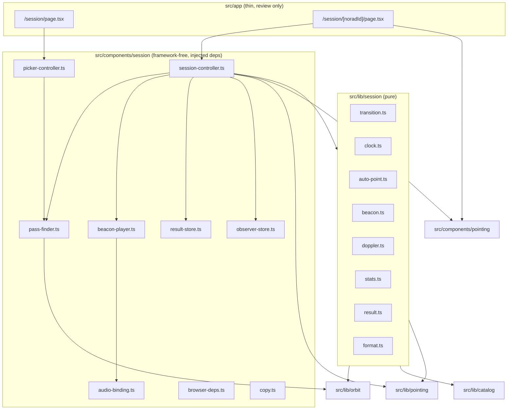
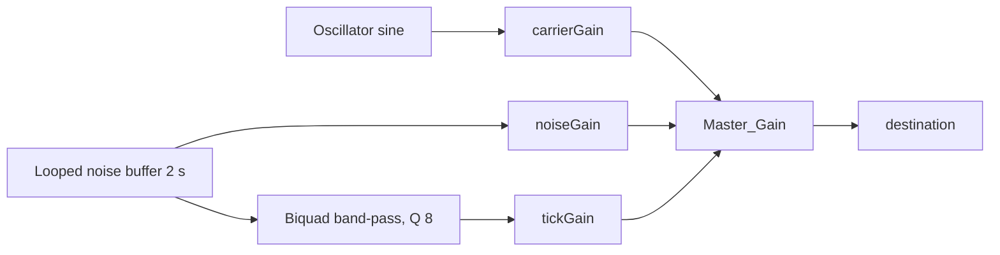

# Design Document: seance-session (S4)

## Overview

This design delivers the session layer of zombieSatellite: a pure Session_Core under `src/lib/session` and framework-free Session_Components under `src/components/session`, composed by two thin pages, `/session` (Satellite_Picker) and `/session/[noradId]` (Session_Page). Requirement numbers refer to `requirements.md` of this spec.

### Normative inputs used by this design

- The landed S1, S2 and S3 interfaces listed in the requirements Introduction, used as they are. No S1, S2 or S3 source file changes.
- Reference_Document C01 (UTC instants), C79 (pass duration, displayed rounded to whole minutes), C80 (minimum elevation 0°), C81 (24 h default window), C83 (azimuth and elevation shown with 1 decimal).
- The S3 lock geometry: `evaluateLock(forward, target, calibrationOffsetDeg)` and `LockResult.locked` are the only lock definition (Requirement 4, criterion 5).
- The Doppler fixtures of Requirement 7, criterion 7, cited as given.

### Settled decisions carried over from requirements.md

OQ-1 to OQ-16 and the time-zone rule, as recorded in the requirements "Decisions" section. In short: four states with a Join event for a real-time pass in progress; the demo takes the next complete pass; 24 h then 168 h search; Session_Result with `mode` and `autoPointUsed`; one localStorage key, 50 results; unmount in in-pass aborts; Jitter mostly locked, rare excursions up to about 20°; periodic beacon behaviour on real time; Tick_Mode iff `downlinkMhz` is null with a fifth output `tickGain`; Doppler shown in in-pass only; `/session` and `/session/[noradId]`; Honesty_Scan checks 1.24 and 1.25 extended; camera view and local time in S6.

### Design decisions made in this design

| ID | Decision | Where |
|---|---|---|
| D1 | The Session_Transition_Function maps phase names and event names only; the session data (Target_Pass, clock anchors, statistics) lives in the controller context | State machine |
| D2 | Pick and Join are separate events; the controller picks one by comparing AOS with the Real_Clock instant | State machine |
| D3 | The pass search (`findTargetPass`) lives in the component layer, because engine calls belong to controllers | Pass selection |
| D4 | Session_Instants are made integers with `Math.floor` | Clocks |
| D5 | One session tick every 250 ms, so the Readout_Rate is 4 Hz | Controllers |
| D6 | Signal_Quality is a raised-cosine curve from 0° to 45° | Beacon |
| D7 | Audible_Base_Frequency 700 Hz; Glide_Scale 30 Hz per km/s, clamped to ±240 Hz | Beacon |
| D8 | Tumble_Envelope is a raised cosine with Tumble_Floor 0.1 | Beacon |
| D9 | `cw-beacon` keys the carrier on and off with a Morse "V V V" pattern; `telemetry` with a frequency steps the carrier level with a fixed 16-bit pattern; `beaconMode` null gives a plain carrier | Beacon |
| D10 | Tick_Mode: one 40 ms band-passed noise click per second, its level set by q | Beacon |
| D11 | The controller samples the Beacon_State_Function on a 20 ms grid, 100 ms ahead of the audio clock | Audio |
| D12 | Smoothing time constants 5 ms (carrier and tick gains), 50 ms (noise gain), 150 ms (frequencies), 20 ms (Master_Gain) | Audio |
| D13 | Auto_Point offsets the Target_Direction along a great circle by the drawn Jitter angle, so the Pointing_Error equals that angle | Pointing |
| D14 | Locked time is integrated sample-and-hold, each hold capped at two session ticks of Session_Clock time | Session result |
| D15 | Storage keys `zombieSatellite.session.results` and `zombieSatellite.session.observer` | Stores |
| D16 | The Doppler_Readout is shown with 2 decimals in kHz and a sign `+` or `−` (U+2212) | Doppler readout |
| D17 | Every page paragraph that mentions a beacon, a signal or the radio comes from one copy module | Pages |
| D18 | Auto_Point and Manual_Pointing use calibration offset 0; the S3 calibration applies to Sensor_Pointing only | Pointing |
| D19 | The default volume is 0.7 | Audio |
| D20 | The real-time lookback for a pass in progress is 24 h | Pass selection |

## Architecture



Data flow during a pass: every 250 ms the Session_Controller reads the Session_Instant, calls `observeAt` at that instant, obtains a Lock_Result from the active Pointing_Source, feeds a Lock_Sample to the Lock_Statistics_Reducer, computes the Doppler_Readout, and publishes a snapshot. Separately, while audio runs, the Beacon_Player asks the controller for Beacon_States on a 20 ms grid of audio time and hands them to the Audio_Binding.

The Session_Core imports only its own modules and, as `import type`, the barrels `../orbit/index` (`Pass`), `../catalog/index` (`BeaconBlock`, `NoradId`, `PlayableEntry`) and `../pointing/index` (`TargetDirection`). No Session_Source_Module calls an engine or pointing function (D3). The one value import is `listPlayableEntries` from `../catalog/index`, used by `resolvePlayableEntry` (see Pages).

## State machine

### Identifiers (`src/lib/session/types.ts`)

```ts
export type SessionPhase = 'selecting' | 'awaiting-pass' | 'in-pass' | 'completed';
export type SessionEvent =
  | 'pick' | 'join' | 'start-demo' | 'aos-reached' | 'los-reached' | 'abort' | 'new-session';

export interface TransitionRejection {
  readonly kind: 'transition-rejected';
  readonly state: SessionPhase;
  readonly event: SessionEvent;
}
export type TransitionOutcome =
  | { readonly ok: true; readonly next: SessionPhase }
  | { readonly ok: false; readonly rejection: TransitionRejection };
```

`SESSION_PHASES` and `SESSION_EVENTS` are exported frozen arrays, so the test can enumerate all 28 pairs.

### Transition function (`transition.ts`)

`sessionTransition(state, event): TransitionOutcome` looks the pair up in a frozen table and returns `{ ok: true, next }` or `{ ok: false, rejection: { kind: 'transition-rejected', state, event } }`. It never throws, also for values outside the types at run time (they are rejected). The table is exactly Requirement 2, criterion 3:

| state \ event | pick | join | start-demo | aos-reached | los-reached | abort | new-session |
|---|---|---|---|---|---|---|---|
| selecting | awaiting-pass | in-pass | in-pass | ✗ | ✗ | ✗ | ✗ |
| awaiting-pass | ✗ | ✗ | in-pass | in-pass | ✗ | selecting | ✗ |
| in-pass | ✗ | ✗ | ✗ | ✗ | completed | completed | ✗ |
| completed | ✗ | ✗ | ✗ | ✗ | ✗ | ✗ | selecting |

✗ = Transition_Rejection. 9 legal pairs, 19 rejections.

D1: the function maps names only, in the style of S3 `permissionTransition`. The data that differs between the two `in-pass` entries (Clock_Mode, anchors, Join_Instant) is set by the controller in the same step in which it applies the outcome, so the transition table stays complete and table-testable.

D2: the controller decides between `pick` and `join` from the selected pass: `pick` when `pass.riseMs > realNowMs`, `join` otherwise.

## Clocks (`clock.ts`)

```ts
export const DEMO_RATE = 60;
export interface VirtualClockAnchor { readonly anchorRealMs: number; readonly anchorSessionMs: number }
export function realInstantMs(realMs: number): number;                       // Math.floor(realMs)
export function virtualInstantMs(anchor: VirtualClockAnchor, realMs: number): number;
// Math.floor(anchor.anchorSessionMs + DEMO_RATE * (realMs - anchor.anchorRealMs))
export function countdownMs(aosMs: number, sessionInstantMs: number): number; // aosMs - sessionInstantMs
```

D4: `Math.floor` makes every Session_Instant an integer (Requirement 3, criterion 2). With integer inputs the virtual formula is exact. Demo start sets `anchorRealMs` to the Real_Clock reading used for the pass search and `anchorSessionMs` to the pass's `riseMs`, so the first Session_Instant equals AOS (Requirement 3, criterion 12).

The Countdown is never stored: `readCountdownMs()` on the controller reads the clock and calls `countdownMs` each time (Requirement 2, criteria 7 and 13).

## Pass selection (`src/components/session/pass-finder.ts`)

```ts
export type ClockMode = 'real' | 'demo';           // defined in lib/session/types.ts
export type PassSearchOutcome = { readonly kind: 'found'; readonly pass: Pass } | { readonly kind: 'none' };
export function findTargetPass(tle: TleRecord, observer: Observer, nowMs: number, mode: ClockMode): PassSearchOutcome;
```

D3: this function calls `predictPasses`, so it lives in the component layer. It is deterministic and needs no injected dependency. Every window start is an explicit instant (Requirement 3, criterion 3). All searches use `minElevationDeg: 0` (C80).

1. Search `start = nowMs`, `durationHours = 24` (C81). The candidate is the first pass for `real`, and the first pass with `startTruncated === false` for `demo` (Requirement 3, criterion 7).
2. If there is no candidate, search once more with `durationHours = 168`, with the same rule. If there is still none, return `{ kind: 'none' }`.
3. Real only, if the candidate is `startTruncated` (D20): search `start = nowMs − 24 h`, `durationHours = 48`. Because 24 h is a whole number of 60 s steps, `nowMs` is a Coarse_Scan sample of this window as well, so the pass in progress appears with `riseMs ≤ nowMs < setMs`. Take that pass when it is not `startTruncated`; otherwise keep the candidate (Risk R5).
4. If the candidate is `endTruncated`, search `start = candidate.riseMs`, `durationHours = 168` and build the full record from its first pass: `riseMs` from the candidate, `peakMs`, `setMs`, `maxElevationDeg` and `endTruncated` from the second search, `startTruncated` from the candidate, `durationMin = (setMs − riseMs) / 60 000` (Requirement 3, criterion 8).
5. Return `{ kind: 'found', pass }`.

Engine exceptions (for example `invalid-tle`) propagate; the controllers catch them.

## Pointing

### Sensor_Pointing (Clock_Mode `real`)

The Session_Page creates the S3 pointing session (`createPointingSession(createBrowserDeps())`, unchanged) and injects it. The controller uses the subset

```ts
export type SensorPointing = Pick<PointingSession,
  'subscribe' | 'getSnapshot' | 'setTarget' | 'setObserver' | 'pointerDown' | 'pointerMove' | 'pointerUp'>;
```

At the start of a real-time session it calls `setObserver(Session_Observer)`. At every in-pass tick it calls `setTarget(Target_Direction)` and reads `getSnapshot().lock` (Requirement 4, criterion 1). The S3 session applies its own declination and calibration (D18).

### Auto_Point (`src/lib/session/auto-point.ts`)

```ts
export const AUTO_POINT_EXCURSION_PROBABILITY = 0.1;
export const AUTO_POINT_WOBBLE_MIN_DEG = 1;
export const AUTO_POINT_WOBBLE_MAX_DEG = 8;      // exclusive
export const AUTO_POINT_EXCURSION_MIN_DEG = 12;
export const AUTO_POINT_EXCURSION_MAX_DEG = 20;  // exclusive
export interface Jitter { readonly offsetDeg: number; readonly bearingDeg: number }
export function drawJitter(u1: number, u2: number, u3: number): Jitter;
export function offsetDirection(target: TargetDirection, jitter: Jitter): TargetDirection;
```

Distribution (D13, OQ-7). The controller draws three Noise_Source values u1, u2, u3 in [0, 1) at every in-pass tick:

- excursion when u2 < 0.1, otherwise wobble;
- wobble: `offsetDeg = 1 + 7 × u1`, in [1°, 8°): always within the Lock_Tolerance;
- excursion: `offsetDeg = 12 + 8 × u1`, in [12°, 20°): never locked, never 20° or more;
- `bearingDeg = 360 × u3`.

Time behaviour: one draw per session tick (250 ms of real time; 15 s of Session_Clock time in a Demo_Session), held until the next tick. An excursion therefore lasts one tick, about 10 % of the ticks are excursions, and a pass played with Auto_Point alone reaches a locked ratio of about 0.9.

Offset geometry: the synthesized direction is the destination point at angular distance δ = `offsetDeg` and initial bearing θ = `bearingDeg` from the target, with elevation as latitude φ and azimuth as longitude λ:

```
φ2 = asin(sin φ1 · cos δ + cos φ1 · sin δ · cos θ)
λ2 = λ1 + atan2(sin θ · sin δ · cos φ1, cos δ − sin φ1 · sin φ2)
```

with the azimuth normalized to [0, 360). The great-circle distance between the two directions is δ, so `evaluateLock(sceneDirection(λ2, φ2), target, 0).pointingErrorDeg` equals `offsetDeg` up to rounding. The lock decision still comes only from `evaluateLock` (Requirement 4, criteria 3 and 5); `auto-point.ts` contains no threshold and no dot product. The controller builds the forward vector with the S3 `sceneDirection` and calls `evaluateLock`.

### Manual_Pointing (demo)

The controller owns one S3 `createDragCompass({ onPose })`. When the user switches to manual, it activates the compass (pose heading 0°, pitch 0°, S3 behaviour) and computes `evaluateLock(cameraBasisFromDrag(pose).forward, target, 0)` at each tick and on each pose change (Requirement 4, criterion 4; D18). Switching back to auto deactivates it.

### Pointing_Error between ticks

Lock_Samples are recorded at ticks only. For a responsive beacon, the controller also refreshes the beacon's Pointing_Error input when the S3 snapshot changes (Sensor_Pointing) or the drag pose changes (Manual_Pointing), without recording a sample.

## Beacon (`src/lib/session/beacon.ts`)

### Interface

```ts
export type BeaconSoundMode = 'carrier' | 'cw' | 'telemetry' | 'ticks' | 'silent';
export interface BeaconInputs {
  readonly pointingErrorDeg: number | null;
  readonly rangeRateKmPerS: number | null;
  readonly beacon: BeaconBlock;
  readonly phaseS: number;            // Beacon_Phase_Input, seconds of audio time
}
export interface BeaconState {
  readonly mode: BeaconSoundMode;
  readonly carrierFrequencyHz: number;
  readonly carrierGain: number;
  readonly noiseGain: number;
  readonly tickGain: number;          // approved addition (OQ-9)
}
export function signalQuality(pointingErrorDeg: number | null): number;
export function dopplerGlideHz(rangeRateKmPerS: number | null): number;
export function tumbleEnvelope(phaseS: number, periodS: number): number;
export function beaconState(inputs: BeaconInputs): BeaconState;
export const SILENT_BEACON_STATE: BeaconState;
```

`beaconState` never returns `'silent'`; only the frozen `SILENT_BEACON_STATE` (frequency 700 Hz, all gains 0) has that mode. The controller applies it whenever the beacon must be silent (Requirement 6, criterion 8), so the binding still takes every value from a Beacon_State.

The inputs are only the quantities that drive an output. The `EntryStatus` is not an input (DQ-1): the mode depends on `downlinkMhz` and `beaconMode` alone, and the status drives copy only.

### Constants

| Constant | Value | Pinned in tests |
|---|---|---|
| `QUALITY_ZERO_ERROR_DEG` | 45 | yes |
| `AUDIBLE_BASE_FREQUENCY_HZ` | 700 | yes |
| `GLIDE_HZ_PER_KM_PER_S` | 30 | — |
| `GLIDE_LIMIT_HZ` | 240 | — |
| `CARRIER_PEAK_GAIN` | 0.5 | via examples |
| `NOISE_FLOOR_GAIN` | 0.04 | via examples |
| `NOISE_SPAN_GAIN` | 0.26 | via examples |
| `TUMBLE_FLOOR` | 0.1 | yes |
| `CW_UNIT_S` | 0.08 | via examples |
| `CW_KEYING_PATTERN` | `'101010111000'` × 3 + `'0000'` (40 units, 3.2 s) | via examples |
| `TELEMETRY_BIT_S` | 0.1 | via examples |
| `TELEMETRY_PATTERN` | `'1011001110001011'` (16 bits, 1.6 s) | via examples |
| `TELEMETRY_LOW_LEVEL` | 0.5 | via examples |
| `TICK_PERIOD_S` | 1.0 | via examples |
| `TICK_LENGTH_S` | 0.04 | via examples |
| `TICK_PEAK_GAIN` | 0.8 | via examples |

### Signal_Quality (D6)

```
q(e) = 0                          for e = null, NaN or e ≥ 45
q(e) = 1                          for e ≤ 0
q(e) = 0.5 · (1 + cos(π · e / 45)) for 0 < e < 45
```

q(0) = 1 and q(45) = 0 exactly; the curve is strictly decreasing on (0, 45) and flat near both ends. At the Lock_Tolerance, q(10) ≈ 0.883, so a locked beacon is clean but not perfect; an Auto_Point excursion at 15° gives q ≈ 0.75.

### Carrier frequency and Doppler_Glide (D7)

```
dopplerGlideHz(rr) = clamp(−rr · 30, −240, 240)    (0 for null or NaN; −0 returned as +0)
carrierFrequencyHz = 700 + dopplerGlideHz(rr)
```

700 Hz is a common CW listening pitch. Glide_Scale: 30 Hz of audible offset per km/s of approach, so a LEO pass sweeps the tone by up to about ±210 Hz (490 Hz to 910 Hz). This is an artistic scale independent of the downlink frequency: at 145.9775 MHz the Physical_Doppler_Shift is about 487 Hz per km/s. The glide is also defined for IMAGE, where it moves the click filter (Tick_Mode). The glide constants live in `beacon.ts`; the Speed_Of_Light and the physical formula live in `doppler.ts`, and neither module imports the other (Requirement 5, criterion 6).

### Mode selection

| `downlinkMhz` | `beaconMode` | mode | Catalog entries |
|---|---|---|---|
| null | any | `ticks` | IMAGE |
| number | `cw-beacon` | `cw` | AO-7 |
| number | `telemetry` | `telemetry` | Transit 5B-5 |
| number | null | `carrier` | LES-1, Prospero |

### Gains

```
q          = signalQuality(pointingErrorDeg)
noiseGain  = 0.04 + 0.26 · (1 − q)                         every mode, in [0.04, 0.30]
tumble     = tumblePeriodS === null ? 1 : tumbleEnvelope(phaseS, tumblePeriodS)
key(phase) = cw:        CW_KEYING_PATTERN[unit] === '1' ? 1 : 0,   unit = floor(phase / 0.08) mod 40
             telemetry: TELEMETRY_PATTERN[bit] === '1' ? 1 : 0.5, bit = floor(phase / 0.1) mod 16
             carrier:   1
carrierGain = mode === 'ticks' ? 0 : 0.5 · q · tumble · key(phase)
tickGain    = mode === 'ticks' ? 0.8 · q · gate(phase) : 0
gate(phase) = (phase mod 1.0) < 0.04 ? 1 : 0
```

`mod` is the non-negative remainder, so negative phases are handled. For fixed other inputs, carrier and tick gains rise with q and the noise gain falls with q (Requirement 5, criterion 3).

Tumble_Envelope (D8): `tumbleEnvelope(t, P) = 0.1 + 0.9 · 0.5 · (1 + cos(2π · t / P))`, period exactly P, maximum 1 at t = 0, minimum 0.1 at t = P / 2. For LES-1 (P = 4 s) the tone swells and fades every 4 s of real time (OQ-8).

Keying (D9, Requirement 5, criterion 10). These are simulation patterns, not the satellites' real telemetry content:

- `cw` (AO-7): on/off keying at 80 ms per Morse unit, sending "V V V" (dit dit dit dah) followed by a word gap, repeating every 3.2 s. It sounds like a Morse beacon.
- `telemetry` (Transit 5B-5): a continuous carrier whose level steps between full and half on a fixed 16-bit pattern at 10 bits per second. It sounds like a data carrier that never breaks.
- `carrier` (LES-1, Prospero): a plain, unkeyed tone (Requirement 5, criterion 9); for LES-1 the Tumble_Envelope applies.

Tick_Mode (D10, Requirement 5, criterion 8): no carrier at all (`carrierGain` 0 for every input). One click of 40 ms per second, made by the tick path of the Audio_Binding (band-passed noise around `carrierFrequencyHz`). Click clarity = `tickGain` = 0.8 · q during the click, against the noise floor `noiseGain`: at q = 1 the click is at 0.8 over noise at 0.04; at q = 0 the click vanishes into noise at 0.30.

## Audio

### Node graph (`audio-binding.ts`)



The noise buffer is one channel of `2 × sampleRate` samples, filled with `2 · noise.next() − 1` from the injected Noise_Source. All three gain nodes and the Master_Gain start at 0; the oscillator and the noise source start once, when the graph is built.

```ts
export interface AudioBinding {
  apply(state: BeaconState, atS: number): void;  // atS: audio-context time
  setMaster(muted: boolean, volume: number): void;
  currentTime(): number;
  dispose(): void;
}
export function createAudioBinding(ctx: AudioContextLike, noise: NoiseSource): AudioBinding;
```

`apply` makes exactly these calls (Requirement 6, criteria 2 and 3):

| Parameter | Value | Time constant |
|---|---|---|
| oscillator `frequency` | `state.carrierFrequencyHz` | `FREQUENCY_TIME_CONSTANT_S` = 0.15 |
| band-pass `frequency` | `state.carrierFrequencyHz` | 0.15 |
| carrier gain | `state.carrierGain` | `GAIN_TIME_CONSTANT_S` = 0.005 |
| tick gain | `state.tickGain` | 0.005 |
| noise gain | `state.noiseGain` | `NOISE_TIME_CONSTANT_S` = 0.05 |

each as `param.setTargetAtTime(value, atS, timeConstant)`. `setMaster` makes one call, `master.gain.setTargetAtTime(muted ? 0 : clamp(volume, 0, 1), ctx.currentTime, 0.02)`, and touches nothing else (Requirement 6, criterion 7). The band-pass Q of 8 is a fixed node setting, not a frequency or gain. D12: 5 ms is short enough for crisp Morse edges and clicks and long enough to avoid clicks at the edges; 150 ms turns the 4 Hz frequency updates into a continuous glide without zipper noise; 50 ms keeps the noise floor steady.

### Scheduling (`beacon-player.ts`, D11)

```ts
export type AudioStatus = 'off' | 'running' | 'suspended' | 'unavailable';
export interface BeaconPlayer {
  enableFromGesture(): AudioStatus;          // synchronous; call only inside a User_Gesture_Handler
  status(): AudioStatus;
  start(stateAt: (phaseS: number) => BeaconState): void;
  stop(): void;                              // applies SILENT_BEACON_STATE now and stops scheduling
  setMaster(muted: boolean, volume: number): void;
  dispose(): void;
}
export function createBeaconPlayer(deps: { audioContextFactory: AudioContextFactory; timers: TimerApi; noise: NoiseSource }): BeaconPlayer;
```

- `enableFromGesture` calls the Audio_Context_Factory on its first call only; `null` or a throw gives `'unavailable'` (Requirement 6, criterion 9). It then calls `resume()` when the state is not `'running'` (iOS unlock), and builds the binding once. Nothing else calls the factory or `resume()` (Requirement 6, criterion 4).
- `start` records the phase origin `origin = currentTime()` and schedules from it. Every `BEACON_SCHEDULER_INTERVAL_MS` = 25 ms (TimerApi), for each grid point `t` from the next unscheduled point up to `currentTime() + BEACON_LOOKAHEAD_S` (0.1 s), stepping `BEACON_STEP_S` (0.02 s), it calls `binding.apply(stateAt(t − origin), t)`. If the next point is already in the past (a throttled background tab), it jumps to `currentTime()`.
- The phase is audio-context time, which is real time in both Clock_Modes (Requirement 5, criterion 11).
- `stateAt` is a closure of the Session_Controller that calls `beaconState` with the latest inputs; the player never calls the Beacon_State_Function itself (Requirement 5, criterion 12).

### Injected audio interfaces (`src/components/session/deps.ts`)

```ts
export interface NoiseSource { next(): number }   // [0, 1)
export interface AudioParamLike { value: number; setTargetAtTime(target: number, startTime: number, timeConstant: number): unknown }
export interface AudioNodeLike { connect(destination: AudioNodeLike): unknown; disconnect(): void }
export interface GainNodeLike extends AudioNodeLike { readonly gain: AudioParamLike }
export interface OscillatorNodeLike extends AudioNodeLike { type: string; readonly frequency: AudioParamLike; start(): void; stop(): void }
export interface BiquadFilterNodeLike extends AudioNodeLike { type: string; readonly frequency: AudioParamLike; readonly Q: AudioParamLike }
export interface AudioBufferLike { getChannelData(channel: number): Float32Array }
export interface AudioBufferSourceNodeLike extends AudioNodeLike { buffer: AudioBufferLike | null; loop: boolean; start(): void; stop(): void }
export interface AudioContextLike {
  readonly currentTime: number; readonly sampleRate: number; readonly state: string;
  readonly destination: AudioNodeLike;
  resume(): Promise<void>; close(): Promise<void>;
  createGain(): GainNodeLike; createOscillator(): OscillatorNodeLike; createBiquadFilter(): BiquadFilterNodeLike;
  createBuffer(channels: number, length: number, sampleRate: number): AudioBufferLike;
  createBufferSource(): AudioBufferSourceNodeLike;
}
export type AudioContextFactory = () => AudioContextLike | null;
```

The browser factory (`browser-deps.ts`):

```ts
export function createAudioContextFactory(globals: { AudioContext?: unknown; webkitAudioContext?: unknown }): AudioContextFactory;
```

It uses `globals.AudioContext` when it is a function, otherwise `globals.webkitAudioContext` when it is a function (Requirement 6, criterion 5), otherwise returns a factory that gives `null`. The real context is cast to `AudioContextLike`.

The default volume is 0.7 and the default is unmuted (D19); neither is persisted (OQ-16).

## Doppler readout (`src/lib/session/doppler.ts`)

```ts
export const SPEED_OF_LIGHT_KM_PER_S = 299_792.458;
export type DopplerReadout =
  | { readonly kind: 'shift'; readonly shiftKhz: number }
  | { readonly kind: 'no-frequency' };
export function physicalDopplerShiftKhz(downlinkMhz: number, rangeRateKmPerS: number): number;
// −downlinkMhz · 1000 · rangeRateKmPerS / SPEED_OF_LIGHT_KM_PER_S
export function dopplerReadout(downlinkMhz: number | null, rangeRateKmPerS: number): DopplerReadout;
export function formatDopplerReadout(readout: DopplerReadout): string;
```

`dopplerReadout(null, rr)` is `{ kind: 'no-frequency' }` and computes nothing (Requirement 7, criterion 4). D16: `formatDopplerReadout` rounds to 2 decimals (10 Hz), prints `+` for a rounded value ≥ 0 (with −0 turned into +0) and `−` (U+2212) otherwise, followed by ` kHz`, for example `+1.03 kHz` and `−1.28 kHz`; the no-frequency marker prints `No documented downlink frequency`. The Session_Page shows the readout in in-pass only (OQ-11), refreshed by the 4 Hz session tick (D5, Readout_Rate 4 Hz).

## Session result

### Type (`src/lib/session/types.ts`)

```ts
export type ClockMode = 'real' | 'demo';
export interface SessionResult {
  readonly noradId: NoradId;
  readonly aosMs: number;                     // Target_Pass riseMs
  readonly losMs: number;                     // Target_Pass setMs, or the Abort instant
  readonly maxElevationDeg: number;           // Target_Pass maxElevationDeg
  readonly lockedSeconds: number;             // Session_Clock seconds
  readonly bestPointingErrorDeg: number | null;
  readonly lockedRatio: number;               // lockedSeconds / ((setMs − riseMs) / 1000)
  readonly completed: boolean;
  readonly mode: ClockMode;                   // approved addition (OQ-4)
  readonly autoPointUsed: boolean;            // approved addition (OQ-4)
}
```

### Lock_Statistics_Reducer (`stats.ts`, D14)

```ts
export interface LockObservation {
  readonly instantMs: number;
  /** null: no Lock_Result at this tick; not a Lock_Sample, and the time from here counts as not locked. */
  readonly lock: { readonly pointingErrorDeg: number; readonly locked: boolean; readonly autoPoint: boolean } | null;
}
export interface LockStats {
  readonly lastInstantMs: number | null;
  readonly lastLocked: boolean;
  readonly lockedMs: number;
  readonly bestPointingErrorDeg: number | null;
  readonly autoPointUsed: boolean;
}
export const EMPTY_LOCK_STATS: LockStats;
export function reduceLockStats(stats: LockStats, observation: LockObservation, maxHoldMs: number): LockStats;
export function closeLockStats(stats: LockStats, endMs: number, maxHoldMs: number): LockStats;
export function maxHoldMsFor(mode: ClockMode): number;   // 2 × SESSION_TICK_MS × (demo ? DEMO_RATE : 1)
```

Integration rule, sample-and-hold: the lock state of each observation holds until the next observation, and each held interval counts at most `maxHoldMs`.

- `reduceLockStats`: if `lastLocked` and `lastInstantMs` is set, add `clamp(instantMs − lastInstantMs, 0, maxHoldMs)` to `lockedMs`. Then, for a Lock_Sample (`lock` not null), set `lastLocked = lock.locked` (Requirement 8, criterion 4), take the smaller of `bestPointingErrorDeg` and `lock.pointingErrorDeg`, and set `autoPointUsed` when `lock.autoPoint` is true. For `lock: null`, set `lastLocked = false` (Requirement 4, criterion 7). Set `lastInstantMs = instantMs`. A clock that runs backwards adds 0.
- `closeLockStats(stats, endMs)` adds the final held interval up to `endMs` by the same rule.
- `maxHoldMs` is two session ticks of Session_Clock time: 500 ms in real time, 30 000 ms in a Demo_Session. The cap stops a throttled background tab or a long gap from counting stale lock time.

`buildSessionResult(input, closedStats)` in `result.ts`:

```ts
export interface SessionResultInput {
  readonly noradId: NoradId; readonly pass: Pass; readonly endMs: number;
  readonly completed: boolean; readonly mode: ClockMode;
}
```

`aosMs = pass.riseMs`; `losMs = completed ? pass.setMs : endMs`; `maxElevationDeg = pass.maxElevationDeg`; `lockedSeconds = lockedMs / 1000`; `lockedRatio = min(1, lockedMs / (pass.setMs − pass.riseMs))` (Requirement 8, criteria 2 and 5).

Hand-computable fixture (Requirement 8, criterion 10): pass `riseMs` 1 000 000, `setMs` 1 600 000, `maxElevationDeg` 42; `maxHoldMs` 100 000; observations at 1 000 000 (5°, locked, auto), 1 100 000 (12°, not locked, auto), 1 200 000 (3°, locked, auto), 1 300 000 (`lock: null`), 1 400 000 (8°, locked, auto); closed at 1 600 000, completed, demo. Locked intervals: 100 s + 100 s + 100 s (the last one capped from 200 s), so `lockedSeconds` 300, `lockedRatio` 0.5, `bestPointingErrorDeg` 3, `autoPointUsed` true, `aosMs` 1 000 000, `losMs` 1 600 000.

### Serialization (`result.ts`) and Result_Store (`result-store.ts`)

```ts
export const MAX_STORED_RESULTS = 50;
export function isSessionResult(value: unknown): value is SessionResult;
export function parseSessionResults(raw: string | null): SessionResult[];          // never throws
export function appendSessionResult(raw: string | null, result: SessionResult): string;
```

`isSessionResult` accepts an object with exactly the ten fields: `noradId` an integer from 1 to 99 999; `aosMs` and `losMs` integers with `losMs ≥ aosMs`; `maxElevationDeg` finite; `lockedSeconds` finite and ≥ 0; `bestPointingErrorDeg` null or finite and ≥ 0; `lockedRatio` finite in [0, 1]; `completed` and `autoPointUsed` booleans; `mode` `'real'` or `'demo'`. `parseSessionResults` returns `[]` for null, invalid JSON or a non-array, and keeps the valid records as fresh frozen copies. `appendSessionResult` returns the JSON of the valid stored records plus the new one, newest last, cut to the last 50 (Requirement 8, criterion 7).

```ts
export const RESULT_STORAGE_KEY = 'zombieSatellite.session.results';   // D15
export function createResultStore(storage: KeyValueStorage): { append(result: SessionResult): void };
export function readSessionResults(storage: KeyValueStorage): SessionResult[];  // the S5 read-back, never throws
```

`append` wraps `getItem` and `setItem` in `try`; a failure is swallowed (Requirement 8, criterion 6).

## Controllers

### Session_Controller (`session-controller.ts`)

```ts
export interface SessionControllerDeps {
  readonly clock: Clock;
  readonly timers: TimerApi;
  readonly storage: KeyValueStorage;
  readonly tleFetcher: TleFetcher;
  readonly noise: NoiseSource;
  readonly audioContextFactory: AudioContextFactory;
  readonly pointing: SensorPointing;
}
export type SessionActionResult =
  | { readonly ok: true; readonly phase: SessionPhase }
  | { readonly ok: false; readonly rejection: TransitionRejection }
  | { readonly ok: false; readonly failure: 'tle-unavailable' | 'no-pass-found' };
export type DemoPointing = 'auto' | 'manual';

export interface SessionController {
  subscribe(listener: () => void): () => void;
  getSnapshot(): SessionSnapshot;
  readCountdownMs(): number | null;        // derived from the clock at each call
  setObserver(position: ObserverPosition): boolean;   // accepted in selecting only
  startRealTime(): Promise<SessionActionResult>;      // dispatches pick or join
  startDemo(): Promise<SessionActionResult>;
  abort(): SessionActionResult;
  newSession(): SessionActionResult;
  setDemoPointing(source: DemoPointing): boolean;
  pointerDown(p: PointerInput): void;      // routed to the S3 session (real) or the drag compass (demo manual)
  pointerMove(p: PointerInput): void;
  pointerUp(p: PointerInput): void;
  enableAudio(): void;                     // gesture entry
  setMuted(muted: boolean): void;
  setVolume(volume: number): void;
  dispose(): void;
}
export function createSessionController(deps: SessionControllerDeps, entry: PlayableEntry): SessionController;
```

`SessionSnapshot` (frozen, replaced on each publish, for `useSyncExternalStore`):

```ts
export interface SessionSnapshot {
  readonly entry: PlayableEntry;
  readonly phase: SessionPhase;
  readonly clockMode: ClockMode | null;
  readonly observer: ObserverPosition;
  readonly tleStatus: 'loading' | 'ready' | 'failed';
  readonly previewPass: Pass | null;           // real-time Next_Pass shown in selecting
  readonly failure: 'tle-unavailable' | 'no-pass-found' | null;
  readonly targetPass: Pass | null;
  readonly sessionInstantMs: number | null;
  readonly countdownMs: number | null;          // at the last publish; the page shows this
  readonly target: TargetDirection | null;      // null with "no orbit data"
  readonly orbitDataMissing: boolean;
  readonly doppler: DopplerReadout | null;      // in-pass only
  readonly lock: LockResult | null;
  readonly pointingSource: 'sensor' | 'auto' | 'manual' | null;
  readonly audio: { readonly status: AudioStatus; readonly muted: boolean; readonly volume: number };
  readonly lastRejection: TransitionRejection | null;
  readonly result: SessionResult | null;
  readonly joined: boolean;                     // true after a `join` dispatch (real-time start in a pass in progress); reset by newSession, awaiting-pass abort and dispose
}
```

Behaviour:

- Creation: reads the Session_Observer from the observer store, creates the drag compass and the Beacon_Player, subscribes to the S3 pointing session, starts the TLE fetch (`tleFetcher.fetchTle(entry.noradId)`), and publishes. When the TLE arrives it creates the Satrec and computes `previewPass = findTargetPass(tle, observer, clock.nowMs(), 'real')`. No timer runs in selecting.
- `dispatch(event)`: calls `sessionTransition(phase, event)`. On a rejection it sets `lastRejection`, publishes and returns the rejection; the phase is unchanged (Requirement 2, criterion 4). On success it clears `lastRejection`.
- `startDemo` / `startRealTime`: first check the event against the current phase with `sessionTransition` and return a rejection at once, so a rejected start fetches nothing. Then await the TLE (refetching after a failure: the OQ-1 retry), read `now = clock.nowMs()`, call `findTargetPass(…, now, mode)`, and on `none` or an engine exception return the failure. Then dispatch again (the phase may have changed during the await). Demo: anchor `{ anchorRealMs: now, anchorSessionMs: pass.riseMs }`, Pointing_Source `auto`, dispatch `start-demo`, begin in-pass. Real: `pointing.setObserver(observer)`, Pointing_Source `sensor`, dispatch `pick` when `pass.riseMs > now` (start the tick timer) and `join` otherwise (begin in-pass at the Join_Instant).
- Session tick (D5): every `SESSION_TICK_MS` = 250 ms while in awaiting-pass or in-pass. `tick()` reads `t = sessionInstant()`, then: in awaiting-pass with `t ≥ AOS`, dispatch `aos-reached` and begin in-pass; in in-pass with `t ≥ LOS`, complete with `los-reached` at LOS; otherwise in in-pass, sample at `t`. Both checks run in one tick, so after a long hidden period the events are dispatched in order (Requirement 2, criterion 10).
- Begin in-pass: reset the statistics to `EMPTY_LOCK_STATS`, sample once at the current Session_Instant (AOS for a demo, the Join_Instant for Join), start the tick timer, and start the Beacon_Player if audio is running.
- Sample at `t`: `observeAt(satrec, t, observer)`. On failure: target null, `orbitDataMissing` true, lock null, a `lock: null` observation, beacon inputs (null, null) (OQ-10). On success: target from `lookAngles`, then the Lock_Result from the Pointing_Source (`sensor`: `setTarget` then `getSnapshot().lock`; `auto`: three Noise_Source draws, `drawJitter`, `offsetDirection`, `evaluateLock(sceneDirection(…), target, 0)`; `manual`: `evaluateLock(cameraBasisFromDrag(pose).forward, target, 0)` while the compass is active), the observation, the beacon inputs (Pointing_Error, range rate), and `dopplerReadout(entry.beacon.downlinkMhz, rangeRateKmPerS)`. Then publish.
- Complete: `closeLockStats` at the end instant, `buildSessionResult`, dispatch, `resultStore.append`, `beaconPlayer.stop()`, clear the timer, publish (Requirement 8, criteria 6 and 7).
- `abort()`: runs the tick checks first, so an abort after LOS completes the pass as LOS. Then in awaiting-pass it dispatches `abort` (to selecting, no result); in in-pass it completes with `completed: false` at the current Session_Instant; in other phases it returns the rejection.
- `newSession()`: dispatch `new-session`; clear the target pass, result and clock mode; recompute the preview pass.
- `enableAudio()`: `beaconPlayer.enableFromGesture()`, apply the master settings, and start the player when in in-pass. Only this method reaches the factory (Requirement 6, criteria 4 and 11).
- Beacon inputs between ticks: on an S3 snapshot change (Sensor_Pointing) or a drag pose change (Manual_Pointing), refresh the Pointing_Error input of the beacon; a drag pose change also republishes so the page follows the drag.
- `dispose()`: in in-pass, complete with `completed: false` (best effort, Requirement 2, criterion 11); in awaiting-pass, drop the session; then clear timers, dispose the player, deactivate the compass, unsubscribe from the S3 session and drop listeners.

### Picker controller (`picker-controller.ts`)

```ts
export interface PickerRow {
  readonly entry: PlayableEntry;
  readonly status: 'loading' | 'ready' | 'tle-unavailable' | 'no-pass-found';
  readonly pass: Pass | null;
  readonly inProgress: boolean;          // pass.riseMs ≤ the Real_Clock instant of the search
}
export interface PickerSnapshot { readonly observer: ObserverPosition; readonly rows: readonly PickerRow[] }
export function createPickerController(deps: { clock: Clock; storage: KeyValueStorage; tleFetcher: TleFetcher }): {
  subscribe(listener: () => void): () => void; getSnapshot(): PickerSnapshot;
  setObserver(position: ObserverPosition): boolean; retry(): void; dispose(): void;
};
```

It fetches the five TLEs in parallel and computes each row with `findTargetPass(…, 'real')` (Requirement 9, criterion 3; DQ-2). An observer change recomputes the rows from the fetched TLEs; `retry` refetches failed rows.

DQ-2 clarification: a row marked "in progress" shows the real-time pass. When the user opens that entry's Session_Page and starts a demo, the controller searches with Clock_Mode `demo`, which skips the pass in progress, so the demo plays the next complete pass, not the one listed. The Session_Page shows the demo's Target_Pass times once the demo starts.

### Observer store (`observer-store.ts`)

`OBSERVER_STORAGE_KEY = 'zombieSatellite.session.observer'` (D15) holds `{"latitudeDeg":…,"longitudeDeg":…}`. The pure `parseStoredObserver(raw)` in `lib/session/format.ts` returns the position when both values are finite and in range, else null; the store then falls back to the S3 `DEFAULT_OBSERVER` (the Reference_Observer). `set` validates and writes, swallowing storage errors. Both controllers use it, so the two pages share the Session_Observer (Requirement 9, criterion 5).

### Browser dependencies (`browser-deps.ts`)

`createSessionBrowserDeps(pointing)` builds `{ clock: { nowMs: () => Date.now() }, timers, storage, tleFetcher: createTleFetcher({ now: clock.nowMs }), noise: { next: Math.random }, audioContextFactory: createAudioContextFactory(window), pointing }` (Requirement 3, criterion 3). `createPickerBrowserDeps()` returns the clock, storage and TLE fetcher. Storage is a local try/catch wrapper around `window.localStorage`, the same pattern as the S3 `createSafeStorage`, which is not exported and is not changed. Browser only: the pages call these inside `useEffect`.

## Pages

Both pages are `'use client'` files in the `/pointing` pattern: create the controllers in `useEffect`, read them with `useSyncExternalStore` (a frozen neutral snapshot on the server), render, and forward events. They call no Orbit_Engine function and no Beacon_State_Function (Requirement 9, criterion 2). Instants are shown with `formatUtc` (`2026-11-09 11:18:05 UTC`), azimuth and elevation with 1 decimal (C83), pass durations rounded to whole minutes (C79).

### `/session` (`src/app/session/page.tsx`)

Observer inputs (latitude, longitude; `/pointing` behaviour with `parseCoordinateInput`), then one row per Playable_Entry in catalog order: name, difficulty, short status label (`SESSION_COPY.statusLabels`), a "Sunlit only" badge where `sunlitOnly` is true, the Next_Pass (rise and set in UTC, maximum elevation, duration; "in progress" when `inProgress`), or the row's failure note with a retry button, and a link to `/session/{noradId}`. No catalog prose (Requirement 10, criterion 6).

### `/session/[noradId]` (`src/app/session/[noradId]/page.tsx`)

The page reads the route parameter with `useParams()` from `next/navigation` and calls the pure `resolvePlayableEntry(raw)` (`lib/session/entry.ts`: accepts `^[1-9][0-9]{0,4}$`, then looks the number up in `listPlayableEntries()`). For `null` it shows a message and a link to `/session` and creates no controller (Requirement 9, criterion 4). Otherwise it creates the S3 pointing session (`createPointingSession(createBrowserDeps())`) and the Session_Controller (`createSessionController(createSessionBrowserDeps(pointing), entry)`), and disposes both on unmount.

Sections:

1. Header: entry name, difficulty, status label, `displayFrequency` verbatim or `SESSION_COPY.noFrequency` (Requirement 7, criteria 1 and 4), the sunlit note where `sunlitOnly` is true (Requirement 9, criterion 6), the IMAGE note where `downlinkMhz` is null, and `SESSION_COPY.utcNote`.
2. Selecting: observer inputs (editable here only), the preview pass, "Start in real time" and "Start demo (60×)" buttons, the failure note. Both start handlers call `controller.enableAudio()` first, synchronously, then the start method.
3. Awaiting-pass: the Target_Pass times and `snapshot.countdownMs` with `formatCountdown` (`T−01:23:45`), "Start demo instead", "Abort".
4. In-pass: Session_Instant (UTC), Target_Direction or `SESSION_COPY.noOrbitData`, the Doppler_Readout with `formatDopplerReadout`, `SESSION_COPY.glideNote`, `SESSION_COPY.joinNote` when `snapshot.joined` is true (the page reads the flag and does not derive it), Pointing_Error and locked flag; in a Demo_Session the auto/manual switch with `SESSION_COPY.autoPointNote`; the drag area (forwarded to `controller.pointer*`) in manual mode and in real time; in real time the S3 controls read from the S3 snapshot (permission button calling `pointing.requestPermission()`, drag toggle, ±5° calibration); "Abort".
5. Completed: the Session_Result as plain values (locked seconds, ratio in %, best Pointing_Error, completed or aborted, mode), and "New session". No QSL card (Requirement 8, criterion 9).
6. Audio: `SESSION_COPY.enableSound` button while the status is `off` or `suspended`, `SESSION_COPY.audioUnavailable` when `unavailable`, a mute checkbox and a volume range input (0 to 1).
7. Footer: `SESSION_COPY.simulationNotice`.

### Copy module (`src/components/session/copy.ts`, D17)

Every paragraph that mentions a beacon, a signal or the radio is one string here; page JSX text stays free of these words. Draft strings, checked against the Honesty_Scan rules (checks 1.24 and 1.25):

| Key | Text |
|---|---|
| `simulationNotice` | zombieSatellite receives no RF. The beacon tone here is synthesized live from public orbital data; bring your own radio for the real thing and tune it by the Doppler figure. |
| `glideNote` | The pitch of the tone glides on an artistic, scaled curve. The real Doppler shift is the kHz figure only. |
| `imageNote` | IMAGE has been silent again since August 2018. The soft ticks are a simulated sketch of its telemetry character, synthesized from public orbital data, and do not mean that it transmits today. |
| `sunlitNote` | Sunlit only: in reality it transmits only in sunlight. This app has no eclipse model, so the simulated beacon plays during every pass. |
| `noFrequency` | No documented downlink frequency |
| `noOrbitData` | No orbit data at this instant |
| `audioUnavailable` | Audio is not available in this browser, so the session runs without the simulated beacon. |
| `enableSound` | Enable sound for the simulated beacon |
| `demoNote` | Demo mode plays the next complete real pass at 60× speed. |
| `autoPointNote` | Auto-point aims for you with a small, hand-like wobble. Switch to manual to drag the view yourself. |
| `joinNote` | This pass is already overhead, so the session joins it now. |
| `utcNote` | All times are UTC. |
| `statusLabels` | still-transmitting: "Still transmitting"; semi-operational: "Semi-operational"; silent-again: "Silent again since 2018"; unconfirmed: "Unconfirmed"; historical: "Historical" |

## Components and Interfaces

### `src/lib/session` (barrel `index.ts` re-exports every public name below)

| File | Exports |
|---|---|
| `types.ts` | `SessionPhase`, `SessionEvent`, `TransitionRejection`, `TransitionOutcome`, `ClockMode`, `SessionResult`, `ObserverPosition` (structurally identical to the S3 type of the same name) |
| `constants.ts` | `DEMO_RATE` 60, `SESSION_TICK_MS` 250, `MAX_HOLD_TICKS` 2, `PASS_SEARCH_HOURS` 24, `PASS_SEARCH_FALLBACK_HOURS` 168, `IN_PROGRESS_LOOKBACK_HOURS` 24, `PASS_MIN_ELEVATION_DEG` 0 |
| `transition.ts` | `SESSION_PHASES`, `SESSION_EVENTS`, `sessionTransition` |
| `clock.ts` | `VirtualClockAnchor`, `realInstantMs`, `virtualInstantMs`, `countdownMs` |
| `auto-point.ts` | the `AUTO_POINT_*` constants, `Jitter`, `drawJitter`, `offsetDirection` |
| `beacon.ts` | the beacon constants, `BeaconSoundMode`, `BeaconInputs`, `BeaconState`, `signalQuality`, `dopplerGlideHz`, `tumbleEnvelope`, `beaconState`, `SILENT_BEACON_STATE` |
| `doppler.ts` | `SPEED_OF_LIGHT_KM_PER_S`, `DopplerReadout`, `physicalDopplerShiftKhz`, `dopplerReadout`, `formatDopplerReadout` |
| `stats.ts` | `LockObservation`, `LockStats`, `EMPTY_LOCK_STATS`, `reduceLockStats`, `closeLockStats`, `maxHoldMsFor` |
| `result.ts` | `SessionResultInput`, `buildSessionResult`, `MAX_STORED_RESULTS` 50, `isSessionResult`, `parseSessionResults`, `appendSessionResult` |
| `format.ts` | `formatUtc`, `formatCountdown`, `formatDurationMin`, `parseCoordinateInput`, `parseStoredObserver`, `serializeObserver` |
| `entry.ts` | `resolvePlayableEntry` |

### `src/components/session`

| File | Exports |
|---|---|
| `deps.ts` | `NoiseSource`, the `Audio*Like` interfaces, `AudioContextFactory`, `SensorPointing` |
| `pass-finder.ts` | `PassSearchOutcome`, `findTargetPass` |
| `audio-binding.ts` | `AudioBinding`, `createAudioBinding`, the time constants, `TICK_FILTER_Q` 8, `NOISE_BUFFER_SECONDS` 2 |
| `beacon-player.ts` | `AudioStatus`, `BeaconPlayer`, `createBeaconPlayer`, `BEACON_SCHEDULER_INTERVAL_MS` 25, `BEACON_STEP_S` 0.02, `BEACON_LOOKAHEAD_S` 0.1, `DEFAULT_VOLUME` 0.7 |
| `result-store.ts` | `RESULT_STORAGE_KEY`, `createResultStore`, `readSessionResults` |
| `observer-store.ts` | `OBSERVER_STORAGE_KEY`, `createObserverStore` |
| `session-controller.ts` | `SessionControllerDeps`, `SessionActionResult`, `DemoPointing`, `SessionSnapshot`, `SessionController`, `createSessionController` |
| `picker-controller.ts` | `PickerRow`, `PickerSnapshot`, `createPickerController` |
| `browser-deps.ts` | `createAudioContextFactory`, `createSessionBrowserDeps`, `createPickerBrowserDeps` |
| `copy.ts` | `SESSION_COPY` |

### `src/app`

`src/app/session/page.tsx` and `src/app/session/[noradId]/page.tsx`.

## Data Models

- Session_Result: the ten-field record above; stored as a JSON array under `zombieSatellite.session.results`, at most 50, newest last.
- Session_Observer: `{ latitudeDeg, longitudeDeg }` under `zombieSatellite.session.observer`; altitude 0 km is added when the S1 `Observer` is built.
- Controller context (not persisted): phase, Clock_Mode, Virtual_Clock anchor, Target_Pass, Satrec, `LockStats`, Pointing_Source, beacon inputs, audio settings.

## Correctness Properties

Each property is checked by plain example assertions (Requirement 11, criterion 3); no property-based generators are needed.

### Property 1: Session source modules stay inside their boundary

Every import and export specifier of every `.ts` file under `src/lib/session` is a relative path inside `src/lib/session` or resolves to `src/lib/orbit/index`, `src/lib/catalog/index` or `src/lib/pointing/index`. Validates Requirement 1, criteria 2 and 5.

### Property 2: Full transition table

For all 28 pairs of `SESSION_PHASES` × `SESSION_EVENTS`, `sessionTransition` returns the next phase of the table in "State machine" for the 9 legal pairs and `{ ok: false, rejection: { kind: 'transition-rejected', state, event } }` for the other 19. Validates Requirement 2, criteria 2, 3, 4 and 12.

### Property 3: Countdown derived from the clock

In awaiting-pass, after the mock Real_Clock advances by d ms and no timer callback runs, `readCountdownMs()` is smaller by exactly d. Validates Requirement 2, criteria 7 and 13.

### Property 4: Virtual_Clock advance

`virtualInstantMs(anchor, r + d) − virtualInstantMs(anchor, r) = 60 · d` for integer anchors and integer r, d, and `virtualInstantMs(anchor, anchor.anchorRealMs) = anchor.anchorSessionMs`. Validates Requirement 3, criteria 2 and 11.

### Property 5: Demo jump to AOS

With a mock TLE fetcher (ISS Baseline_TLE_Snapshot), the Reference_Observer and a mock clock, `startDemo()` resolves to in-pass and, with no clock advance, `snapshot.sessionInstantMs === snapshot.targetPass.riseMs` and `targetPass.startTruncated === false`. Validates Requirement 3, criteria 4 and 12.

### Property 6: Jitter distribution

`drawJitter(u1, u2, u3)`: u2 < 0.1 gives `offsetDeg = 12 + 8 · u1`, otherwise `1 + 7 · u1`, and `bearingDeg = 360 · u3`, checked at u1 = 0 and u1 close to 1 for both branches; and for a few targets (including elevation 0° and 80°) `evaluateLock(sceneDirection(offsetDirection(target, j)), target, 0).pointingErrorDeg` equals `j.offsetDeg` within 1e-6°, locked for a wobble and not locked for an excursion. Validates Requirement 4, criteria 6 and 8.

### Property 7: Auto_Point locks come from evaluateLock

With a scripted Noise_Source, after `startDemo()`, `snapshot.lock` deep-equals `evaluateLock(sceneDirection(dir.azimuthDeg, dir.elevationDeg), snapshot.target, 0)` with `dir = offsetDirection(snapshot.target, drawJitter(u1, u2, u3))` for the scripted values. Validates Requirement 4, criteria 3 and 9.

### Property 8: Beacon state shape

- `signalQuality(0) = 1`, `signalQuality(45) = signalQuality(60) = 0`, non-increasing over 0°, 5°, …, 45°, and `signalQuality(null) = 0`.
- `beaconState` at range rate 0 gives `carrierFrequencyHz = 700`; at range rate −3 km/s a frequency above 700 Hz and at +3 km/s one below (Requirement 5, criterion 14).
- LES-1: `tumbleEnvelope(t, 4) = tumbleEnvelope(t + 4, 4)` at several t, every sampled value in [0.1, 1], with 1 at t = 0 and 0.1 at t = 2.
- IMAGE: `mode === 'ticks'` and `carrierGain === 0` over a grid of Pointing_Errors, range rates and phases.
- One example per beacon shape, at Pointing_Error 0 and range rate 0: AO-7 `cw` with carrier gain 0.5 at phase 0.04 s (unit 0, key down) and 0 at 0.12 s (unit 1, key up); Transit 5B-5 `telemetry` with 0.5 at 0.05 s (bit 0) and 0.25 at 0.15 s (bit 1); Prospero `carrier` with 0.5 at any phase; IMAGE `ticks` with tick gain 0.8 at 0.02 s and 0 at 0.5 s; every example with noise gain 0.04.

Validates Requirement 5, criteria 2, 4, 5, 7, 8, 9, 13 and 14.

### Property 9: Audio binding applies the state

Against the mock audio context: `apply(state, 1.5)` makes one `setTargetAtTime` call on each of the five parameters with the values and time constants of the table in "Node graph" and start time 1.5; `setMaster(true, 0.7)` and `setMaster(false, 0.4)` each add exactly one call, on the Master_Gain (0 and 0.4), and no call on any other parameter. Validates Requirement 6, criteria 2, 3, 7, 10 and 12.

### Property 10: Audio context only from the gesture entry

A controller with a counting mock factory: `startDemo()`, firing the pending timers, `abort()` and `newSession()` leave the count at 0; `enableAudio()` raises it to 1. `createAudioContextFactory({ webkitAudioContext: MockCtor })()` returns a `MockCtor` instance. Validates Requirement 6, criteria 4, 5 and 11.

### Property 11: Physical Doppler vectors

`dopplerReadout(145.9775, −2.1094)` is a shift within 0.01 of +1.03 kHz, `dopplerReadout(145.9775, 2.6384)` within 0.01 of −1.28 kHz, and `dopplerReadout(null, 1)` is `{ kind: 'no-frequency' }`. Validates Requirement 7, criteria 2, 4 and 7.

### Property 12: Statistics fixture

The fixture in "Lock_Statistics_Reducer" gives exactly the listed Session_Result. Validates Requirement 8, criteria 2 to 5 and 10.

### Property 13: Results persisted at LOS and on Abort

Demo session with a mock storage: advancing the clock past `(setMs − riseMs) / 60` ms and firing the tick writes one record with `completed: true`, `losMs = setMs`, `mode: 'demo'`; a second session aborted right after `startDemo()` appends a record with `completed: false` and `losMs` = the abort instant; `readSessionResults` returns both. Validates Requirement 8, criteria 6 to 8 and 11.

### Property 14: Session copy honesty and routes

The extended scaffold checks 1.24 and 1.25 find no violation in the JSX text of the two session pages and the strings of `copy.ts`, and check 1.19 admits exactly the `session` route files. Validates Requirement 10, criteria 5 and 7.

## Error Handling

| Situation | Handling |
|---|---|
| TLE fetch rejects (EngineError `network`, `http`, `catalog-mismatch`, …) | `tleStatus: 'failed'`, failure `tle-unavailable`, phase stays selecting; the next start refetches (OQ-1) |
| `findTargetPass` finds nothing in 24 h and 168 h | failure `no-pass-found`, phase stays selecting |
| Engine throws during a search (`invalid-tle`) | treated as `tle-unavailable` |
| `observeAt` returns `{ ok: false }` in in-pass | no target, `orbitDataMissing`, `lock: null` observation, q = 0 (OQ-10) |
| No Lock_Result yet (sensors not enabled) | `lock: null` observation, q = 0 |
| Rejected transition | phase unchanged, `lastRejection` set, rejection returned |
| Storage `getItem` / `setItem` throws | swallowed; the session continues; reads fall back to defaults or `[]` |
| Malformed stored results or observer | skipped or default (Reference_Observer) |
| Audio factory returns null or throws | `audio.status: 'unavailable'`, session runs silently, note shown (OQ-16) |
| `resume()` rejects or the context stays suspended (iOS interruption) | status `suspended`; the enable button is shown again |
| `close()` or `stop()` throws on dispose | swallowed |
| Clock runs backwards | the reducer adds 0 for negative intervals; the Countdown may grow; no exception |

## Testing Strategy

All tests run in the Vitest `node` environment under the network guard (Requirement 11). Fixtures: `tests/helpers/baseline.ts` (ISS Baseline_TLE_Snapshot, parsed with `parseTle`), the catalog entries from `getCatalogEntry`.

| Test file | Covers |
|---|---|
| `tests/session/source-boundary.test.ts` (with `tests/helpers/session-source-scan.ts`, modelled on the S3 scanner) | Property 1 |
| `tests/session/transition.test.ts` | Property 2 |
| `tests/session/clock.test.ts` | Property 4 |
| `tests/session/auto-point.test.ts` | Property 6 |
| `tests/session/beacon.test.ts` | Property 8 |
| `tests/session/doppler.test.ts` | Property 11 |
| `tests/session/result.test.ts` | Property 12 |
| `tests/session/audio-binding.test.ts` | Property 9, the factory part of Property 10 |
| `tests/session/session-controller.test.ts` | Properties 3, 5, 7, 13 and the controller part of Property 10 |
| `tests/scaffold/scaffold.test.ts` (extended) | Property 14 |

`tests/helpers/session-mocks.ts` provides: a manual clock (`nowMs`, `advance`), manual timers that run callbacks only when the test calls `fireAll()`, a scripted Noise_Source, a mock TLE fetcher, a stub `SensorPointing`, and a recording mock audio context whose parameters log `setTargetAtTime` calls.

The mock TLE fetcher's `fetchTle(noradId)` returns `parseTle` of the ISS Baseline_TLE_Snapshot with the catalog-number field (columns 3 to 7 of both lines) replaced by `noradId` zero-padded to five digits, so the record's `NORAD_CAT_ID` equals the requested NORAD ID (Requirement 11, criterion 2). Only the number changes; the orbital elements stay the ISS values, so the fixture is a test orbit, not the real orbit of the entry. `parseTle` does not verify the checksum (S1 D1), so the checksum digit is left as it is. The controller tests use the AO-7 entry and the clock at 2026-11-09T11:00:00Z; they read expected pass values from the snapshot instead of hard-coding them.

Scaffold test changes: check 1.19 expects `['layout.tsx', 'page.tsx', 'pointing', 'session']` in `src/app` and adds `app/session/page.tsx` and `app/session/[noradId]/page.tsx` to the `.tsx` list; `checkedTexts()` gains the JSX texts of the two session pages and the property-assignment string values of `src/components/session/copy.ts`, so both 1.24 and 1.25 cover them. `APP_FILES` (checks 1.20, 1.21) is unchanged, because the session pages are client pages.

Not automated: the React pages (review), the picker controller and the observer store (review; their logic is the tested `findTargetPass` and `parseStoredObserver`), and the Manual_Listening_Check.

### Manual_Listening_Check (final task, review item)

On a phone (iOS Safari or Android Chrome), open `/session/1002` (LES-1), start the demo, enable sound, and check: the tone starts only after the tap; it swells and fades every 4 s; its pitch glides down through the pass; switching to manual and dragging away makes it noisier; mute and volume work; at LOS the completed view shows a result. Repeat the demo for `/session/26113` (IMAGE): ticks only, no tone, and the IMAGE note is shown.

## Risks

- R1 Pass searches run on the main thread. A 24 h search is about 1 440 propagations plus refinements; the 168 h fallback about 10 000. The picker runs up to five searches at once. Acceptable for this catalog; a worker is S6 material if needed.
- R2 iOS may suspend or interrupt the audio context (lock screen, calls). The status shows `suspended` and the enable button returns; the session itself continues.
- R3 Background tabs throttle timers. The countdown and the phase stay correct because they are derived from the clock; the held lock time is capped (D14); the beacon scheduler skips forward.
- R4 `/session/[noradId]` is a client page on a dynamic segment and renders on demand. A static export in S6 would need `generateStaticParams` for the five IDs.
- R5 A pass in progress that rose more than 24 h before the Real_Clock instant keeps its clipped `riseMs` as AOS.
- R6 While the page is hidden, the S3 pointing session keeps its last attitude, so Sensor_Pointing samples may repeat a stale Lock_Result; the hold cap limits the effect.
- R7 One Noise_Source feeds both Auto_Point and the noise buffer; the noise buffer draws only when audio is enabled, so tests of Auto_Point leave audio off.

## Design decisions recorded during review

The design was approved with the values and structure above (D1 to D20) and these decisions:

- DQ-1: The `EntryStatus` input is removed from `beaconState`; Requirement 5, criterion 1 is changed to match. The inputs carry only quantities that drive an output.
- DQ-2: The Satellite_Picker uses the real-time rule and marks a pass in progress as "in progress"; a demo started for that entry plays the next complete pass (see "Picker controller").
- DQ-3: The `cw` keying and the `telemetry` level pattern are simulated beacon characteristics, not real telemetry content. The copy never presents them as real, and the "simulated" wording in the same paragraph covers them; no extra copy is added.
- The mock TLE fetcher returns a record whose NORAD number equals the requested one (see "Testing Strategy").
