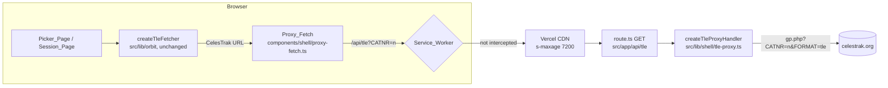

# Design Document

## Overview

S6 (shell-pwa-deploy) wraps the landed S1 to S5 work into a deployable app. It adds a global header and a real home page, a minimal PWA (manifest, locally generated icons, a shell-only service worker), a same-origin TLE proxy on the server, geolocation as the default observer source, a camera backdrop with a pointing marker in the real-time in-pass phase, an optional local-time note on the picker, and the submission materials.

No library logic of S1 to S5 changes. The touched landed files are exactly: `src/app/layout.tsx`, `src/app/page.tsx`, `src/app/session/page.tsx`, `src/app/session/[noradId]/page.tsx`, `src/components/session/browser-deps.ts` (one line: the injected fetch), `tests/scaffold/scaffold.test.ts` (extensions only) and `README.md`. `next.config.ts` is not touched, so the developer's uncommitted `allowedDevOrigins` edit never meets a staged change.



### Motivation of the TLE_Proxy (Requirement 6, criterion 1)

End users' browsers, phones in China in particular, must not depend on a direct connection to celestrak.org, which can be slow or unreachable from there. With the TLE_Proxy only the Hosting_Platform's servers talk to CelesTrak; the browser talks only to the app's own origin. A side effect is fewer upstream requests: the CDN cache answers repeated requests for the same NORAD number.

## Architecture and file layout

New files:

| Path | Layer | Purpose |
|---|---|---|
| `src/lib/shell/tle-proxy.ts` | lib | `parseCatnr`, `upstreamUrl`, `createTleProxyHandler` (injected fetch), constants |
| `src/lib/shell/proxy-url.ts` | lib | `toProxyUrl` (pure URL rewrite) |
| `src/lib/shell/marker.ts` | lib | `markerPlacement` (pure, consumes S3 `projectMarker`) |
| `src/lib/shell/local-time.ts` | lib | `formatLocalTimeNote` (pure) |
| `src/lib/shell/index.ts` | lib | barrel, the only entry file |
| `src/app/api/tle/route.ts` | platform | thin `GET` that binds the handler to `globalThis.fetch` |
| `src/app/manifest.ts` | platform | Next.js metadata route for the Web_App_Manifest |
| `src/components/shell/copy.ts` | component | `SHELL_COPY`, every new string of S6 pages |
| `src/components/shell/proxy-fetch.ts` | component | `createProxyFetch` |
| `src/components/shell/geolocation.ts` | component | `createLocator` (Geolocation_Controller) |
| `src/components/shell/camera.ts` | component | `createCameraController` (Camera_Controller) |
| `src/components/shell/service-worker.ts` | component | `registerServiceWorker` |
| `src/components/shell/service-worker-registrar.tsx` | component | the only client component of S6; renders nothing |
| `src/components/shell/browser-deps.ts` | component | real `navigator.geolocation` and `navigator.mediaDevices` lookups |
| `public/sw.js` | static | the Service_Worker |
| `public/icons/icon-192.png`, `icon-512.png`, `apple-touch-icon.png` | static | App_Icons (generated) |
| `scripts/generate-icons.mjs` | tooling | generates the App_Icons |
| `tests/shell/*.test.ts`, `tests/helpers/shell-source-scan.ts` | tests | see Testing Strategy |
| `docs/reference/TECHNICAL_ROUTE.en.md` | docs | English_Route |
| `docs/submission/DEVPOST.md`, `docs/submission/VIDEO_SCRIPT.md` | docs | Devpost_Copy, Video_Script |

### The `src/lib/shell` boundary (Requirement 12, criterion 2)

`src/lib/shell` is a new lib directory, so it gets a source-boundary scan copied from `tests/helpers/qsl-source-scan.ts`: every import and export specifier must be a relative path inside `src/lib/shell` or exactly the `index.ts` barrel of `src/lib/orbit` or `src/lib/pointing`. No package, no React, no Next.js, no component code. The modules use no DOM global; `tle-proxy.ts` uses the WHATWG `Request`, `Response`, `URL` and `AbortSignal` globals, which exist in Node 22 and on the server runtime, following the S1 precedent of `tle-fetcher.ts`.

### Upstream URL constant (D1)

`CELESTRAK_GP_URL` is internal to `src/lib/orbit` (it is not exported by its barrel), and `src/lib/orbit` must not be modified. `src/lib/shell/tle-proxy.ts` therefore declares `UPSTREAM_GP_URL = 'https://celestrak.org/NORAD/elements/gp.php'`, and one test imports `src/lib/orbit/constants.ts` directly and asserts equality, so a drift fails `pnpm test`. Rejected alternative: exporting `CELESTRAK_GP_URL` from the orbit barrel (a change to `src/lib/orbit`).

## Components and Interfaces

### App shell and navigation (Requirement 1)

`src/app/layout.tsx` stays a server component (checks 1.20/1.21 hold: no `'use client'`, no `fetch`, no `async`, no `next/font`, no `next/image`). Its body becomes:

```tsx
<body>
  <header style={headerStyle}>
    <nav aria-label={SHELL_COPY.navLabel}>
      <Link href="/">{SHELL_COPY.navHome}</Link> · <Link href="/session">{SHELL_COPY.navSession}</Link> ·{' '}
      <Link href="/cards">{SHELL_COPY.navCards}</Link>
    </nav>
  </header>
  {children}
  <ServiceWorkerRegistrar />
</body>
```

- `headerStyle` matches the pages' container: `maxWidth: '40rem', margin: '0 auto', padding: '0.5rem 1rem 0'`.
- `/pointing` stays a utility page: reachable by URL, not in the Global_Navigation (Requirement 1, criterion 2, default kept).
- No active-link highlighting, so the header needs no client component.
- The pages keep their own `<main>`; nothing inside them changes for the header.

Metadata additions in `layout.tsx` (static objects, allowed by 1.20/1.21):

```ts
export const metadata: Metadata = {
  title: 'zombieSatellite',
  description: 'Pass predictions for seven zombie satellites from public TLE data.', // unchanged
  icons: { icon: '/icons/icon-192.png', apple: '/icons/apple-touch-icon.png' },
  appleWebApp: { capable: true, title: 'zombieSat', statusBarStyle: 'black-translucent' },
};
export const viewport: Viewport = { themeColor: '#0d1117' };
```

Next.js links `src/app/manifest.ts` automatically as `/manifest.webmanifest`.

### Service worker registration

`src/components/shell/service-worker.ts`:

```ts
export interface ServiceWorkerHost {
  readonly serviceWorker?: { register(scriptUrl: string, options: { scope: string }): Promise<unknown> };
}
/** Registers `/sw.js` with scope `/`. Never throws; a missing API or a rejection is ignored. */
export function registerServiceWorker(host: ServiceWorkerHost): void;
```

`src/components/shell/service-worker-registrar.tsx` (`'use client'`) calls `registerServiceWorker(window.navigator)` once in `useEffect`, only when `process.env.NODE_ENV === 'production'` (a dev-mode worker would cache hot-reload chunks), and renders `null`.

### Home page (Requirements 2 and 3)

`src/app/page.tsx` stays a server component with no `'use client'`, no `fetch` and no `async`. It reads `listCatalogEntries()` at render time (static data) and renders:

1. `<h1>zombieSatellite</h1>` and the App_Statement (`SHELL_COPY.appStatement`).
2. A start block: links to `/session` (`SHELL_COPY.startSession`) and `/cards` (`SHELL_COPY.openCards`), and the demo hint `SHELL_COPY.demoHint`.
3. The Catalog_Presentation: one `<article>` per entry in `listCatalogEntries()` order, with:
   - `name` as `<h3>`, then `SESSION_COPY.statusLabels[entry.status]` and a kind label (`SHELL_COPY.playableLabel` or `SHELL_COPY.storyOnlyLabel`);
   - `hook` as the lead paragraph;
   - a `<details>` element with summary `SHELL_COPY.historyLabel` ("Documented history") holding `story` and the `sourceUrls` as links labelled `SHELL_COPY.sourceLabel` + index;
   - playable: a link to `/session/${noradId}` (`SHELL_COPY.openSession`); story-only: `SHELL_COPY.unplayableReasons[entry.unplayableReason]`.
4. Footer: `SHELL_COPY.honestyFooter`.

Catalog_Prose is rendered verbatim from S2 (no rewording, no change to S2), always inside the "Documented history" block next to its sources, which attributes it as documented history (Requirement 2, criteria 5 and 6). `statusNote` is not shown. That the S2 wording never presents a historical reception as an app capability is a review item (Testing Strategy).

### Shell copy (Requirement 3)

`src/components/shell/copy.ts` follows `SESSION_COPY`: `Object.freeze` of plain string literals, the honesty rule comment at the top. Proposed wording (approved with this design):

| Key | Text |
|---|---|
| `appStatement` | `A finding, pointing and Doppler aid for amateur radio and satellite hobbyists. Its beacon sound is simulated, synthesized from public orbital data, and only that orbital data is real.` |
| `honestyFooter` | `zombieSatellite has no radio hardware. Every beacon tone in it is simulated from public TLE data.` |
| `demoHint` | `New to satellites? Every session has a 60× demo mode that plays the next real pass in minutes.` |
| `navLabel`, `navHome`, `navSession`, `navCards` | `Main`, `Home`, `Passes`, `QSL cards` |
| `startSession`, `openCards`, `openSession` | `Find a pass`, `Your QSL cards`, `Open session` |
| `catalogHeading` | `The zombie satellites` |
| `playableLabel`, `storyOnlyLabel` | `Playable`, `Story only` |
| `historyLabel`, `sourceLabel` | `Documented history`, `Source` |
| `unplayableReasons['geo-slot-not-visible-from-china']` | `Story only: its geostationary slot is not visible from China, so it has no passes to play.` |
| `unplayableReasons['graveyard-orbit-drift']` | `Story only: it drifts in a near-geostationary graveyard orbit and has no regular passes.` |
| `useMyLocation`, `locating`, `locationFailed` | `Use my location`, `Locating…`, `Location not available. Your coordinates stay as they are.` |
| `cameraToggle` | `Camera backdrop` |
| `skyViewHeading`, `markerOutOfView`, `noPointingYet` | `Sky view`, `Target outside the view. Follow the azimuth and elevation figures.`, `Enable motion sensors or the drag compass to see the marker.` |
| `localTimeLabel` | `Local start:` |

Scan check of the proposal: `appStatement` and `honestyFooter` carry radio terms and contain `simulated`/`synthesized` (1.24); none of their sentences contains a reception word (1.25); "listeners" is replaced by "hobbyists" (Decision RQ-1).

### Web App Manifest (Requirement 4)

`src/app/manifest.ts`:

```ts
export default function manifest(): MetadataRoute.Manifest {
  return {
    name: 'zombieSatellite',
    short_name: 'zombieSat',
    description: 'Pass predictions, pointing and a simulated Doppler beacon for a catalog of zombie satellites, from public TLE data.',
    start_url: '/',
    scope: '/',
    display: 'standalone',
    theme_color: '#0d1117',
    background_color: '#0d1117',
    icons: [
      { src: '/icons/icon-192.png', sizes: '192x192', type: 'image/png', purpose: 'any' },
      { src: '/icons/icon-512.png', sizes: '512x512', type: 'image/png', purpose: 'any' },
      { src: '/icons/icon-512.png', sizes: '512x512', type: 'image/png', purpose: 'maskable' },
    ],
  };
}
```

Palette (Decision RQ-4): the S1 to S5 pages are unstyled (browser defaults); the only palette in the app is the QSL card face in `src/lib/qsl/card-svg.ts` (`#0d1117` background, `#2ea043` green, `#f0f6fc` white, `#8b949e` grey). `theme_color` and `background_color` both take the card background `#0d1117`, so the splash screen and the status bar match the card and the icon.

### App icons (Requirement 4, criteria 2 and 3)

`scripts/generate-icons.mjs` draws the icon by per-pixel geometry and writes PNG files with Node built-ins only (`node:zlib` `deflateSync` and `crc32`, `node:fs`); no package, no network. Run: `node scripts/generate-icons.mjs`; the outputs are committed. Design, in units of the icon side `s`, centre `(0.5, 0.5)`:

- full square background `#0d1117`;
- an orbit ring: annulus of radius `0.30s`, width `0.035s`, grey `#8b949e`;
- a planet disk of radius `0.12s`, white `#f0f6fc`;
- the satellite: a disk of radius `0.07s`, green `#2ea043`, on the ring at 45° (upper right).

Every shape lies inside the radius `0.40s` maskable safe zone, so one drawing serves `any` and `maskable`. Edges use 4×4 supersampling. Sizes: 192 and 512 (Android Chrome installability), 180 (`apple-touch-icon.png`, iOS home screen).

### Service worker (Requirement 5)

`public/sw.js`, plain JavaScript, no imports:

- `CACHE = 'zombiesat-shell-v1'`.
- `install`: `skipWaiting()`. `activate`: delete every cache whose name is not `CACHE`, then `clients.claim()`.
- `fetch`: handle only same-origin `GET` requests that are Shell_Assets; return without `respondWith` for everything else, so the browser goes to the network and nothing is cached:
  - static assets, cache first: path starts with `/_next/static/` (content-hashed build output) or `/icons/`;
  - shell documents, network first with cache fallback: navigation requests to exactly `/`, `/session` and `/cards`; a successful network response is stored, the cache is read only when the network fails.
- `/api/tle`, CelesTrak, `/session/[noradId]`, the card detail routes and every other URL match no rule and are never cached or answered from cache (Requirement 5, criteria 2 and 3). The shell documents carry no TLE, pass or session data: those are fetched and computed in the browser after load.

Update rule (Requirement 5, criterion 5): a new Deployment changes the hashed `/_next/static/` URLs, and the network-first documents reference the new ones, so new assets are fetched and cached on first use. Old hashed entries stay in the cache until `CACHE` is bumped; any change to `sw.js` bumps the version suffix, and the `activate` step then deletes the old cache. This leftover storage is accepted.

### TLE proxy (Requirement 6)

Route: `GET /api/tle?CATNR=<n>` (the upstream parameter name, mirrored). File `src/app/api/tle/route.ts`:

```ts
import { createTleProxyHandler } from '../../../lib/shell/index';
export const GET = createTleProxyHandler({ fetch: (input, init) => globalThis.fetch(input, init) });
```

`src/lib/shell/tle-proxy.ts`:

```ts
export const TLE_PROXY_PATH = '/api/tle';
export const UPSTREAM_GP_URL = 'https://celestrak.org/NORAD/elements/gp.php';
export const PROXY_CACHE_SECONDS = TLE_CACHE_TTL_MS / 1000; // 7200 s = 2 h, from the orbit barrel
/** A NORAD number from exactly one CATNR value of /^[1-9][0-9]{0,4}$/, else null. */
export function parseCatnr(params: URLSearchParams): number | null;
export function upstreamUrl(noradId: number): string; // `${UPSTREAM_GP_URL}?CATNR=${n}&FORMAT=tle`
export function createTleProxyHandler(deps: { fetch: FetchFunction }): (request: Request) => Promise<Response>;
```

Handler steps:

| Case | Status | Body | `Cache-Control` |
|---|---|---|---|
| `CATNR` missing, repeated, not decimal, 0 or above 99999; no upstream call | 400 | `Invalid CATNR` | `no-store` |
| upstream fetch rejects or times out (`AbortSignal.timeout(REQUEST_TIMEOUT_MS)`, 15 s) | 502 | `Upstream unavailable` | `no-store` |
| upstream status ≠ 200 | 502 | `Upstream status <code>` | `no-store` |
| upstream 200 but the body fails `parseTle` or its `NORAD_CAT_ID` ≠ the requested number (for example "No GP data found") | 502 | `Upstream answer is not a TLE` | `no-store` |
| upstream 200 with a TLE of the requested number | 200 | the upstream text, unchanged | `public, max-age=0, s-maxage=7200` |

- Every response has `Content-Type: text/plain; charset=utf-8`.
- The upstream request is `{ method: 'GET', cache: 'no-store', signal }` with no extra headers; `cache: 'no-store'` keeps the Next.js data cache out of the path, so the only cache is the explicit one below.
- Body check (Requirement 6, criterion 8): yes, the handler checks with the landed `parseTle` and the catalog-number match, the same tests the browser fetcher applies, so a non-TLE 200 answer is never cached.

Server-side cache (Requirement 6, criterion 7): the Vercel CDN caches function responses that carry `s-maxage`, keyed by the full URL including the query, and invalidates them on each Deployment. Only the 200 row carries `s-maxage`; error rows carry `no-store`, so a failure is never cached. `max-age=0` keeps the browser HTTP cache out; the browser fetcher keeps its own landed 2 h cache. Duration: 2 h, equal to the landed browser `TLE_CACHE_TTL_MS`. New element sets for these objects appear on a scale of hours to days, so a 2 h old TLE is within the accuracy the app needs, and CelesTrak sees at most one request per NORAD number per 2 h per CDN region. No `stale-while-revalidate`, so an expired entry is never served as fresh. Under `next dev` or `next start` there is no CDN, and every request goes upstream; this affects local runs only.

### Proxy fetch and the browser assembly (Requirement 7)

`src/lib/shell/proxy-url.ts`:

```ts
/** `/api/tle?CATNR=n` for a URL of exactly the landed fetcher shape, else null. */
export function toProxyUrl(input: string): string | null;
```

The function accepts the input only if `new URL(input)` succeeds, `origin + pathname === UPSTREAM_GP_URL`, the search parameters are exactly `CATNR` (valid by `parseCatnr`) and `FORMAT=tle`, and there is no hash.

`src/components/shell/proxy-fetch.ts`:

```ts
export function createProxyFetch(getFetch: () => FetchFunction): FetchFunction;
```

The returned function rewrites the URL with `toProxyUrl`. If the result is `null`, it returns `Promise.reject(new TypeError('Not a CelesTrak GP request'))` without calling `getFetch`. Otherwise it calls `getFetch()(proxyUrl, init)`, forwarding the fetcher's init (GET, `credentials: 'omit'`, abort signal) unchanged. It has no fallback branch to celestrak.org.

Change in `src/components/session/browser-deps.ts`, the only edit there:

```ts
tleFetcher: createTleFetcher({ now: clock.nowMs, fetch: createProxyFetch(() => globalThis.fetch.bind(globalThis)) }),
```

A proxy error status reaches the landed fetcher as status ≠ 200, which rejects with `EngineError('http')`; an unreachable proxy rejects with `EngineError('network')`. Both surface as `'tle-unavailable'` and "Orbit data unavailable." exactly as today (Requirement 7, criterion 5).

### Geolocation (Requirement 8)

`src/components/shell/geolocation.ts`:

```ts
export interface GeolocationLike {
  getCurrentPosition(
    success: (position: { coords: { latitude: number; longitude: number } }) => void,
    error: (error: { code: number }) => void,
    options: { enableHighAccuracy: boolean; timeout: number; maximumAge: number },
  ): void;
}
export type LocateOutcome = 'applied' | 'skipped' | 'denied' | 'timeout' | 'unavailable' | 'failed';
export const AUTO_LOCATE_FLAG_KEY = 'zombieSatellite.shell.autoLocateAttempted';
export const LOCATE_OPTIONS = { enableHighAccuracy: false, timeout: 10_000, maximumAge: 600_000 } as const;
export function createLocator(deps: { geolocation: GeolocationLike | null; storage: KeyValueStorage }): {
  autoLocate(apply: (position: ObserverPosition) => boolean): Promise<LocateOutcome>;
  locateNow(apply: (position: ObserverPosition) => boolean): Promise<LocateOutcome>;
};
```

- "Valid stored value" means `parseStoredObserver(storage.getItem(OBSERVER_STORAGE_KEY)) !== null`, using the landed key and the landed parser; the observer store and its format are untouched.
- `autoLocate` (Automatic_Locate):
  1. a valid stored value → `'skipped'`, no request (Requirement 8, criterion 2);
  2. `AUTO_LOCATE_FLAG_KEY` is set → `'skipped'`, no request; this is the no-repeat rule of criterion 3: the automatic request runs at most once per browser profile, whatever its outcome;
  3. `geolocation === null` → `'unavailable'`;
  4. otherwise set the flag to `'1'`, request one fix; on success, check the stored value again and, if it became valid in the meantime (the user typed), return `'skipped'`; else call `apply` → `'applied'`.
- `locateNow` (Explicit_Locate): no stored-value check, no flag check; on success call `apply` → `'applied'`, overwriting the stored observer.
- Error mapping: code 1 → `'denied'`, code 3 → `'timeout'`, code 2 or anything else → `'failed'`. The promise never rejects.
- Coordinates are rounded to 4 decimal places (about 11 m) before `apply`, so the number inputs show readable values.
- Options (criterion 11): `enableHighAccuracy: false` (pass prediction needs kilometre precision only, and a network fix is faster), `timeout: 10 s`, `maximumAge: 10 min`.

`apply` is the page controller's landed `setObserver`, which writes through `createObserverStore(storage).set` (same key, same format) and updates the snapshot, so the shown observer follows (criterion 4). The page also resets its raw input text for both fields, so the inputs show the new snapshot value.

Trigger (criterion 1): on mount of the Picker_Page and of the Session_Page, right after the page controller is created, the page calls `autoLocate`. On the Session_Page, a fix that arrives after the phase left `selecting` is refused by the landed `setObserver`, and nothing else happens. The "use my location" button (`SHELL_COPY.useMyLocation`) sits under the two observer inputs on both pages; while a `locateNow` runs it shows `SHELL_COPY.locating`; on `'denied'`, `'timeout'`, `'unavailable'` or `'failed'` it shows `SHELL_COPY.locationFailed` as a plain non-blocking note. An Automatic_Locate failure shows nothing.

`src/components/shell/browser-deps.ts` exports `browserGeolocation(): GeolocationLike | null` (`navigator.geolocation` when present, else `null`). Storage comes from the landed `createPickerBrowserDeps().storage` and `createSessionBrowserDeps(...).storage`.

### Camera backdrop and sky view (Requirement 9)

Finding: the S1 to S5 pages render no pointing marker. S3 delivered only the pure `projectMarker` and assigned the camera view with the marker drawn over it to S4 or S6 (ar-pointing requirements, "Out of scope"); the in-pass section shows numeric readouts only. Requirement 9 overlays "the existing pointing marker", so this design adds the missing element: a Sky_View box in the real-time in-pass section that draws the marker with the landed `projectMarker`, and the Camera_Backdrop as an optional layer behind it. Neither `projectMarker` nor the S4 controller changes. (Design decision DD-1, needs approval.)

Scope: the Sky_View and the Camera_Backdrop appear only in the `in-pass` phase with `clockMode === 'real'`. In a Demo_Session the satellite is not where the sky is (the pass runs at 60× from its own instant), and the S4 controller does not expose the demo view basis, so a camera backdrop would be misleading there. (DD-2, needs approval.)

`src/lib/shell/marker.ts`:

```ts
export const SKY_VIEW_ASPECT = 3 / 4; // width / height of the Sky_View box
export type MarkerPlacement =
  | { readonly kind: 'none' }                     // no basis or no target
  | { readonly kind: 'out-of-view' }              // behind the camera plane or outside [-1, 1]²
  | { readonly kind: 'on-screen'; readonly leftPct: number; readonly topPct: number };
export function markerPlacement(
  target: TargetDirection | null,
  calibrationOffsetDeg: number,
  basis: CameraBasis | null,
): MarkerPlacement;
```

The target vector is `sceneDirection(effectiveAzimuthDeg(target.azimuthDeg, calibrationOffsetDeg), target.elevationDeg)`, the same vector `evaluateLock` uses, so the marker and the lock agree. Then `projectMarker(vector, basis, SKY_VIEW_ASPECT)`; on screen: `leftPct = (ndcX + 1) × 50`, `topPct = (1 − ndcY) × 50` (NDC +y up, CSS top down). Inputs on the page: `pointingSnapshot.target`, `pointingSnapshot.calibrationOffsetDeg`, `pointingSnapshot.basis`; `target` is passed as `null` when `snapshot.orbitDataMissing` or `snapshot.target === null`.

`src/components/shell/camera.ts`:

```ts
export interface MediaStreamLike { getTracks(): ReadonlyArray<{ stop(): void }> }
export interface MediaDevicesLike { getUserMedia(constraints: MediaStreamConstraints): Promise<MediaStreamLike> }
export type CameraOutcome = 'on' | 'denied' | 'unavailable' | 'failed' | 'cancelled';
export const CAMERA_CONSTRAINTS = { audio: false, video: { facingMode: { ideal: 'environment' } } } as const;
export function createCameraController(deps: { mediaDevices: MediaDevicesLike | null }): {
  start(): Promise<CameraOutcome>;
  stop(): void;              // stops every track of the current stream; idempotent
  getStream(): MediaStreamLike | null;
};
```

- `mediaDevices === null` → `'unavailable'`. `browserMediaDevices()` in `src/components/shell/browser-deps.ts` returns `null` unless `window.isSecureContext` and `navigator.mediaDevices?.getUserMedia` exist, so HTTP (non-localhost) falls back here.
- Rejection mapping: `NotAllowedError`/`SecurityError` → `'denied'`; `NotFoundError`/`OverconstrainedError`/`NotReadableError` → `'unavailable'`; else `'failed'`. Never rejects.
- Race: each `start` takes a generation number; `stop` increments it. A stream that resolves after a `stop` gets all its tracks stopped at once and `start` returns `'cancelled'`.
- No frame is read: no canvas, no `ImageCapture`, no recorder, no upload, no storage (criterion 5).

Seam in `src/app/session/[noradId]/page.tsx` (criterion 6), inside the existing real-time branch of the `in-pass` section, directly after `<h3>Motion sensors</h3>`'s block and before the drag area:

```tsx
<h3>{SHELL_COPY.skyViewHeading}</h3>
<label><input type="checkbox" checked={cameraOn} onChange={toggleCamera} /> {SHELL_COPY.cameraToggle}</label>
<div style={{ position: 'relative', width: '100%', aspectRatio: '3 / 4', overflow: 'hidden', border: '1px solid currentColor' }}>
  {cameraOn ? <video ref={videoRef} autoPlay playsInline muted style={{ position: 'absolute', inset: 0, width: '100%', height: '100%', objectFit: 'cover' }} /> : null}
  {/* marker: a 1.5rem ring at leftPct/topPct, green when lock.locked, else white; or the out-of-view / no-pointing note */}
</div>
```

- Toggle: `toggleCamera` calls `camera.start()`; on `'on'` the page sets `cameraOn` and assigns `videoRef.current.srcObject = camera.getStream()`; any other outcome leaves the checkbox off with no message ("falls back silently", criterion 3). Unchecking calls `camera.stop()`.
- Stop (criterion 4): a `useEffect` on `phase` and `clockMode` calls `camera.stop()` and clears `cameraOn` whenever the page is not in real-time `in-pass`; the effect cleanup of the page calls `camera.stop()` on unmount.
- With the camera off the box shows the plain page background, so the session never depends on the camera.
- The 75° vertical field of view stays (Known limitation 1); `objectFit: 'cover'` crops the video to the 3:4 box.

### Time display (Requirement 10)

Decision DD-3: adopt the Local_Time_Note on the Picker_Page only. Reason: the main audience includes users in China at UTC+8, where a pass at `11:18 UTC` is `19:18` local, and the date can roll over; one small line saves the mental conversion when planning. Cost: one pure function, one test file, one JSX line. UTC stays primary and `formatUtc` stays the only UTC formatter.

`src/lib/shell/local-time.ts`:

```ts
/** "2026-11-09 19:18 (UTC+8)"; offsetMinutes is east-positive, e.g. 480, -300, 330 → UTC+5:30. */
export function formatLocalTimeNote(instantMs: number, offsetMinutes: number): string;
```

Pure: it shifts the instant by the offset and reads the `getUTC*` fields. The Picker_Page computes `offsetMinutes = -new Date(pass.riseMs).getTimezoneOffset()` (daylight saving included) and renders, as a separate line under the "Next pass" line of a ready row: `{SHELL_COPY.localTimeLabel} {formatLocalTimeNote(pass.riseMs, offset)}`. No other page changes its time display.

### Scaffold check extensions (Requirement 11)

In `tests/scaffold/scaffold.test.ts`:

- 1.19, directory listing: `['api', 'cards', 'layout.tsx', 'manifest.ts', 'page.tsx', 'pointing', 'session']`.
- 1.19, `.tsx` inventory: the seven existing entries plus `'components/shell/service-worker-registrar.tsx'`; the test title names the shell registrar.
- 1.19, new assertion in the same test: the `.ts` files under `src/app` are exactly `['api/tle/route.ts', 'manifest.ts']`. This names the route handler and the manifest, which the `.tsx` inventory cannot see.
- 1.20/1.21: `APP_FILES` stays `['layout.tsx', 'page.tsx']`; the check runs on the new versions of both.
- 1.22/1.23: unchanged.
- 1.24/1.25 `checkedTexts()`: add `['shell copy strings', propertyStrings('src/components/shell/copy.ts')]` and `['manifest strings', propertyStrings('src/app/manifest.ts')]`; append the JSX text of `src/components/shell/service-worker-registrar.tsx` to the rendered-JSX group (it has none today; listing it keeps future text covered). `SESSION_PAGES` already covers both session pages.
- No existing assertion is removed or loosened.

Decision RQ-2 recorded: `docs/submission/` is deliberately not in `checkedTexts()`. Its red lines are checked by review in the Final_Submission_Checklist.

## Deployment (Requirement 13)

Hosting_Platform: Vercel. Reasons: native Next.js 16 support (route handlers as functions, CDN caching by `s-maxage`, static assets), free Hobby tier, HTTPS and a public `*.vercel.app` link without configuration, and redeploy on every push to `main`, so the later tasks reach the Deployed_Build by pushing.

The Deployment task stops and hands over with these import points:

1. Vercel → Add New → Project → import the GitHub repository; Framework Preset: Next.js (detected).
2. Install and build: defaults. Vercel detects pnpm from `pnpm-lock.yaml` and `packageManager`, and Node 22 from `engines.node`.
3. No environment variables. Production branch: `main`.
4. After the first deployment: report the production URL (`https://<project>.vercel.app`).

The agent then records the Live_URL in the README and checks it once from its shell: `GET <Live_URL>/api/tle?CATNR=7530` answers 200 with a TLE for AO-7, or a 502 that is reported to the owner (Known limitation 2). The uncommitted `allowedDevOrigins` edit in `next.config.ts` is never staged; nothing in this design edits that file.

## Submission materials (Requirements 15 to 18)

- English_Route: `docs/reference/TECHNICAL_ROUTE.en.md`, a section-by-section translation of the trimmed `TECHNICAL_ROUTE.md`, same headings and order, numbers, units, formulas, identifiers and code unchanged, nothing added. A one-line note at the top says it is a translation of `TECHNICAL_ROUTE.md` and that only sections 2 and 4 are normative, as in the source.
- README: sections Introduction, How to play (the five-step loop), Live app (Live_URL), Honesty, Run locally (the existing requirements, commands and live-test sections, kept accurate), Origins (both Provenance_Sentences verbatim, plus a pointer to the English_Route). Proposed honesty wording: `The beacon sound is simulated: the browser synthesizes it from public TLE data. zombieSatellite has no radio hardware and processes no real-world transmission; the only real input is public orbital data.` The block carries radio terms and the word `simulated` (1.24), and neither sentence contains a reception word (1.25).
- Devpost_Copy: `docs/submission/DEVPOST.md` with headings in form order: Project name, Tagline, Inspiration (the problem), What it does, Who it is for, How we built it, Kiro usage, Challenges, What we learned, What's next, Built with, Story anchors (one short paragraph per catalog entry from the Story_Source, every historical reception attributed to its named listener or source). Tagline (approved): `Find a zombie satellite's next pass, point your phone at it and follow its Doppler shift, with a simulated beacon built from public orbital data.`
- Kiro usage section facts: six specs (orbit-engine, zombie-catalog, ar-pointing, seance-session, qsl-card, shell-pwa-deploy), each with requirements.md, design.md and tasks.md in `.kiro/specs`; Opus for requirements and design, Sonnet for implementation; a human review gate between requirements, design and tasks; one commit per task; steering files in `.kiro/steering`; the test count taken from the final `pnpm test` run, not from memory.
- Video_Script: `docs/submission/VIDEO_SCRIPT.md`, a table with columns Shot, Picture, Narration points, Duration (s), and a total row. Arc and budget (total 170 s, 10 s margin): 1 LES-1 story hook, heard again in 2012, attributed (25); 2 home page and catalog (15); 3 picker with a predicted real pass (15); 4 real pass outdoors, phone raised, sky view and lock (40); 5 the simulated beacon and the Doppler readout (30); 6 the QSL card (20); 7 demo mode as the newcomer entry, closing line (25).

## Error Handling

| Situation | Behavior |
|---|---|
| Proxy input invalid | 400, no upstream call; the browser never sends this, since `toProxyUrl` validates first |
| CelesTrak down, 403 or non-TLE answer | 502 `no-store`; picker row "Orbit data unavailable." with Retry |
| Proxy unreachable | fetcher `network` rejection; same picker text; no direct CelesTrak fallback |
| Geolocation denied, timeout, unavailable | stored observer or Reference_Observer stays; explicit locate shows `locationFailed` |
| Camera denied, missing, insecure context | checkbox stays off, plain background, session continues |
| Service worker unsupported or registration rejects | ignored; the app runs as a normal web page |

## Testing Strategy

All tests are `tests/**/*.test.ts`, Vitest `node` environment, offline under the network guard; every fetch is an injected mock.

1. `tests/shell/source-boundary.test.ts` with `tests/helpers/shell-source-scan.ts`: the scan reports no violation (Requirement 12, criterion 2).
2. `tests/shell/tle-proxy.test.ts` (Requirement 6): valid request → 200, unchanged body, `s-maxage=7200`, and the mock saw exactly `upstreamUrl(n)`; invalid `CATNR` values (missing, `0`, `100000`, `abc`, repeated) → 400 with no upstream call; upstream 403 → 502 `no-store`; upstream rejection → 502 `no-store`; upstream 200 with `No GP data found` → 502 `no-store`; `UPSTREAM_GP_URL` equals `CELESTRAK_GP_URL` of `src/lib/orbit/constants.ts` (D1). TLE fixture: `celestrakBody` of `tests/helpers/mock-celestrak.ts`.
3. `tests/shell/proxy-url.test.ts` (Requirement 7, criterion 6): the URL the landed fetcher builds rewrites to `/api/tle?CATNR=n`; another host, another path, a missing `FORMAT` or an extra parameter → `null`; `createProxyFetch` with such a URL rejects and never calls `getFetch`.
4. `tests/shell/geolocation.test.ts` (Requirement 8, criterion 10): the six listed cases, with a mock `GeolocationLike` and a map-backed `KeyValueStorage`.
5. `tests/shell/camera.test.ts` (Requirement 9, criterion 8): started stream → `'on'`; `NotAllowedError` → `'denied'`; `null` devices → `'unavailable'`; `stop` stops every track, including a stream that resolves after `stop` (`'cancelled'`).
6. `tests/shell/marker.test.ts`: a basis facing the target gives `on-screen` at 50 %/50 %; a target behind gives `out-of-view`; a `null` basis gives `none`.
7. `tests/shell/local-time.test.ts`: offset 480 with a date rollover, offset −300, offset 330 (`UTC+5:30`).
8. `tests/shell/service-worker.test.ts`: a host without `serviceWorker` does not throw; a rejecting `register` does not throw or reject; a working host is called with `/sw.js` and scope `/`.
9. Scaffold checks 1.19 to 1.25 as extended.

Not automated: the Service_Worker script, the manifest's installability, the icons, the pages, the Deployment. These are verified by `pnpm run build`, the Live_URL and the review items below.

### Review items (executed by the project owner on the Deployed_Build)

- Device_Checklist of `.kiro/specs/ar-pointing/design.md`: full iPhone pass including step 5, and the Android pass. If step 5 shows the flip, record the measured data; a separate fix follows R1's policy; no fallback is built here.
- PWA: install to home screen on Android Chrome and iOS Safari; opens standalone; icon and splash color look right.
- Geolocation: first visit with an empty store fills the observer; a typed value survives a reload; "Use my location" overwrites it; deny leaves the value.
- Camera: in a real-time pass the backdrop shows, the marker sits over the video, and the camera indicator turns off when unchecked, at LOS and when leaving the page.
- Home page: the catalog prose reads as attributed history and never as an app capability.

## Risks

- R-S6-1 CelesTrak blocks Vercel IPs (HTTP 403). The proxy answers 502 and the app shows "Orbit data unavailable." The CDN cache lowers the request rate. If it happens on the Deployed_Build, it is reported to the owner; no workaround is built in this spec.
- R-S6-2 iOS standalone mode and permissions: iOS can ask again for motion, camera and location inside the installed app. This is a platform behavior; the checklist records it.
- R1 (S3) stays as recorded.

## Design decisions needing approval

- DD-1 Sky_View with the marker: the pointing marker does not exist in any page; this design adds it to the real-time in-pass section using the landed `projectMarker`, and the camera layers behind it.
- DD-2 Camera and Sky_View only in real-time passes, not in Demo_Sessions.
- DD-3 Local_Time_Note adopted on the Picker_Page, rise time only.
- DD-4 Manifest values: name `zombieSatellite`, short_name `zombieSat`, theme and background `#0d1117` from the card palette (the pages themselves have no palette).
- DD-5 `UPSTREAM_GP_URL` duplicated in `src/lib/shell` with an equality test, instead of exporting `CELESTRAK_GP_URL` from the orbit barrel.
- DD-6 Automatic_Locate runs at most once per browser profile (`zombieSatellite.shell.autoLocateAttempted`); later locates are explicit only.
