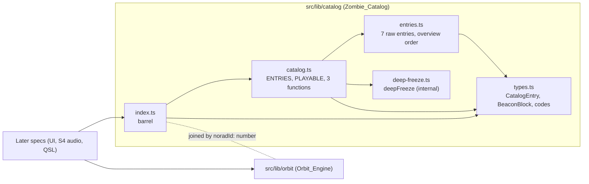

# Design Document: zombie-catalog (S2)

## Overview

The Zombie_Catalog is a small, static, pure data layer under `src/lib/catalog`. It holds the 7 Catalog_Entries of the Entry overview as typed, deeply frozen TypeScript objects and exports three pure functions over them:

- `listCatalogEntries()`: all 7 entries.
- `getCatalogEntry(noradId)`: one entry by NORAD_ID, or `undefined`.
- `listPlayableEntries()`: the 5 Playable_Entries.

It delivers no UI, no audio, no network or storage access, and imports nothing outside its own directory. Later specs join it to the Orbit_Engine (`src/lib/orbit`) through the NORAD_ID, which both layers model as a plain TypeScript `number`.

All catalog data and copy in this design are taken from the Fact_Source, `docs/reference/POSITIONING_AND_STORY.md`. The design restates no facts from other sources. Section numbers in the form "FS §2.5" refer to the per-satellite subsections of section 2 of the Fact_Source (FS §2.1 LES-1, §2.2 Transit 5B-5, §2.3 AO-7, §2.4 Prospero, §2.5 IMAGE, §2.6 Galaxy 15, §2.7 LES-5) and "FS appendix" to its list of unconfirmed and disputed items.

### Settled design decisions

These decisions are fixed by the user and are not open.

| ID | Decision |
|---|---|
| D1 | An absent launch date, Difficulty or Unplayable_Reason is the value `null`. The field is always present on every Catalog_Entry; no field is ever omitted or `undefined`. |
| D2 | Both list functions return entries in the Entry overview order of requirements.md: 1002, 965, 7530, 5580, 26113, 28884, 2866 (the playable list keeps the same relative order: 1002, 965, 7530, 5580, 26113). |
| D3 | `getCatalogEntry(id)` returns the same object reference that `listCatalogEntries()` holds for that entry. Each Catalog_Entry exists exactly once in memory. |
| D4 | The Source_Boundary_Scan checks static import and export specifiers (including `import type` and `export type ... from`), `import x = require(...)`, dynamic `import()`, `import('...')` type nodes and `require()` calls. It scans `.ts` files only, under `src/lib/catalog`. |
| D5 | The substring checks of Requirement 5 ("disputed", "5E-5", "1996", "unconfirmed", and the absence checks "nuclear", "still transmitting", "is transmitting", "currently transmitting") are case-insensitive. |
| D6 | `getCatalogEntry` returns `undefined` without throwing for any argument that is not the NORAD_ID of a Catalog_Entry, including 0, negative numbers, non-integers, `NaN`, values above 99,999 and non-number values passed through an untyped caller. It does no validation and throws no error. |
| D7 | Transit 5B-5 `launchDate` is `"1964-12-13"`; the test pins only the year 1964. |
| D8 | IMAGE `downlinkMhz` and `displayFrequency` are both `null`, checked by an automated spot check. |
| D9 | LES-1: `downlinkMhz` 237, `displayFrequency` "about 237 MHz", `tumblePeriodS` 4, `beaconMode` `null`. |
| D10 | `orbitLabel` is `null` for 1002, 965, 7530 and 5580. |
| D11 | Every Entry_Text is English only. |
| D12 | Deep freezing is checked by review, not by an automated test. |

### Design decisions made in this design

| ID | Decision | Rationale |
|---|---|---|
| D13 | Directory `src/lib/catalog`, one barrel `index.ts`, internal modules `types.ts`, `entries.ts`, `deep-freeze.ts`, `catalog.ts`. | Mirrors the Orbit_Engine layout (one directory, one barrel, helpers internal). |
| D14 | `CatalogEntry` is a discriminated union on `playable`: `PlayableEntry` (`difficulty: Difficulty`, `unplayableReason: null`) and `StoryOnlyEntry` (`difficulty: null`, `unplayableReason: UnplayableReason`). | The compiler enforces Requirement 2, criteria 4 and 5, so no runtime check is needed. `listPlayableEntries()` can return `readonly PlayableEntry[]`. |
| D15 | Every field is `readonly` in the types, and every object and array is passed through an internal `deepFreeze` once at module load. | Requirement 7, criterion 5. The `readonly` types catch writes at compile time; the freeze catches them at runtime. Matches `Object.freeze` use in `tle-parser.ts`. |
| D16 | The frozen entry array and the frozen playable array are built once at module load. The list functions return those same arrays on every call. | Pure, no allocation per call, and the returned arrays are frozen (Requirement 7, criterion 5). Callers cannot mutate shared state because everything is frozen. |
| D17 | `getCatalogEntry` is `ENTRIES.find((entry) => entry.noradId === noradId)`. | Strict equality never throws and never matches `NaN`, strings or out-of-range numbers (D6). With 7 entries a lookup map adds nothing. |
| D18 | No Entry_Text refers to the in-app beacon. | Requirement 9, criterion 2 then holds trivially, and the red line is easier to review. Beacon copy belongs to S4. |
| D19 | Every Entry_Text that mentions a real reception credits it to the named listener or listener group (e.g. "Phil Williams (G3YPQ) heard it"), never to the app. No hardware description is added beyond what the Fact_Source states. | Requirement 9, criterion 1. Attribution to the listener is enough to keep the reception separate from the app; equipment details the Fact_Source does not give would be new facts. |
| D20 | The catalog gets its own scanner helper `tests/helpers/catalog-source-scan.ts`; `tests/helpers/source-scan.ts` (S1) is not changed. | The S1 scanner hard-codes the engine root, allows `satellite.js` and checks globals; the catalog rule differs (relative paths only, `.ts` only, `require()` as a specifier). Leaving S1 untouched keeps its tests stable. The duplicated walking logic is about 40 lines. |
| D21 | Beacon_Mode codes are `'cw-beacon'` and `'telemetry'`. Entry_Status, Difficulty and Unplayable_Reason codes are listed in Data Models. | Only two signal types appear in the Fact_Source for catalog satellites (AO-7 CW beacon; telemetry for Transit 5B-5, IMAGE and LES-5). |

## Architecture



Dependency rules:

- Every import and export specifier inside `src/lib/catalog` is a relative path that resolves inside `src/lib/catalog` (Requirement 8, criterion 1).
- Nothing under `src/lib/catalog` imports `src/lib/orbit`. The join is done by the later specs, which import both barrels.
- `index.ts` is the only entry file. `deepFreeze` and the raw entry constant are not exported.

Module load sequence (runs once, synchronously, no I/O):

1. `entries.ts` defines `RAW_ENTRIES: readonly CatalogEntry[]`, a literal array in overview order.
2. `catalog.ts` sets `ENTRIES = deepFreeze(RAW_ENTRIES)`, which freezes the array, every entry, every `beacon` block and every `sourceUrls` array.
3. `catalog.ts` sets `PLAYABLE = Object.freeze(ENTRIES.filter(isPlayable))`. Its elements are the frozen objects of `ENTRIES` (D3).

## Components and Interfaces

### `src/lib/catalog/index.ts` (barrel)

```ts
// Public interface of the Zombie_Catalog and its only entry file.
// deepFreeze and the raw entry data stay internal.
export { getCatalogEntry, listCatalogEntries, listPlayableEntries } from './catalog';
export type {
  BeaconBlock,
  BeaconMode,
  CatalogEntry,
  Difficulty,
  EntryStatus,
  NoradId,
  PlayableEntry,
  StoryOnlyEntry,
  UnplayableReason,
} from './types';
```

### `src/lib/catalog/catalog.ts` (Access_Interface)

```ts
import { deepFreeze } from './deep-freeze';
import { RAW_ENTRIES } from './entries';
import type { CatalogEntry, NoradId, PlayableEntry } from './types';

const ENTRIES: readonly CatalogEntry[] = deepFreeze(RAW_ENTRIES);
const PLAYABLE: readonly PlayableEntry[] = Object.freeze(
  ENTRIES.filter((entry): entry is PlayableEntry => entry.playable),
);

/** All 7 Catalog_Entries in Entry overview order (D2). Same frozen array on every call. */
export function listCatalogEntries(): readonly CatalogEntry[] {
  return ENTRIES;
}

/**
 * The Catalog_Entry with this NORAD_ID, the same reference as in listCatalogEntries() (D3),
 * or undefined for any other value, including invalid ones (D6). Never throws.
 */
export function getCatalogEntry(noradId: NoradId): CatalogEntry | undefined {
  return ENTRIES.find((entry) => entry.noradId === noradId);
}

/** The 5 Playable_Entries in Entry overview order (D2). Same frozen array on every call. */
export function listPlayableEntries(): readonly PlayableEntry[] {
  return PLAYABLE;
}
```

### `src/lib/catalog/deep-freeze.ts` (internal)

```ts
/** Freezes value and every object and array reachable from it, then returns it. Internal. */
export function deepFreeze<T>(value: T): T {
  if (typeof value === 'object' && value !== null && !Object.isFrozen(value)) {
    Object.freeze(value);
    for (const child of Object.values(value)) deepFreeze(child);
  }
  return value;
}
```

The catalog data is a tree of plain objects, arrays, strings, numbers, `true` and `null`, with no cycles, so the recursion terminates. `Object.values` on an array yields its elements.

### `src/lib/catalog/entries.ts` (internal data)

Exports `RAW_ENTRIES: readonly CatalogEntry[]`, the 7 entries of the Entry data section below, in overview order, written as object literals typed against `CatalogEntry` so that the compiler checks every field. No logic.

### `tests/helpers/catalog-source-scan.ts` (test helper)

```ts
export interface CatalogSourceViolation {
  readonly file: string;   // path relative to src/lib/catalog, "/" separators
  readonly line: number;   // 1-based
  readonly detail: string;
}
/** Every .ts file under src/lib/catalog, relative names, sorted. */
export function listCatalogSourceFiles(): string[];
/** Parses every .ts file under src/lib/catalog with the TypeScript compiler API and reports every bad specifier. */
export function scanCatalogSources(): CatalogSourceViolation[];
```

The scanner walks `src/lib/catalog` recursively, keeps files ending in `.ts`, parses each with `ts.createSourceFile` and visits every node. It checks the module specifier of:

- `ImportDeclaration` and `ExportDeclaration` with a module specifier (this covers `import type` and `export type ... from`; `export { a }` without `from` has none),
- `ImportEqualsDeclaration` with an `ExternalModuleReference`,
- a `CallExpression` whose callee is the `import` keyword (dynamic `import()`),
- an `ImportTypeNode` (`import('...')` in a type position),
- a `CallExpression` whose callee is the identifier `require`.

A specifier is allowed only when it is a string literal that starts with `./` or `../` and whose `path.resolve(dirname(file), specifier)` lies inside `src/lib/catalog`. Anything else, including a non-literal argument, is a violation. Because the TypeScript parser builds a syntax tree, comments and string contents elsewhere in a file cannot cause false matches. The node handling follows `tests/helpers/source-scan.ts`.

## Data Models

### Types (`src/lib/catalog/types.ts`)

```ts
/** NORAD catalog number, an integer from 1 to 99,999; the same key and type as TleRecord.NORAD_CAT_ID. */
export type NoradId = number;

export type EntryStatus =
  | 'still-transmitting'
  | 'semi-operational'
  | 'silent-again'
  | 'unconfirmed'
  | 'historical';

export type Difficulty = 'standard' | 'hard';

export type UnplayableReason =
  | 'geo-slot-not-visible-from-china'   // Galaxy 15
  | 'graveyard-orbit-drift';            // LES-5: near-geostationary graveyard drift, no regular passes

export type BeaconMode =
  | 'cw-beacon'    // CW (Morse) beacon
  | 'telemetry';   // telemetry transmitter or telemetry carrier

export interface BeaconBlock {
  /** Downlink_Frequency in MHz, or null where the Fact_Source documents none. */
  readonly downlinkMhz: number | null;
  /** Display_Frequency, e.g. "about 237 MHz"; null exactly when downlinkMhz is null. */
  readonly displayFrequency: string | null;
  /** Beacon_Mode code, or null where the Fact_Source documents no signal type. */
  readonly beaconMode: BeaconMode | null;
  /** Tumble_Period in seconds, or null. */
  readonly tumblePeriodS: number | null;
  /** true where the Fact_Source documents sunlight-only transmission, otherwise null. */
  readonly sunlitOnly: true | null;
}

interface CatalogEntryBase {
  readonly slug: string;               // [a-z0-9]+(-[a-z0-9]+)*, unique
  readonly name: string;               // display name
  readonly noradId: NoradId;
  readonly operatorOrigin: string;     // operator and origin text
  readonly launchDate: string | null;  // ISO 8601 calendar date YYYY-MM-DD, or null (D1)
  readonly status: EntryStatus;
  readonly statusNote: string;
  readonly beacon: BeaconBlock;
  readonly hook: string;               // one English sentence
  readonly story: string;              // one English paragraph, no line breaks
  readonly orbitLabel: string | null;
  readonly sourceUrls: readonly string[]; // at least one, each verbatim in the Fact_Source
}

export interface PlayableEntry extends CatalogEntryBase {
  readonly playable: true;
  readonly difficulty: Difficulty;
  readonly unplayableReason: null;
}

export interface StoryOnlyEntry extends CatalogEntryBase {
  readonly playable: false;
  readonly difficulty: null;
  readonly unplayableReason: UnplayableReason;
}

export type CatalogEntry = PlayableEntry | StoryOnlyEntry;
```

Entry_Text maps to these fields: `name`, `operatorOrigin`, `statusNote`, `beacon.displayFrequency`, `hook`, `story`, `orbitLabel`. Fields that are `null` contribute no text.

### Entry data: structured fields

Values in overview order. Each value cites its Fact_Source location.

| Field | 1002 | 965 | 7530 | 5580 | 26113 | 28884 | 2866 |
|---|---|---|---|---|---|---|---|
| slug | `les-1` | `transit-5b-5` | `ao-7` | `prospero` | `image` | `galaxy-15` | `les-5` |
| name | LES-1 | Transit 5B-5 | AMSAT-OSCAR 7 (AO-7) | Prospero | IMAGE | Galaxy 15 | LES-5 |
| playable | true | true | true | true | true | false | false |
| difficulty | `hard` | `standard` | `standard` | `standard` | `hard` | null | null |
| unplayableReason | null | null | null | null | null | `geo-slot-not-visible-from-china` | `graveyard-orbit-drift` |
| status | `still-transmitting` | `still-transmitting` | `semi-operational` | `unconfirmed` | `silent-again` | `historical` | `still-transmitting` |
| launchDate | `1965-02-11` (FS §2.1) | `1964-12-13` (FS §2.2, appendix 1) | `1974-11-15` (FS §2.3) | `1971-10-28` (FS §2.4) | `2000-03-25` (FS §2.5) | null (not in FS) | `1967-07-01` (FS §2.7) |
| beacon.downlinkMhz | 237 (FS §2.1, appendix 6) | 136.65 (FS §2.2) | 145.9775 (FS §2.3) | 137.56 (FS §2.4, historical downlink) | null (FS gives none) | null (FS gives none) | 236.7487 (FS §2.7) |
| beacon.displayFrequency | "about 237 MHz" | "136.65 MHz" | "145.9775 MHz" | "137.56 MHz (historical)" | null | null | "236.7487 MHz" |
| beacon.beaconMode | null (Req 3.6) | `telemetry` (FS §2.2: telemetry transmitter) | `cw-beacon` (FS §2.3: CW beacon) | null (Req 3.6) | `telemetry` (FS §2.5: telemetry decoded by NASA) | null (Req 3.6) | `telemetry` (FS §2.7: telemetry beacon, modulated carrier) |
| beacon.tumblePeriodS | 4 (FS §2.1) | null | null | null | null | null | null |
| beacon.sunlitOnly | null (FS §2.1 gives sunlight power only as a presumed cause) | true (FS §2.2: transmits whenever sunlit; solar-powered) | true (FS §2.3: works only in sunlight, off in eclipse) | null | null | null | true (FS §2.7: sends whenever sunlit) |
| orbitLabel | null | null | null | null | "Highly elliptical polar orbit" (FS §2.5) | "Geostationary orbit" (FS §2.6) | "Near-geostationary graveyard orbit" (FS §2.7) |
| operatorOrigin | "MIT Lincoln Laboratory, for a US Air Force program" | "US Navy, Transit navigation system" | "AMSAT, the amateur radio satellite organization" | "United Kingdom, launched by a Black Arrow rocket from Woomera, Australia" | "NASA" | "Intelsat" | "MIT Lincoln Laboratory" |

### Entry data: source URLs

Each URL is copied character for character from the source line of the Fact_Source section for that satellite.

- **1002 LES-1**: `https://en.wikipedia.org/wiki/LES-1`, `https://www.amsat.org/ans-299-amsat-news-service-bulletins/`, `https://www.drewexmachina.com/2022/02/11/zombie-satellites-the-tale-of-lincoln-experimental-satellite-1/`
- **965 Transit 5B-5**: `https://www.sigidwiki.com/wiki/Category:Satellite`, `https://spacedaily.com/b-there-is-a-single-satellite-launched-by-the-us-navy-in-1964-that-is-still-in-orbit-still-transmitting-and-still-being-used-by-amateur-radio-operators-around-the-world-and-nobody-at-the-nav/`, `https://www.rtl-sdr.com/category/rtl-sdr/page/30/`
- **7530 AO-7**: `https://www.amsat.org/amsat/ftp/news/news/2002/wsr181.txt`, `https://satellites.ham-amplifiers.com/satellite/ao-7`
- **5580 Prospero**: `https://en.wikipedia.org/wiki/Prospero_(spacecraft)`, `https://futurescot.com/astronaut-tim-peake-joins-scottish-space-mission-to-rescue-satellite/`
- **26113 IMAGE**: `https://www.nasa.gov/solar-system/a-detailed-timeline-of-the-image-mission-recovery/`, `https://www.nasa.gov/solar-system/nasas-newly-rediscovered-image-mission-provided-key-aurora-research/`, `https://en.wikipedia.org/wiki/IMAGE_(spacecraft)`
- **28884 Galaxy 15**: `https://en.wikipedia.org/wiki/Galaxy_15`, `https://www.space.com/8747-sun-eruption-spawned-zombie-satellite-identified.html`, `https://www.USGS.gov/programs/geomagnetism/science/april-5-2010-magnetic-disturbance` (the capitalised host is kept as written in the Fact_Source)
- **2866 LES-5**: `https://en.wikipedia.org/wiki/Zombie_satellite`, `https://www.amsat.org/ans-117-amsat-news-service-weekly-bulletins/`

### Entry data: copy drafts

Draft English copy adapted from the Fact_Source. The implementation copies it into `entries.ts`; small wording edits are allowed if they keep every rule below. Copy rules that apply to every entry:

- Hook: one sentence. Story: one paragraph, no line breaks. English only.
- No "nuclear", no "236.997", no LES-1 orbit figures (2800, 2,800, 145.7).
- No mention of the in-app beacon (D18). Every real reception is credited to the named listener or listener group, never to the app, and no equipment is described beyond what the Fact_Source states (D19).

**1002 LES-1**
- statusNote: "Still transmitting: listeners have heard it since 2012, and the SatNOGS network still observes it."
- hook: "Silent for 45 years, this 1965 test satellite came back on the air in 2012, its signal swelling and fading every four seconds."
- story: "MIT Lincoln Laboratory built LES-1 for a US Air Force military communications test and launched it on 11 February 1965, but a wiring error kept it from its planned orbit, and it was switched off as planned in 1967. On 18 December 2012, radio amateur Phil Williams (G3YPQ) in Cornwall, England, heard it again near 237 MHz, and Hearsat listeners PY2ZX in Brazil and DD1US in Germany confirmed the reception. The presumed cause is an aged battery that has shorted, so that sunlight on the solar cells powers the transmitter directly. The satellite tumbles about once every four seconds, and its signal brightens and fades in that rhythm, which listeners describe as the most ghostly sound in the sky."

**965 Transit 5B-5**
- statusNote: "Still transmitting whenever sunlight reaches it, but its identity is disputed: listener analysis suggests the signal may come from Transit 5E-5."
- hook: "Launched in 1964 for the forerunner of GPS, it is believed to be the oldest satellite still transmitting."
- story: "Transit 5B-5 was launched on 13 December 1964 as part of the US Navy's Transit navigation system, the forerunner of GPS that gave submarines their positions. Its navigation mission failed after about 19 days, but its telemetry transmitter never stopped: whenever sunlight reaches it, it sends on 136.65 MHz, and amateurs around the world receive it with a V-shaped dipole antenna and an RTL-SDR. It is commonly called Transit 5B-5, but its identity is disputed: listener analysis of SDR recordings suggests the signal format matches Transit 5E-5, and the catalog identities may have been mixed up during digitization."

**7530 AMSAT-OSCAR 7 (AO-7)**
- statusNote: "Semi-operational: AMSAT lists it as partly working, and hams use it for voice and CW contacts."
- hook: "Dead for 21 years after a battery short, AO-7 woke up in 2002, and hams still use it for contacts."
- story: "AMSAT launched AMSAT-OSCAR 7 on 15 November 1974 as its second Phase 2 amateur satellite, with a linear transponder built for hams around the world to contact each other. In 1981 a battery short killed the whole satellite, and it stayed silent for 21 years. On 21 June 2002, British amateur Pat Gowen (G3IOR) heard its CW beacon on 145.9775 MHz: the shorted battery cell had gone open, so the solar cells could power the satellite directly. It works only in sunlight, switches off in eclipse and moves between modes A and B at random, and it is the one satellite in this catalog that came back and returned to its original job."

**5580 Prospero**
- statusNote: "Unconfirmed: officially shut down in 1996; later reception claims are unconfirmed because other satellites share its frequency."
- hook: "The only satellite ever put into orbit by a British rocket, Prospero is the closest thing to an urban legend in this catalog."
- story: "Prospero was launched on 28 October 1971 by a British Black Arrow rocket from Woomera, Australia, three months after the Black Arrow programme had been cancelled, which makes it the only satellite ever placed in orbit by a British rocket. After its tape recorder failed in 1973 it was contacted once a year, and a UK defence research agency officially shut it down in 1996. Its historical downlink was 137.56 MHz. Since then some listeners have claimed to hear it there, but other satellites use the same frequency and a signal in a 2004 BBC programme was later traced to an Orbcomm satellite, so these reports remain unconfirmed. For its 40th anniversary in 2011, UCL's Mullard Space Science Laboratory dug out decades-old command documents to try to reach it again, and no two-way contact has been confirmed."

**26113 IMAGE**
- statusNote: "Silent again: its signal weakened in February 2018 and was lost after August 2018, with no public reception reports since."
- hook: "NASA ended the IMAGE mission in 2007, and in 2018 an amateur hunting a different satellite from his backyard found it again."
- story: "NASA launched the IMAGE magnetosphere imaging satellite on 25 March 2000; on 18 December 2005 a cosmic-ray single-event upset tripped its power controller and contact was lost, and when a long eclipse in 2007 failed to reboot it, the mission was declared over. On 20 January 2018, Canadian amateur Scott Tilley was searching from his backyard for Zuma, a classified satellite rumoured to have failed, when he picked up an unknown signal; he matched its Doppler curve against the public orbit catalog and identified object 26113, IMAGE. On 30 January NASA decoded spacecraft ID 166 from the telemetry and confirmed the identity; the batteries were fully charged, and analysis showed that it had been sending since at least 2016 with no one listening. The signal weakened in February 2018 and was lost again after August 2018, and no new public reception has been reported since. Its highly elliptical polar orbit gives rare, long passes, which makes it the hard target of this catalog."

**28884 Galaxy 15**
- statusNote: "Historical: the 2010 runaway ended with a reboot that December, and it returned to service in 2011."
- hook: "In 2010 this communications satellite stopped obeying commands and drifted with its transponders at full power, and the press called it a zombie satellite."
- story: "Galaxy 15 is an Intelsat communications satellite in geostationary orbit. On 5 April 2010 it stopped responding to ground commands but kept its transponders on at full power as it drifted along the geostationary belt, threatening the uplink signals of other satellites, and operators spent eight months moving other satellites out of its way. The media called it a zombie satellite, and that term caught on with this incident. The ending was simple physics: on 23 December 2010 it ran out of attitude control, its battery drained, and its computer rebooted as designed and obeyed commands again; in 2011 it returned to its original slot and to service. In August 2022 it lost contact once more, officially attributed to a space weather event. Its slot is not visible from China, so it appears here as a story only, in honour of the satellite that named the category."

**2866 LES-5**
- statusNote: "Still transmitting: its telemetry beacon sends whenever sunlight reaches it, as a listener found in 2020."
- hook: "Forgotten in a graveyard orbit for almost half a century, LES-5 was found again in 2020 by an amateur scanning during lockdown."
- story: "LES-5, a sibling of LES-1 from MIT Lincoln Laboratory, was launched on 1 July 1967 for UHF military communications tests, retired in 1971 and moved in 1972 to a graveyard orbit above the geostationary belt, where it was forgotten for almost half a century; it carried a battery meant to switch it off after five years, and that battery did not work. On 24 March 2020, during the pandemic lockdown, Scott Tilley found a modulated carrier on 236.7487 MHz and confirmed it as the LES-5 telemetry beacon, which sends whenever sunlight reaches it; NPR covered the find. It drifts in a near-geostationary graveyard orbit without regular passes, so it appears here as a story only, and together with IMAGE it makes Scott Tilley the listener who brought back two lost satellites."

## Correctness Properties

*A property is a characteristic or behavior that should hold true across all valid executions of a system-essentially, a formal statement about what the system should do. Properties serve as the bridge between human-readable specifications and machine-verifiable correctness guarantees.*

The input space of this spec is finite and fixed: 7 static entries and the `.ts` files of one directory. Each "for any" below is therefore checked by exhaustive enumeration over that finite set, which is stronger than random sampling. No property-based test library or generator is used. Only criteria in the Verification scope of requirements.md have properties; review-checked criteria have none.

### Property 1: Every source URL is verbatim in the Fact_Source

*For any* Catalog_Entry, its `sourceUrls` list is not empty, and *for any* URL in that list, the URL occurs character-for-character as a substring of `docs/reference/POSITIONING_AND_STORY.md`.

**Validates: Requirements 4.3**

### Property 2: No entry is described as nuclear-powered

*For any* Catalog_Entry, its Entry_Text does not contain "nuclear" (case-insensitive).

**Validates: Requirements 5.3**

### Property 3: Lookup returns the listed entry for every catalog NORAD_ID

*For any* Catalog_Entry `e` in `listCatalogEntries()`, `getCatalogEntry(e.noradId)` returns `e` itself (same reference, D3), whose `noradId` equals the argument.

**Validates: Requirements 7.2**

### Property 4: Every catalog specifier stays inside the catalog directory

*For any* `.ts` file under `src/lib/catalog` and *for any* import or export specifier in it (static, type-only, `import =`, dynamic `import()`, `import('...')` type, `require()`), the specifier is a string literal starting with `./` or `../` that resolves inside `src/lib/catalog`; the scan therefore reports no violation.

**Validates: Requirements 8.1, 8.2**

### Example checks

These fixed-value assertions cover the remaining automated criteria.

| Check | Expected | Validates |
|---|---|---|
| `listCatalogEntries()` NORAD_IDs | `[1002, 965, 7530, 5580, 26113, 28884, 2866]` (overview order, D2) | 1.1, 7.1 |
| NORAD_IDs with `playable === true` | 1002, 965, 7530, 5580, 26113; 28884 and 2866 have `false` | 1.2, 1.3 |
| `listPlayableEntries()` NORAD_IDs | `[1002, 965, 7530, 5580, 26113]` | 7.3 |
| `unplayableReason` | 28884 `geo-slot-not-visible-from-china`, 2866 `graveyard-orbit-drift` | 1.4 |
| `difficulty` | 26113 and 1002 `hard`; 965, 7530, 5580 `standard` | 1.5 |
| 965 `launchDate` year | `launchDate.slice(0, 4) === '1964'` | 5.1 (year only) |
| 965 Entry_Text, lowercased | contains "disputed" and "5e-5" | 5.2 |
| 26113 `status` | `silent-again` | 5.4 |
| 26113 Entry_Text, lowercased | contains none of "still transmitting", "is transmitting", "currently transmitting" | 5.5 |
| 5580 `status` | `unconfirmed` | 5.6 |
| 5580 `story`, lowercased | contains "1996" and "unconfirmed" | 5.7 |
| 1002 `beacon.displayFrequency` | "about 237 MHz" | 5.8 |
| 1002 `beacon.tumblePeriodS` | 4 | 5.9 |
| 7530 `beacon` | `downlinkMhz` 145.9775, `beaconMode` `cw-beacon`, `sunlitOnly` true | 6.1 |
| 965 `beacon.downlinkMhz` | 136.65 | 6.2 |
| 2866 `beacon.downlinkMhz` | 236.7487 | 6.3 |
| 26113 `beacon.downlinkMhz`, `beacon.displayFrequency` | both `null` | 6.4 |

The Entry_Text of an entry in the tests is the non-null values of `name`, `operatorOrigin`, `statusNote`, `beacon.displayFrequency`, `hook`, `story` and `orbitLabel` joined with a space. Case-insensitive checks lowercase both sides (D5).

## Error Handling

The Zombie_Catalog has no error paths at runtime and defines no error type.

- `listCatalogEntries()` and `listPlayableEntries()` take no input and cannot fail.
- `getCatalogEntry(noradId)` does not validate its argument. For any value that is not a catalog NORAD_ID (0, negative, non-integer, `NaN`, above 99,999, or a non-number from an untyped caller) the strict-equality `find` matches nothing and returns `undefined` without throwing (D6, Requirement 7.4). This is checked by review; there is no automated test for it.
- Writes to a returned entry or array fail: in strict-mode modules (all ES modules) assignment to a frozen property throws `TypeError` in the caller. The `readonly` types catch the same writes at compile time. This is the intended behavior of Requirement 7.5, not an error the catalog handles.
- Data errors (a wrong value, a missing field, a bad code) are caught before runtime: missing fields or invalid codes fail `pnpm typecheck` because `entries.ts` is typed against `CatalogEntry`, and the pinned values fail the example checks.

## Testing Strategy

PBT library: none. The data is a fixed set of 7 entries, so the properties are checked by iterating over every entry (and every scanned file), not by generated inputs. fast-check stays a dev dependency of S1 and is not used in this spec. Tests stay minimal: plain Vitest example assertions over the static data, with no multi-layer verification, no instrumentation and no negative self-checks of the scanner.

Test files (all picked up by `tests/**/*.test.ts` in `vitest.config.ts`; run with `pnpm test`, which is `vitest run`):

- `tests/catalog/catalog.test.ts`
  - Imports only from `src/lib/catalog` (the barrel).
  - Property 1: reads the Fact_Source with `readFileSync` (test-side file access is allowed; Requirement 7.6 binds only the catalog modules) and loops over every entry and URL.
  - Property 2 and Property 3: loops over `listCatalogEntries()`.
  - Every row of the Example checks table as one `expect` each, grouped by requirement.
  - Each property test carries a comment tag `// Feature: zombie-catalog, Property N: <title>`.
- `tests/catalog/source-boundary.test.ts`
  - Property 4: `expect(scanCatalogSources()).toEqual([])`.
  - One sanity assertion that `listCatalogSourceFiles()` contains `index.ts`, so an empty or moved directory cannot pass vacuously.
- `tests/helpers/catalog-source-scan.ts`: the scanner of the Components section (D20).

The network guard in `tests/setup/network-guard.ts` stays active; the catalog tests make no network calls.

Review-checked at task completion (no automated test): Requirement 2 (entry structure, ISO launch dates, unique slugs), Requirement 3 (beacon field rules), Requirement 4 criteria 1, 2, 4, 5, 6 and 7, the full Transit 5B-5 date `1964-12-13`, Requirement 5 criteria 10 and 11 (LES-1 237 MHz, no 236.997), Requirement 7 criteria 4, 5 and 6 (unknown lookup, deep freeze, no I/O), and Requirement 9 (red line). The reviewer compares `entries.ts` with the Entry data tables and copy drafts of this design and with the Fact_Source.

Implementation workflow: after each task is complete and `pnpm test` and `pnpm typecheck` pass, commit locally staging files by name, then push immediately. Never push in the middle of a task.
